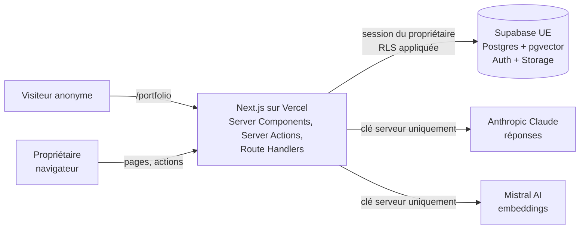
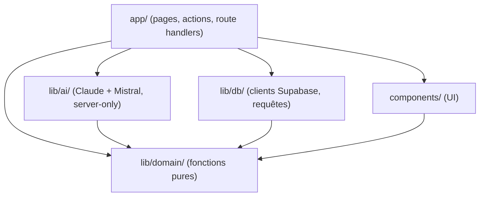
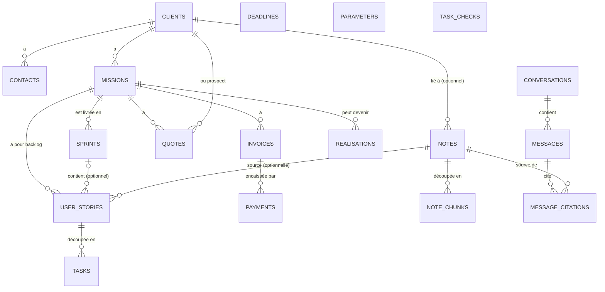
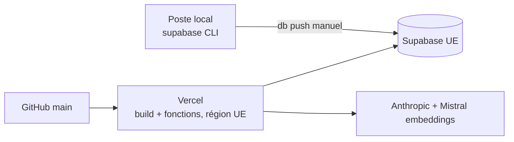

# Architecture Spine — LogMerry

> Lecture débutant : chaque décision a une ligne **En clair**. Ces lignes servent à comprendre ; la règle, elle, est dans **Rule**. Chaque est à confirmer (liste en fin de document).

## Design Paradigm

**Monolithe Next.js « server-first » + Supabase comme autorité sur les données.**

- Une seule application Next.js (App Router) déployée sur Vercel. Tout le code qui tourne côté serveur y vit : pages, écritures, appel au modèle d'IA.
- Supabase stocke tout et décide *qui a le droit de voir quoi* (RLS). Le code Next.js n'a donc jamais à « penser » à la sécurité des lignes : la base refuse.
- La logique métier (règles du cockpit, estimations, découpage de texte, vérification de citations) est écrite en **fonctions pures** dans `lib/domain/`, testables sans base ni réseau.

En clair : Next.js affiche et orchestre, Supabase garde les données et fait respecter les accès, `lib/domain/` contient les calculs.



Sens des dépendances dans le code (une flèche = « a le droit d'importer ») :



`lib/domain/` n'importe rien d'autre. `components/` n'importe ni `lib/db` ni `lib/ai`.

## Invariants & Rules

### AD-1 — Répartition des rôles Next.js / Supabase [ADOPTED partiel]

- **Binds:** all
- **Prevents:** de la logique dupliquée ou à la mauvaise place (un calcul dans le navigateur, une règle d'accès dans le code).
- **Rule:**
  - Next.js : interface, orchestration, appels IA, calculs (`lib/domain/`). Supabase : tables, Auth, Storage, pgvector, RLS.
  - Aucune Edge Function Supabase et aucun n8n dans le MVP. Le chat et l'indexation sont des Route Handlers / Server Actions Next.js. *(Écart assumé avec l'addendum du PRD, qui prévoyait une fonction Supabase pour le chat : le jeton de l'utilisateur et donc la RLS s'appliquent aussi via la session Next.js, avec un seul code à maintenir.)*
  - Le navigateur ne parle à Supabase que pour l'authentification ; toutes les lectures et écritures de données passent par le serveur Next.js.
- **En clair :** un seul endroit pour le code serveur, moins de pièces à sécuriser pour un premier projet.

### AD-2 — La RLS est la frontière de sécurité [ADOPTED]

- **Binds:** FR-1, FR-2, FR-5, FR-16, NFR-3
- **Prevents:** qu'un compte voie les données d'un autre ; qu'un oubli dans le code ouvre une fuite.
- **Rule:**
  - Toute table de `public` : `owner_id uuid not null default auth.uid() references auth.users`, RLS activée, policies `using (owner_id = (select auth.uid()))` pour select, insert (`with check`), update, delete. Une table sans RLS ne passe pas en revue.
  - Le code utilise **uniquement** le client Supabase de la session de l'utilisateur (clé publique + cookie). La clé `service_role` n'existe pas dans l'application (ni en variable Vercel, ni dans le code).
  - Les fonctions SQL (ex. recherche vectorielle) sont `security invoker` et filtrent aussi `owner_id` explicitement.
  - Stockage : bucket `portfolio` en lecture publique, écriture limitée au dossier `{owner_id}/` ; on n'y dépose que des images destinées à être publiques.
- **En clair :** même si le code a un bug, la base ne rend jamais les lignes d'un autre compte.

### AD-3 — Rôles et droits d'accès [ADOPTED partiel]

- **Binds:** FR-1, FR-16, NFR-3
- **Prevents:** deux interprétations différentes de « qui peut quoi ».
- **Rule:**

| Qui | Voir | Créer | Modifier | Supprimer |
| --- | --- | --- | --- | --- |
| Propriétaire connecté (`authenticated`) | ses lignes uniquement | ses lignes | ses lignes | ses lignes |
| Visiteur anonyme (`anon`) | uniquement la vue `public_realisations` | rien | rien | rien |

  - Il n'y a qu'un seul rôle applicatif (propriétaire) ; pas de table de rôles. Démo et réel = comptes distincts, isolés par `owner_id`.
  - Connexion par e-mail + mot de passe (Supabase Auth). Une fois les comptes créés, l'inscription publique est désactivée dans le tableau de bord Supabase.
  - Les routes privées sont protégées par `proxy.ts` (redirection vers `/auth/login`) **et** revérifiées côté serveur avec `supabase.auth.getUser()` (jamais `getSession()` seul).
  - Suppression d'une note : ses extraits (`note_chunks`) partent en cascade ; une citation d'historique garde la ligne mais perd son lien (`on delete set null`), l'interface affiche « source supprimée ».
  - La vue `public_realisations` n'expose que les colonnes publiables, des lignes `published = true` avec `client_consent = true` (nom du client anonymisé si pas d'accord). Une seule page publique `/portfolio` liste toutes les réalisations publiées ; chacune porte son étiquette d'origine (« démo » incluse).
- **En clair :** une seule personne se connecte et voit tout ce qui est à elle ; le public ne voit que le portfolio publié.

### AD-4 — Comment les données sont écrites et lues [ADOPTED partiel]

- **Binds:** FR-3, FR-7..FR-13, FR-16, FR-21, FR-22
- **Prevents:** plusieurs façons concurrentes de modifier la même donnée ; des règles de validation dispersées.
- **Rule:**
  - **Lecture** : Server Components (requête Supabase côté serveur). **Écriture** : Server Actions, une par intention (`createNote`, `markInvoicePaid`…). Les Route Handlers (`app/api/`) ne servent qu'au chat (AD-7) ; pas d'API REST « maison » pour le reste.
  - Une Server Action : vérifie l'utilisateur → écrit via le client de session → `revalidatePath` → retourne `{ ok: true, data } | { ok: false, error: { code, message } }` (message en français, affichable tel quel).
  - Les contraintes de validité sont **dans la base** (`not null`, `check`, clés étrangères, enums) : par exemple échéance sans date ou sans source refusée (FR-13), devis sans montant refusé (FR-22). Les Server Actions traduisent l'erreur Postgres en message ; aucune bibliothèque de validation ajoutée au MVP.
  - Un seul chemin d'écriture par entité ; aucune écriture depuis un composant client directement vers Supabase.
- **En clair :** on lit côté serveur, on écrit par des « actions » nommées, et la base est le dernier juge de ce qui est valide.

### AD-5 — Noyau métier pur et déterministe [ADOPTED]

- **Binds:** FR-9..FR-15, FR-22
- **Prevents:** deux calculs différents pour le même chiffre (cockpit vs assistant) ; des taux écrits en dur ; un montant inventé par le modèle.
- **Rule:**
  - `lib/domain/` : fonctions pures (entrées → sorties), sans import de Supabase, Next.js ni IA. Les paramètres (taux, plafonds) y entrent **en argument**, lus depuis la table `parameters`.
  - Un seul calcul par résultat : le cockpit (FR-15) et l'explication de l'assistant (FR-12) appellent la même fonction.
  - Paramètre absent ou périmé → la fonction retourne `{ status: 'missing_parameter', key }` ; l'interface affiche « paramètre manquant ». Jamais de valeur par défaut.
  - Les six règles du cockpit (FR-14) sont six fonctions dans `lib/domain/cockpit/`, ordre de priorité 1 à 6 défini en un seul endroit. Les tâches du jour sont **calculées à la lecture** ; seul le fait de cocher est stocké (`task_checks`: règle, entité source, date).
  - Le LLM n'affiche et ne calcule aucun chiffre : il reçoit les résultats déjà calculés pour les expliquer.
  - Chaque fonction de `lib/domain/` a un test unitaire ; les ≥ 6 cas de référence de FR-11 y sont des tests.
- **En clair :** les calculs vivent à un seul endroit, testables seuls ; l'IA les explique mais ne les fait jamais.

### AD-6 — Appels IA uniquement côté serveur, fournisseurs et embeddings [ADOPTED]

- **Binds:** FR-3, FR-4, FR-12, FR-20, FR-23, FR-24, NFR-3
- **Prevents:** une clé d'API exposée au navigateur ; un changement de modèle qui casse les vecteurs sans le dire.
- **Rule:**
  - LLM : **Claude (Anthropic)**, choix de l'auteur. Identifiant du modèle dans `AI_CHAT_MODEL` (suggestion : `claude-sonnet-5-5`, à valider sur le jeu de test du RAG ; `claude-haiku-5-5` si le coût ou la vitesse l'exige). Réponse structurée obtenue par appel d'outil (tool use) imposant `{ answer, citations }`.
  - Embeddings : Anthropic ne propose pas de modèle d'embeddings. **`mistral-embed`** (Mistral AI, société européenne, **1024 dimensions** vérifié dans la doc Mistral). Colonne `vector(1024)`, index HNSW en distance cosinus. Chaque extrait stocke `embedding_model`. Changer de modèle = nouvelle migration + réindexation complète.
  - Les extraits de notes sont envoyés à deux fournisseurs (Anthropic pour répondre, Mistral pour vectoriser) : à documenter dans la mention RGPD ; pas de notes réelles de clients avant cette vérification (PRD §5.2).
  - **Aide à la conception (17 octobre, FR-23, FR-24) :** mêmes fournisseur et clé ; un appel commun `lib/ai/claude-tool.ts` (`fetch`, 60 s, outil à sortie structurée), des fonctions par usage (`story-proposals`, `task-proposals`, `prompt-generation`) ; propositions éphémères, vérifiées côté serveur (titres, doublons, nombres absents des sources), brief, notes, stories et tâches envoyés à Anthropic, texte traité comme donnée (voir l'addendum).
  - Tout le code d'appel est dans `lib/ai/`, qui commence par `import 'server-only'` (le build échoue s'il est importé côté client). Clés : `ANTHROPIC_API_KEY` et `MISTRAL_API_KEY`, sans préfixe `NEXT_PUBLIC_`, définies dans Vercel et `.env.local`.
- **En clair :** Claude rédige les réponses, Mistral transforme les textes en vecteurs ; l'IA n'est appelée que depuis le serveur, et changer de modèle d'embeddings oblige à tout réindexer.

### AD-7 — Pipeline RAG et citations vérifiées [ADOPTED]

- **Binds:** FR-3, FR-4, FR-5, FR-6, FR-19, FR-21
- **Prevents:** une citation inventée par le modèle ; un historique qui casse quand une note est modifiée ; une note perdue si l'IA est en panne.
- **Rule:**
  - **Indexation** (dans la Server Action de sauvegarde d'une note) : la note est d'abord enregistrée, puis découpée (`lib/domain/chunking`, avec chevauchement), vectorisée, et ses extraits remplacés. En cas d'échec IA, la note reste enregistrée avec `index_status = 'failed'` (nouvel essai possible). Note brouillon vide : aucun extrait, aucun appel IA.
  - **Question** (`app/api/chat/route.ts`) : vectoriser la question → fonction SQL `match_chunks(query_embedding, threshold, k)` filtrée par `owner_id` → si aucun extrait au-dessus du seuil, **réponse « je ne trouve pas » sans appeler le LLM** → sinon appel au LLM avec les extraits identifiés → réponse structurée `{ answer, citations: [chunk_id] }` → rejet de toute citation dont l'id n'a pas été envoyé → enregistrement du message et des citations → réponse.
  - **Pas de streaming** au MVP : la réponse n'est affichée qu'une fois vérifiée ; un état d'attente couvre NFR-1.
  - **Citations stockées** par `note_id` (et `chunk_id` nullable), car modifier une note régénère ses extraits. L'interface relit la note en base ; elle n'affiche jamais le texte « cité » par le modèle.
  - Garde-fous (FR-12) : consigne système fixe interdisant le conseil fiscal/juridique ; aucune donnée d'une autre table que `notes`/`note_chunks` et les résultats de `lib/domain/` n'est fournie au modèle.
- **En clair :** on retrouve d'abord les passages utiles dans la base, on ne montre une réponse que si ses sources sont réelles.

### AD-8 — Modèle de données : un propriétaire pour chaque entité

- **Binds:** FR-3, FR-5, FR-7..FR-16, FR-21, FR-22, FR-23
- **Prevents:** deux tables pour la même chose ; une donnée sans `owner_id` ; des montants mal arrondis.
- **Rule:**
  - Entités du MVP : voir le schéma ci-dessous. Prospect et client sont **une seule table** `clients` avec un `status` (un prospect devenu client change de statut, sans ressaisie).
  - Identifiants `uuid` ; horodatages `timestamptz` en UTC ; les dates métier (échéance, date d'envoi) sont de type `date`. « Aujourd'hui » se calcule à l'heure de Paris dans `lib/domain/`.
  - Montants en **centimes entiers** (`bigint`), jamais en flottant ; pourcentages et taux en `numeric`.
  - Valeurs à plusieurs choix (statuts, étiquette d'origine, source d'une échéance) en **enums Postgres** ; ajout d'une valeur = migration.
  - `parameters` : `key`, `value`, `unit`, `source`, `verified_on`, `revalidate_after`. C'est la seule source des taux et plafonds.
  - **Sprints (17 octobre, story 3.5c) :** `sprints` (rattaché à une mission : nom, objectif, `start_date` et `end_date` avec fin ≥ début, état enum `planned` / `active` / `closed`) ; `user_stories.sprint_id` (nul = backlog, `on delete set null`). Un seul sprint `active` par mission (index unique partiel). La policy de `user_stories` exige un sprint à moi ET de la même mission (une clé étrangère contourne la RLS). Un sprint clos est figé **en base** par un déclencheur (`user_stories_guard_closed_sprint` : aucune story n'y entre ni n'en sort ; sa suppression reste permise) et aussi à l'écran et dans les Server Actions. `position` ordonne les stories à l'intérieur de leur liste (backlog ou un sprint).
  - **Règle de migration :** une migration qui remplace une policy repart de la définition en vigueur (`pg_policies`), pas du fichier d'origine (régression attrapée en 3.5c).
  - Schéma modifié **uniquement** par des fichiers dans `supabase/migrations/`, un fichier par changement, appliqués avec la CLI Supabase après relecture du SQL.
- **En clair :** une table par notion, tout est rattaché à un propriétaire, l'argent est en centimes, le schéma ne bouge que par migration.



### AD-9 — Recherche (FR-19) sans nouvelle technologie

- **Binds:** FR-19
- **Prevents:** deux moteurs de recherche concurrents.
- **Rule:** la palette ⌘K appelle **une** Server Action `search` qui interroge notes, clients et missions avec la recherche plein texte de Postgres (configuration `french`, colonnes `tsvector` générées), sous RLS. La recherche vectorielle est réservée à l'assistant (AD-7). Aucun Elasticsearch ni service externe.
- **En clair :** la recherche rapide utilise ce que Postgres sait déjà faire.

### AD-10 — Portfolio public

- **Binds:** FR-16, UJ-3
- **Prevents:** fuite de données privées via la page publique.
- **Rule:** `/portfolio` est la seule route publique de données ; elle lit **exclusivement** la vue `public_realisations` avec le rôle `anon`. Elle est en lecture seule (pas d'écriture anonyme au MVP ; contact par `mailto:`). Aucune autre table n'a de policy pour `anon`.
- **En clair :** le public passe par une seule « fenêtre » étroite sur la base.

### AD-11 — Hébergement, environnements, secrets

- **Binds:** NFR-1, NFR-3, NFR-4
- **Prevents:** une clé secrète dans Git ; des régions éloignées qui ralentissent les réponses.
- **Rule:**
  - **Vercel** (déploiement depuis la branche `main` de GitHub ; une prévisualisation par branche). Région des fonctions alignée sur la région UE du projet Supabase (ex. `cdg1` Paris). Plan Hobby pendant le Workshop 8 (limite de 300 s par fonction, suffisante pour l'assistant). Le plan Hobby est réservé à un usage non commercial : passage au plan Pro au démarrage de l'activité réelle.
  - **Un seul projet Supabase** (région UE), partagé par le développement local, les prévisualisations et la production : démo et réel sont séparés par `owner_id`, comme décidé dans le PRD.
  - Variables d'environnement : `NEXT_PUBLIC_SUPABASE_URL`, `NEXT_PUBLIC_SUPABASE_PUBLISHABLE_KEY` (publiques, déjà dans `.env.example`), `ANTHROPIC_API_KEY`, `MISTRAL_API_KEY`, `AI_CHAT_MODEL` (serveur). `.env.local` ignoré par Git.
  - Les migrations ne sont **pas** appliquées automatiquement par le déploiement : application manuelle (`supabase db push`) après relecture.
- **En clair :** une base, un hébergeur, des clés secrètes seulement côté serveur.

## Consistency Conventions

| Concern | Convention |
| --- | --- |
| Noms de code | Code et commits en anglais ; interface et messages d'erreur en français. Tables et colonnes en `snake_case` pluriel (`user_stories`) ; fichiers en `kebab-case` ; Server Actions nommées par verbe (`createNote`). |
| Données | `uuid`, `timestamptz` UTC, centimes entiers (AD-8) ; réponses d'actions `{ ok, data } \| { ok: false, error: { code, message } }`. |
| Sécurité | `owner_id` + RLS sur chaque table ; jamais de `service_role` ; `server-only` sur `lib/ai/` et `lib/db/`. |
| Erreurs et journaux | Erreur attendue → `{ ok: false }` ; erreur inattendue → log serveur (journaux Vercel) + message générique français. Aucun contenu de note dans les logs. |
| Tests | Fonctions de `lib/domain/` : tests unitaires avec le lanceur intégré de Node (`node --test`, choisi à la place de Vitest : aucune dépendance de plus). Essais réels de l'IA : `npm run test:proposals` (données fictives, nettoyage en fin d'essai). Isolation : script de test à deux comptes fictifs (FR-1, SM-2) à rejouer après chaque migration touchant une table. |
| Journal | Chaque décision ou bug notable est consigné dans `docs/journal.md` (NFR-5). |

## Stack

| Name | Version |
| --- | --- |
| Next.js (App Router) | 16.x LTS, à épingler. Le dépôt est en 15.3.1 (fin de vie annoncée vers le 21 octobre 2026) : monter en 16 avant d'écrire du code métier |
| React / TypeScript | 19 / 5 (déjà installés) |
| Tailwind CSS + shadcn/ui | 3.4 / déjà installés (template Supabase) |
| @supabase/ssr, @supabase/supabase-js | à épingler (aujourd'hui `latest`) |
| Supabase | projet cloud, région UE ; Postgres + extension `pgvector` |
| Anthropic API (Claude) | modèle de chat suggéré `claude-sonnet-5-5`, à valider |
| Mistral AI API | `mistral-embed` (1024 dim), embeddings seulement |
| Vercel | plan Hobby puis Pro |
| Lanceur de tests Node (`node --test`) | intégré, remplace Vitest (décision de construction) |
| dnd-kit (`@dnd-kit/core`, `sortable`, `utilities`) | glisser-déposer des stories et des tâches (17 octobre) ; touche, clavier, annonces |

## Structural Seed

```text
logmerry/
  app/
    auth/                 # connexion (template)
    (app)/                # zone privée protégée : aujourd'hui, notes, assistant, clients, missions, finances, échéances, à faire, réalisations
    portfolio/            # page publique (AD-10)
    api/chat/route.ts     # seul Route Handler (AD-7)
  components/             # UI uniquement (shadcn + composants maison)
  lib/
    domain/               # fonctions pures : cockpit/, finance/, chunking, citations (AD-5)
    db/                   # clients Supabase (server, browser pour l'auth) + requêtes
    ai/                   # Claude + Mistral embeddings, server-only (AD-6)
  supabase/migrations/    # schéma versionné (AD-8)
  proxy.ts                # protection des routes (AD-3)
  docs/                   # journal.md, rag-tests.md
```

Déploiement :



## Capability → Architecture Map

| Capacité | Vit dans | Gouverné par |
| --- | --- | --- |
| FR-1, FR-2 (connexion, isolation, démo) | Supabase Auth, RLS, `proxy.ts` | AD-2, AD-3 |
| FR-3, FR-19, FR-21 (notes, recherche, à documenter) | `app/(app)/notes`, `lib/domain/chunking`, `lib/ai` | AD-4, AD-7, AD-9 |
| FR-4, FR-5, FR-6, FR-12 (assistant, historique, tests) | `app/api/chat`, `conversations`, `messages` | AD-6, AD-7 |
| FR-20 (résumé) | Server Action + `lib/ai` | AD-6 (après le jalon du 30 octobre) |
| FR-7, FR-8, FR-22 (CRM, missions, backlog, tâches, devis) | `app/(app)/clients`, `missions` ; tables `missions`, `user_stories`, `tasks`, `sprints` | AD-4, AD-8 |
| FR-23, FR-24 (aide de l'IA à la conception, prompt de mission) | Server Actions de `missions` + `lib/ai/claude-tool`, `lib/domain/*proposals`, `mission-context`, `prompt-generation` | AD-6 |
| FR-9, FR-10, FR-11, FR-15 (finances) | `lib/domain/finance`, `parameters` | AD-5, AD-8 |
| FR-13, FR-14 (échéances, cockpit) | `lib/domain/cockpit`, `deadlines`, `task_checks` | AD-5 |
| FR-16 (portfolio) | `app/portfolio`, vue `public_realisations` | AD-3, AD-10 |

## Deferred

| Sujet | Pourquoi ça peut attendre / condition de reprise |
| --- | --- |
| Modèle d'embeddings définitif (alternative : Voyage AI, recommandé par Anthropic, hébergement hors UE) | `bmad-deep-recon` technique, avant la première migration de `note_chunks` (PRD §9.3) |
| n8n (rappels, résumé hebdo, calendrier, veille des taux) | Hors MVP ; à introduire si une tâche doit tourner sans que le propriétaire soit connecté |
| Sauvegardes et restauration (NFR-4) | Vérifier l'offre du plan Supabase et une sauvegarde manuelle (`pg_dump`) avant la première vraie donnée |
| Limitation de débit des appels IA | Un seul utilisateur au MVP ; à ajouter avec le portail client ou le formulaire public (V2). Les propositions de l'IA (stories, tâches, prompt) n'ont pas de plafond de générations : coût d'API à surveiller |
| Pièces jointes aux notes (photos, documents, enregistrements) | Idée du 15 octobre ; demande du stockage (Supabase Storage) et ses policies, à étudier après le MVP |
| Ordre du backlog écrit de façon atomique | Aujourd'hui une mise à jour par ligne (non atomique) ; procédure stockée si les listes grossissent ou si deux onglets entrent en conflit |
| Formulaire de contact public, import de fichiers, portail client, SQL libre | PRD §7.4, V2 |
| Surveillance et alertes techniques | Journaux Vercel/Supabase suffisent au MVP |
| Détail des policies de stockage (images du portfolio) | À la livraison de FR-16 |

## Décisions confirmées par l'auteur

Toutes les hypothèses ont été confirmées (2026-10-12 et 2026-10-13), dont : Claude pour les réponses, `mistral-embed` pour les embeddings, envoi des extraits à deux fournisseurs (à documenter côté RGPD avant toute donnée réelle), modèle de chat à valider sur `docs/rag-tests.md`.
