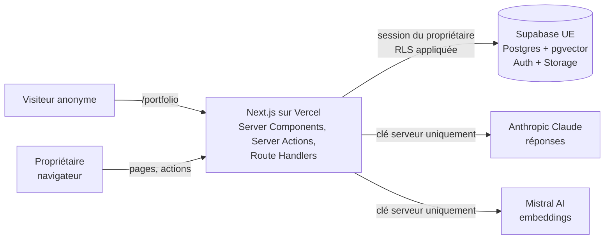
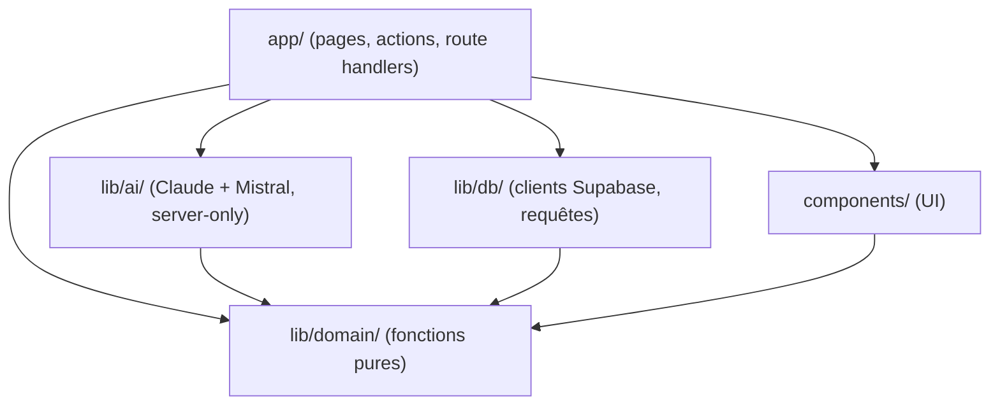
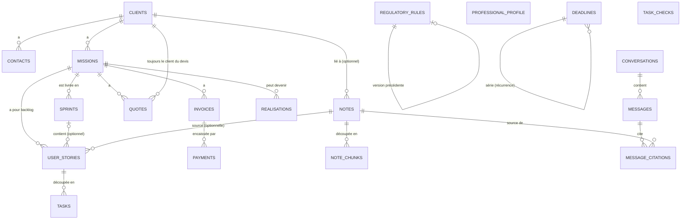
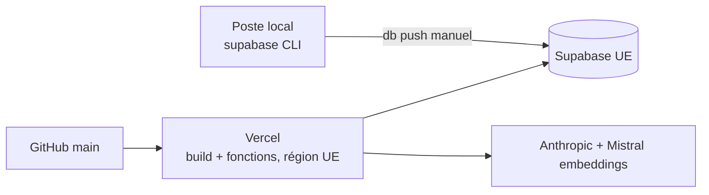

# Architecture Spine — LogMerry

> Lecture débutant : chaque décision a une ligne **En clair**. Ces lignes servent à comprendre ; la règle, elle, est dans **Rule**. Chaque est à confirmer (liste en fin de document).

## Design Paradigm

**Monolithe Next.js « server-first » + Supabase comme autorité sur les données.**

- Une seule application Next.js (App Router) déployée sur Vercel. Tout le code qui tourne côté serveur y vit : pages, écritures, appel au modèle d'IA.
- Supabase stocke tout et décide *qui a le droit de voir quoi* (RLS). Le code Next.js n'a donc jamais à « penser » à la sécurité des lignes : la base refuse.
- La logique métier (règles du cockpit, estimations, découpage de texte, vérification de citations) est écrite en **fonctions pures** dans `lib/domain/`, testables sans base ni réseau.

En clair : Next.js affiche et orchestre, Supabase garde les données et fait respecter les accès, `lib/domain/` contient les calculs.



Sens des dépendances dans le code (une flèche = « a le droit d'importer ») :



`lib/domain/` n'importe rien d'autre. `components/` n'importe ni `lib/db` ni `lib/ai`.

## Invariants & Rules

### AD-1 — Répartition des rôles Next.js / Supabase [ADOPTED partiel]

- **Binds:** all
- **Prevents:** de la logique dupliquée ou à la mauvaise place (un calcul dans le navigateur, une règle d'accès dans le code).
- **Rule:**
  - Next.js : interface, orchestration, appels IA, calculs (`lib/domain/`). Supabase : tables, Auth, Storage, pgvector, RLS.
  - Aucune Edge Function Supabase et aucun n8n dans le MVP. Le chat et l'indexation sont des Route Handlers / Server Actions Next.js. *(Écart assumé avec l'addendum du PRD, qui prévoyait une fonction Supabase pour le chat : le jeton de l'utilisateur et donc la RLS s'appliquent aussi via la session Next.js, avec un seul code à maintenir.)*
  - Le navigateur ne parle à Supabase que pour l'authentification ; toutes les lectures et écritures de données passent par le serveur Next.js.
- **En clair :** un seul endroit pour le code serveur, moins de pièces à sécuriser pour un premier projet.

### AD-2 — La RLS est la frontière de sécurité [ADOPTED]

- **Binds:** FR-1, FR-2, FR-5, FR-16, NFR-3
- **Prevents:** qu'un compte voie les données d'un autre ; qu'un oubli dans le code ouvre une fuite.
- **Rule:**
  - Toute table de `public` : `owner_id uuid not null default auth.uid() references auth.users`, RLS activée, policies `using (owner_id = (select auth.uid()))` pour select, insert (`with check`), update, delete. Une table sans RLS ne passe pas en revue.
  - Le code utilise **uniquement** le client Supabase de la session de l'utilisateur (clé publique + cookie). La clé `service_role` n'existe pas dans l'application (ni en variable Vercel, ni dans le code).
  - Les fonctions SQL (ex. recherche vectorielle) sont `security invoker` et filtrent aussi `owner_id` explicitement.
  - Stockage : bucket `portfolio` en lecture publique, écriture limitée au dossier `{owner_id}/` ; on n'y dépose que des images destinées à être publiques.
- **En clair :** même si le code a un bug, la base ne rend jamais les lignes d'un autre compte.

### AD-3 — Rôles et droits d'accès [ADOPTED partiel]

- **Binds:** FR-1, FR-16, NFR-3
- **Prevents:** deux interprétations différentes de « qui peut quoi ».
- **Rule:**

| Qui | Voir | Créer | Modifier | Supprimer |
| --- | --- | --- | --- | --- |
| Propriétaire connecté (`authenticated`) | ses lignes uniquement | ses lignes | ses lignes | ses lignes |
| Visiteur anonyme (`anon`) | uniquement la vue `public_realisations` | rien | rien | rien |

  - Il n'y a qu'un seul rôle applicatif (propriétaire) ; pas de table de rôles. Démo et réel = comptes distincts, isolés par `owner_id`.
  - Connexion par e-mail + mot de passe (Supabase Auth). Une fois les comptes créés, l'inscription publique est désactivée dans le tableau de bord Supabase.
  - Les routes privées sont protégées par `proxy.ts` (redirection vers `/auth/login`) **et** revérifiées côté serveur avec `supabase.auth.getUser()` (jamais `getSession()` seul).
  - Suppression d'une note : ses extraits (`note_chunks`) partent en cascade ; une citation d'historique garde la ligne mais perd son lien (`on delete set null`), l'interface affiche « source supprimée ».
  - La vue `public_realisations` n'expose que les colonnes publiables, des lignes `published = true` avec `client_consent = true` (nom du client anonymisé si pas d'accord). Une seule page publique `/portfolio` liste toutes les réalisations publiées ; chacune porte son étiquette d'origine (« démo » incluse).
- **En clair :** une seule personne se connecte et voit tout ce qui est à elle ; le public ne voit que le portfolio publié.

### AD-4 — Comment les données sont écrites et lues [ADOPTED partiel]

- **Binds:** FR-3, FR-7..FR-13, FR-16, FR-21, FR-22
- **Prevents:** plusieurs façons concurrentes de modifier la même donnée ; des règles de validation dispersées.
- **Rule:**
  - **Lecture** : Server Components (requête Supabase côté serveur). **Écriture** : Server Actions, une par intention (`createNote`, `markInvoicePaid`…). Les Route Handlers (`app/api/`) ne servent qu'au chat (AD-7) ; pas d'API REST « maison » pour le reste.
  - Une Server Action : vérifie l'utilisateur → écrit via le client de session → `revalidatePath` → retourne `{ ok: true, data } | { ok: false, error: { code, message } }` (message en français, affichable tel quel ; `code` parmi `invalid`, `not_found`, `conflict`, `missing_parameter`, `forbidden`, `failed`).
  - Les contraintes de validité sont **dans la base** (`not null`, `check`, clés étrangères, enums) : par exemple échéance sans date ou sans source refusée (FR-13), devis sans montant refusé (FR-22). Les Server Actions traduisent l'erreur Postgres en message ; aucune bibliothèque de validation ajoutée au MVP.
  - Un seul chemin d'écriture par entité ; aucune écriture depuis un composant client directement vers Supabase.
  - **Un écrivain par entité (18 octobre) :** `professional_profile` : `saveProfile` seule ; `deadlines` : `saveDeadline` et `markDeadlineDone` (le fait de cocher une tâche d'échéance au cockpit appelle `markDeadlineDone`) ; `regulatory_rules` : `create_rule_version` (AD-12) ; `quotes.status` : `updateQuote` pour « envoyé » et « refusé », **`accept_quote` seule pour « accepté »**.
  - **Devis accepté (FR-22) :** passer un devis en « accepté » est **une seule action, tout ou rien**, la fonction SQL `accept_quote(quote_id)` (`security invoker`, une transaction, ligne verrouillée `for update`, **idempotente** : déjà accepté, elle renvoie la mission existante). Devis lié à un prospect : le prospect passe en client et une mission est créée (client du devis, statut `in_progress`, titre « Devis du JJ/MM/AAAA — Nom du client » avec la **date d'envoi** du devis, fuseau Europe/Paris) ; le devis garde son `client_id` et reçoit le `mission_id` créé. Devis lié à une mission existante : rien d'autre ne change. Un déclencheur `before update` refuse `status → accepted` hors de cette fonction. `[ASSUMPTION : fonction SQL (supabase-js n'enchaîne pas plusieurs écritures dans une transaction) ; date du titre = date d'envoi ; à confirmer à la story 3.6]`
- **En clair :** on lit côté serveur, on écrit par des « actions » nommées, et la base est le dernier juge de ce qui est valide.

### AD-5 — Noyau métier pur et déterministe [ADOPTED]

- **Binds:** FR-9..FR-15, FR-22, FR-25
- **Prevents:** deux calculs différents pour le même chiffre (cockpit vs assistant) ; des taux écrits en dur ; un montant inventé par le modèle.
- **Rule:**
  - `lib/domain/` : fonctions pures (entrées → sorties), sans import de Supabase, Next.js ni IA. Les règles (taux, plafonds, dates d'effet) et le profil y entrent **en argument**, lus depuis `regulatory_rules` et `professional_profile` (AD-12) ; les formules (prorata de la première année, bascule de TVA, fin de l'ACRE) sont des fonctions de `lib/domain/finance/` qui lisent ces données et ne contiennent **aucun chiffre réglementaire**.
  - Un seul calcul par résultat : le cockpit (FR-15) et l'explication de l'assistant (FR-12) appellent la même fonction.
  - Règle absente, non vérifiée ou périmée, ou donnée du profil **vide** dont elle dépend → la fonction retourne `{ status: 'missing_parameter', reasons: [{ key, why: 'absente' | 'non_verifiee' | 'perimee' | 'profil_vide', field? }] }` (la liste complète : un manque n'en cache pas un autre) ; l'interface affiche « paramètre manquant ». Jamais de valeur par défaut. Une donnée du profil **déclarée mais non confirmée** n'empêche pas le calcul : le résultat porte `unconfirmedInputs: [champ]` et l'interface affiche le bandeau « calcul basé sur une donnée déclarée, non confirmée » (AD-12). Toute fonction reçoit une date de référence `asOf` (jour de Paris) en argument et ne lit jamais l'horloge ; pour une période passée, `asOf` est la fin de la période.
  - Les **sept** règles du cockpit (FR-14) sont sept fonctions dans `lib/domain/cockpit/`. Chacune expose `{ ruleNo, trigger(asOf), sortDate: Date | null, tieKey: string }`. **Tri unique, défini en un seul endroit :** `ruleNo` croissant (1 à 6, puis 7, puis les tâches du sprint actif : `[ASSUMPTION : règle 7 avant les tâches du sprint, ordre non précisé par l'auteur]`), puis `sortDate` croissant (`null` en dernier), puis `tieKey` (identifiant). **Fenêtres :** règle 1 : échéance entre 0 et 3 jours (une échéance en retard relève de la vue « En retard » du calendrier, pas du cockpit) ; règle 2 : facture en retard d'au moins 1 jour ; règle 4 : fin de l'ACRE dans 31 jours au plus, calculée à partir de la date de début d'activité du profil et de la règle ACRE ; règle 7 : sprint « en cours » qui se termine dans 0 à 2 jours avec au moins une story non terminée. **Règle 3 :** un plafond suivi émet une tâche à 90 % et une à 100 % seulement si ce seuil est **actif au profil** ; à 100 % seule la tâche 100 % reste. **Règle 5 :** devis « envoyé » dont `updated_at` a plus de 7 jours (jours de Paris) `[ASSUMPTION : toute modification du devis, remarque comprise, remet le compteur à zéro]`. **Règle 6 :** nombre de missions « en cours » plus nombre de devis « envoyés » **non liés à une mission déjà en cours** inférieur à 2 (ce qui est lié compte une fois ; décision de l'auteur du 18 octobre). **Sprint :** trois tâches au plus, plus un lien « N autres tâches dans ton sprint » ; « en cours » = statut de story `in_progress`, « terminée » = `done`. Une règle dont une règle réglementaire manque est affichée comme ligne « paramètre manquant » sous les tâches, jamais comme une tâche classée. Une même entité source ne donne **qu'une** tâche : si plusieurs règles la déclenchent, seule celle au plus petit numéro est gardée. Les tâches du jour sont **calculées à la lecture** à partir du calendrier et des autres données (AD-13) ; toute tâche issue d'un sprint porte « Client / Mission / Sprint X » (un sprint appartient à une seule mission).
  - Le LLM n'affiche et ne calcule aucun chiffre : il reçoit les résultats déjà calculés pour les expliquer.
  - Chaque fonction de `lib/domain/` a un test unitaire ; les ≥ 6 cas de référence de FR-11 y sont des tests, **calculés à la main par l'auteur indépendamment du code** (jamais générés à partir du code testé). Leurs valeurs vivent dans `lib/domain/finance/__fixtures__/<rule_key>.cases.ts` avec un en-tête obligatoire : `FICTIF` (valeurs inventées, elles vérifient la **formule**) ou `RÉEL` + source + date de vérification (cas de l'auteur) ; un test échoue si l'en-tête manque.
- **En clair :** les calculs vivent à un seul endroit, testables seuls ; l'IA les explique mais ne les fait jamais.

### AD-6 — Appels IA uniquement côté serveur, fournisseurs et embeddings [ADOPTED]

- **Binds:** FR-3, FR-4, FR-12, FR-20, FR-23, FR-24, NFR-3
- **Prevents:** une clé d'API exposée au navigateur ; un changement de modèle qui casse les vecteurs sans le dire.
- **Rule:**
  - LLM : **Claude (Anthropic)**, choix de l'auteur. Identifiant du modèle dans `AI_CHAT_MODEL` (suggestion : `claude-sonnet-5-5`, à valider sur le jeu de test du RAG ; `claude-haiku-5-5` si le coût ou la vitesse l'exige). Réponse structurée obtenue par appel d'outil (tool use) imposant `{ answer, citations }`.
  - Embeddings : Anthropic ne propose pas de modèle d'embeddings. **`mistral-embed`** (Mistral AI, société européenne, **1024 dimensions** vérifié dans la doc Mistral). Colonne `vector(1024)`, index HNSW en distance cosinus. Chaque extrait stocke `embedding_model`. Changer de modèle = nouvelle migration + réindexation complète.
  - Les extraits de notes sont envoyés à deux fournisseurs (Anthropic pour répondre, Mistral pour vectoriser) : à documenter dans la mention RGPD ; pas de notes réelles de clients avant cette vérification (PRD §5.2).
  - **Aide à la conception (17 octobre, FR-23, FR-24) :** mêmes fournisseur et clé ; un appel commun `lib/ai/claude-tool.ts` (`fetch`, 60 s, outil à sortie structurée), des fonctions par usage (`story-proposals`, `task-proposals`, `prompt-generation`) ; propositions éphémères, vérifiées côté serveur (titres, doublons, nombres absents des sources), brief, notes, stories et tâches envoyés à Anthropic, texte traité comme donnée (voir l'addendum).
  - **Explication d'une estimation (18 octobre, FR-12) :** l'assistant reçoit le résultat déjà calculé, les règles utilisées (valeurs, sources, dates de vérification) et **le profil professionnel entier** (décision de l'auteur, seul utilisateur connecté) ; la mention RGPD est affichée ; à revoir avant toute donnée réelle (PRD §5.2). Il ne calcule et n'affiche aucun chiffre lui-même.
  - Tout le code d'appel est dans `lib/ai/`, qui commence par `import 'server-only'` (le build échoue s'il est importé côté client). Clés : `ANTHROPIC_API_KEY` et `MISTRAL_API_KEY`, sans préfixe `NEXT_PUBLIC_`, définies dans Vercel et `.env.local`.
- **En clair :** Claude rédige les réponses, Mistral transforme les textes en vecteurs ; l'IA n'est appelée que depuis le serveur, et changer de modèle d'embeddings oblige à tout réindexer.

### AD-7 — Pipeline RAG et citations vérifiées [ADOPTED]

- **Binds:** FR-3, FR-4, FR-5, FR-6, FR-19, FR-21
- **Prevents:** une citation inventée par le modèle ; un historique qui casse quand une note est modifiée ; une note perdue si l'IA est en panne.
- **Rule:**
  - **Indexation** (dans la Server Action de sauvegarde d'une note) : la note est d'abord enregistrée, puis découpée (`lib/domain/chunking`, avec chevauchement), vectorisée, et ses extraits remplacés. En cas d'échec IA, la note reste enregistrée avec `index_status = 'failed'` (nouvel essai possible). Note brouillon vide : aucun extrait, aucun appel IA.
  - **Question** (`app/api/chat/route.ts`) : vectoriser la question → fonction SQL `match_chunks(query_embedding, threshold, k)` filtrée par `owner_id` → si aucun extrait au-dessus du seuil, **réponse « je ne trouve pas » sans appeler le LLM** → sinon appel au LLM avec les extraits identifiés → réponse structurée `{ answer, citations: [chunk_id] }` → rejet de toute citation dont l'id n'a pas été envoyé → enregistrement du message et des citations → réponse.
  - **Pas de streaming** au MVP : la réponse n'est affichée qu'une fois vérifiée ; un état d'attente couvre NFR-1.
  - **Citations stockées** par `note_id` (et `chunk_id` nullable), car modifier une note régénère ses extraits. L'interface relit la note en base ; elle n'affiche jamais le texte « cité » par le modèle.
  - Garde-fous (FR-12) : consigne système fixe interdisant le conseil fiscal/juridique ; aucune donnée d'une autre table que `notes`/`note_chunks` et les résultats de `lib/domain/` n'est fournie au modèle.
  - **Exception FR-12 (18 octobre) :** pour une demande d'explication d'estimation, le modèle reçoit en plus le résultat calculé, les règles utilisées et le profil (AD-6). Le routeur du chat décide par une fonction pure `intent` ; le court-circuit « je ne trouve pas » ne s'applique qu'aux questions documentaires. Les citations deviennent une union `{ kind: 'note', id } | { kind: 'rule', id }`, vérifiée contre ce qui a été envoyé ; un résultat issu d'une règle d'essai porte l'étiquette « DEMO, non officielle » dans ce qui est envoyé au modèle et dans la réponse.
- **En clair :** on retrouve d'abord les passages utiles dans la base, on ne montre une réponse que si ses sources sont réelles.

### AD-8 — Modèle de données : un propriétaire pour chaque entité

- **Binds:** FR-3, FR-5, FR-7..FR-16, FR-21, FR-22, FR-23, FR-25
- **Prevents:** deux tables pour la même chose ; une donnée sans `owner_id` ; des montants mal arrondis.
- **Rule:**
  - Entités du MVP : voir le schéma ci-dessous. Toute nouvelle table suit la convention existante : `owner_id` (`default auth.uid()`), RLS à quatre policies, `with check` qui vérifie que le parent référencé est à moi (une clé étrangère contourne la RLS) ; la purge supprime par `owner_id` ; `on delete set null` pour les liens de version. Prospect et client sont **une seule table** `clients` avec un `status` (un prospect devenu client change de statut, sans ressaisie).
  - Identifiants `uuid` ; horodatages `timestamptz` en UTC ; les dates métier (échéance, date d'envoi) sont de type `date`. « Aujourd'hui » se calcule à l'heure de Paris dans `lib/domain/`.
  - Montants en **centimes entiers** (`bigint`), jamais en flottant ; pourcentages et taux en `numeric`. **Factures, encaissements et devis enregistrent le montant hors taxe et le montant de taxe** (`amount_ht_cents`, `tax_cents`, le toutes taxes comprises se déduit) ; une taxe inconnue est `null`, jamais 0 ; la taxe d'un encaissement partiel est saisie, pas répartie au prorata. Le statut « payée » d'une facture est **dérivé** de la somme de ses encaissements (aucun statut stocké). Chaque règle de plafond désigne sa base (AD-12).
  - Valeurs à plusieurs choix (statuts, étiquette d'origine, source d'une échéance) en **enums Postgres** ; ajout d'une valeur = migration.
  - `regulatory_rules` et `professional_profile` : voir AD-12 (elles remplacent la table `parameters`, qui n'a jamais été créée). `deadlines` : voir AD-13. `regulatory_rules` est la seule source des taux, plafonds et seuils.
  - **Sprints (17 octobre, story 3.5c) :** `sprints` (rattaché à une mission : nom, objectif, `start_date` et `end_date` avec fin ≥ début, état enum `planned` / `active` / `closed`) ; `user_stories.sprint_id` (nul = backlog, `on delete set null`). Un seul sprint `active` par mission (index unique partiel). La policy de `user_stories` exige un sprint à moi ET de la même mission (une clé étrangère contourne la RLS). Un sprint clos est figé **en base** par un déclencheur (`user_stories_guard_closed_sprint` : aucune story n'y entre ni n'en sort ; sa suppression reste permise) et aussi à l'écran et dans les Server Actions. `position` ordonne les stories à l'intérieur de leur liste (backlog ou un sprint).
  - **Règle de migration :** une migration qui remplace une policy repart de la définition en vigueur (`pg_policies`), pas du fichier d'origine (régression attrapée en 3.5c).
  - Schéma modifié **uniquement** par des fichiers dans `supabase/migrations/`, un fichier par changement, appliqués avec la CLI Supabase après relecture du SQL.
- **En clair :** une table par notion, tout est rattaché à un propriétaire, l'argent est en centimes, le schéma ne bouge que par migration.



Extension prévue pour la phase suivante (FR-26 à FR-28, non construite) : les dates d'effet de `regulatory_rules` et les champs du profil portent déjà ce que l'ARE et les prévisions demanderont ; aucune table n'est ajoutée avant.

### AD-9 — Recherche (FR-19) sans nouvelle technologie

- **Binds:** FR-19
- **Prevents:** deux moteurs de recherche concurrents.
- **Rule:** la palette ⌘K appelle **une** Server Action `search` qui interroge notes, clients et missions avec la recherche plein texte de Postgres (configuration `french`, colonnes `tsvector` générées), sous RLS. La recherche vectorielle est réservée à l'assistant (AD-7). Aucun Elasticsearch ni service externe.
- **En clair :** la recherche rapide utilise ce que Postgres sait déjà faire.

### AD-10 — Portfolio public

- **Binds:** FR-16, UJ-3
- **Prevents:** fuite de données privées via la page publique.
- **Rule:** `/portfolio` est la seule route publique de données ; elle lit **exclusivement** la vue `public_realisations` avec le rôle `anon`. Elle est en lecture seule (pas d'écriture anonyme au MVP ; contact par `mailto:`). Aucune autre table n'a de policy pour `anon`.
- **En clair :** le public passe par une seule « fenêtre » étroite sur la base.

### AD-11 — Hébergement, environnements, secrets

- **Binds:** NFR-1, NFR-3, NFR-4
- **Prevents:** une clé secrète dans Git ; des régions éloignées qui ralentissent les réponses.
- **Rule:**
  - **Vercel** (déploiement depuis la branche `main` de GitHub ; une prévisualisation par branche). Région des fonctions alignée sur la région UE du projet Supabase (ex. `cdg1` Paris). Plan Hobby pendant le Workshop 8 (limite de 300 s par fonction, suffisante pour l'assistant). Le plan Hobby est réservé à un usage non commercial : passage au plan Pro au démarrage de l'activité réelle.
  - **Un seul projet Supabase** (région UE), partagé par le développement local, les prévisualisations et la production : démo et réel sont séparés par `owner_id`, comme décidé dans le PRD.
  - Variables d'environnement : `NEXT_PUBLIC_SUPABASE_URL`, `NEXT_PUBLIC_SUPABASE_PUBLISHABLE_KEY` (publiques, déjà dans `.env.example`), `ANTHROPIC_API_KEY`, `MISTRAL_API_KEY`, `AI_CHAT_MODEL` (serveur). `.env.local` ignoré par Git.
  - Les migrations ne sont **pas** appliquées automatiquement par le déploiement : application manuelle (`supabase db push`) après relecture.
- **En clair :** une base, un hébergeur, des clés secrètes seulement côté serveur.

### AD-12 — Règles réglementaires versionnées et profil professionnel [ADOPTED partiel]

- **Binds:** FR-2, FR-9, FR-10, FR-11, FR-12, FR-14, FR-25
- **Prevents:** un taux, un plafond ou une date réglementaire écrit en dur ; un calcul fait avec une règle non vérifiée ou périmée présenté comme fiable ; le mélange des règles d'essai de la démonstration et des vraies règles ; deux versions d'une même règle utilisées au hasard ; deux fonctions qui lisent la même règle sous deux formes.
- **Rule:**
  - **Une seule table `regulatory_rules`**, créée directement, avec `owner_id` (RLS). Colonnes : `id` (uuid d'une ligne), **`rule_key`** (clé stable d'une règle à travers ses versions, catalogue fermé dans `lib/domain/finance/rule-keys.ts`), catégorie, description, `params` (`jsonb` : valeur, unité et paramètres de calcul), `effective_from` (inclus), `effective_to` (**exclu** ; nul = en vigueur), conditions d'application, `activity_category`, source officielle (URL), date de dernière vérification, `revalidate_after`, statut de validation (enum **`a_verifier`, `verifiee`, `essai`**), `previous_version_id` (`on delete set null`).
  - **Contrat des `params` :** chaque `rule_key` a un schéma de `params` (types TypeScript dans `rule-keys.ts`, vérifié à l'enregistrement) ; les formules déclarent les clés qu'elles lisent et la page « Règles » valide chaque saisie avec le même schéma. La durée de l'ACRE, la base de jours du prorata et la base d'un plafond (période, catégorie de recettes, hors taxe ou taxe) sont des champs de `params`, **jamais des constantes dans le code**. Une règle déclare aussi `requires_profile_fields` (les champs du profil dont elle dépend).
  - **Une règle est une donnée ; les formules sont du code** (`lib/domain/finance/`, AD-5) : prorata de la première année, bascule de TVA, fin de l'ACRE lisent ces données.
  - **Versions :** un changement de valeur est une **nouvelle version** créée par l'unique fonction SQL `create_rule_version(…)` (une transaction : elle ferme la version précédente à la date d'effet et insère la nouvelle) ; les intervalles `[effective_from, effective_to)` d'un même (`owner_id`, `rule_key`, `activity_category`) **ne se chevauchent jamais** (contrainte d'exclusion). Sélection d'une règle : `rule_key` + `activity_category` du profil + l'intervalle contenant `asOf`.
  - **« Périmée » est dérivée, jamais stockée :** une règle est périmée si elle est **en vigueur** (`effective_to` nul) et `revalidate_after` < `asOf`. Une version close est de l'histoire : elle ne bloque jamais le calcul d'une période passée. Une règle `a_verifier`, périmée, ou absente n'est jamais utilisée en silence : le calcul retourne `missing_parameter` avec ses `reasons` (AD-5).
  - **`professional_profile`** (une ligne par propriétaire, écrite par `saveProfile` seule) : statut juridique, régime fiscal, catégorie BNC ou BIC, nature des prestations, date de début d'activité, fréquence des déclarations Urssaf, régime de TVA, éligibilité à l'ACRE, situation France Travail, objectifs financiers, taux de réserve personnels, seuils d'alerte actifs (50, 75, 90, 100 %), préférences de notification. **Chaque champ = une valeur et une date de confirmation** (`<champ>_confirmed_at`) : valeur vide = « À confirmer » ; valeur présente sans date = **déclarée, non confirmée** (le calcul se fait, avec le bandeau « à confirmer », décision de l'auteur) ; aucune valeur par défaut. Les fonctions pures reçoivent `ProfileField<T> = { value: T | null, confirmed: boolean }`.
  - **Plusieurs plafonds distincts** : chacun est une règle qui désigne sa base. Au MVP les alertes de plafond sont **visibles dans l'application seulement** (jauge à chaque seuil actif, tâche du cockpit à 90 % puis 100 %) ; aucun canal de notification avant n8n.
  - **Compte de démonstration :** ses règles d'essai ont le statut `essai`, étiqueté « DEMO, non officielle » partout où elles s'affichent ; un résultat calculé avec une règle `essai` hérite de l'étiquette. L'isolation est celle de tout le projet : **la RLS par `owner_id`, sans colonne « fictif »** (CLAUDE.md). Les règles d'essai sont semées par un script authentifié (`npm run seed:demo`), purgées avec le reste au passage à l'outil pro, jamais lues par un autre compte.
  - Les cas de référence (≥ 6) sont les tests des règles, écrits par l'auteur (AD-5, fixtures étiquetées).
  - `[ASSUMPTION : noms des colonnes, du statut `essai` et de la fonction `create_rule_version` à confirmer à la story 4.1]`
- **En clair :** les chiffres réglementaires sont des données sourcées et datées que tu saisis, jamais du code ; une règle qui change devient une nouvelle version qui ne chevauche pas l'ancienne ; ce qui n'est pas vérifié n'est jamais calculé, et ce qui est seulement déclaré est calculé avec un bandeau.

### AD-13 — Le calendrier est la source unique des échéances [ADOPTED partiel]

- **Binds:** FR-13, FR-14, FR-15
- **Prevents:** une même échéance présente dans deux listes avec deux statuts ; une fausse échéance inventée ; des tâches du cockpit stockées au lieu d'être calculées ; deux propriétaires de l'état « fait » d'une même chose.
- **Rule:**
  - **`deadlines`** est la seule liste d'échéances et d'obligations : titre, description, date, catégorie (Urssaf, France Travail, fiscale, TVA, CFE, justificatifs, renouvellements, personnalisée), statut, priorité, lien vers la source officielle, récurrence. Une échéance **saisie** a toujours une date (refusée sinon, AD-4) ; une échéance qu'une règle devrait calculer mais dont la règle est absente ou non vérifiée est enregistrée **sans date, marquée « À confirmer »**, jamais estimée.
  - **Récurrence :** chaque occurrence est **sa propre ligne** de `deadlines` (colonne `series_id`), avec son statut ; les occurrences des 12 prochains mois sont créées avec la série et complétées à la lecture quand il en manque. `[ASSUMPTION : occurrences stockées plutôt que calculées, pour pouvoir cocher chaque occurrence ; à confirmer à la story 5.1]`
  - **Les « factures à émettre » et « factures à relancer » ne sont pas des échéances stockées** : ce sont des lignes calculées à partir des factures (règle 2), affichées dans le calendrier.
  - Les tâches du jour du cockpit sont **calculées à la lecture** (AD-5) ; **cocher une tâche issue d'une échéance appelle `markDeadlineDone`** (l'échéance porte son statut) ; **cocher une tâche de story coche `tasks.done`** (un seul propriétaire de « fait » pour une tâche de story). `task_checks` ne garde que les coches des autres tâches (alerte de plafond, devis, pipeline) : clé `(rule_no, entité source ou null, plafond et seuil ou null, début de période)`, de sorte que cocher la tâche à 90 % ne masque pas celle à 100 %.
  - Le calendrier ne contient que des obligations, pas de rendez-vous. Les tâches du jour ne sont pas archivées : on ne reconstruit pas l'historique de ce qui a été fait (limite assumée).
- **En clair :** une seule liste de dates ; chaque chose n'a qu'un endroit où elle est « faite » ; le cockpit lit cette liste et en tire ce qu'il faut faire aujourd'hui.

## Consistency Conventions

| Concern | Convention |
| --- | --- |
| Noms de code | Code et commits en anglais ; interface et messages d'erreur en français. Tables et colonnes en `snake_case` pluriel (`user_stories`) ; fichiers en `kebab-case` ; Server Actions nommées par verbe (`createNote`). |
| Données | `uuid`, `timestamptz` UTC, centimes entiers (AD-8) ; réponses d'actions `{ ok, data } \| { ok: false, error: { code, message } }`. |
| Sécurité | `owner_id` + RLS sur chaque table ; jamais de `service_role` ; `server-only` sur `lib/ai/` et `lib/db/`. |
| Erreurs et journaux | Erreur attendue → `{ ok: false }` ; erreur inattendue → log serveur (journaux Vercel) + message générique français. Aucun contenu de note dans les logs. |
| Tests | Fonctions de `lib/domain/` : tests unitaires avec le lanceur intégré de Node (`node --test`, choisi à la place de Vitest : aucune dépendance de plus). Essais réels de l'IA : `npm run test:proposals` (données fictives, nettoyage en fin d'essai). Isolation : script de test à deux comptes fictifs (FR-1, SM-2) à rejouer après chaque migration touchant une table. |
| Journal | Chaque décision ou bug notable est consigné dans `docs/journal.md` (NFR-5). |

## Stack

| Name | Version |
| --- | --- |
| Next.js (App Router) | 16.x LTS, à épingler. Le dépôt est en 15.3.1 (fin de vie annoncée vers le 21 octobre 2026) : monter en 16 avant d'écrire du code métier |
| React / TypeScript | 19 / 5 (déjà installés) |
| Tailwind CSS + shadcn/ui | 3.4 / déjà installés (template Supabase) |
| @supabase/ssr, @supabase/supabase-js | à épingler (aujourd'hui `latest`) |
| Supabase | projet cloud, région UE ; Postgres + extension `pgvector` |
| Anthropic API (Claude) | modèle de chat suggéré `claude-sonnet-5-5`, à valider |
| Mistral AI API | `mistral-embed` (1024 dim), embeddings seulement |
| Vercel | plan Hobby puis Pro |
| Lanceur de tests Node (`node --test`) | intégré, remplace Vitest (décision de construction) |
| dnd-kit (`@dnd-kit/core`, `sortable`, `utilities`) | glisser-déposer des stories et des tâches (17 octobre) ; touche, clavier, annonces |

## Structural Seed

```text
logmerry/
  app/
    auth/                 # connexion (template)
    (app)/                # zone privée protégée : aujourd'hui, notes, assistant, clients, missions, finances, échéances, à faire, réalisations
    portfolio/            # page publique (AD-10)
    api/chat/route.ts     # seul Route Handler (AD-7)
  components/             # UI uniquement (shadcn + composants maison)
  lib/
    domain/               # fonctions pures : cockpit/, finance/, chunking, citations (AD-5)
    db/                   # clients Supabase (server, browser pour l'auth) + requêtes
    ai/                   # Claude + Mistral embeddings, server-only (AD-6)
  supabase/migrations/    # schéma versionné (AD-8)
  proxy.ts                # protection des routes (AD-3)
  docs/                   # journal.md, rag-tests.md
```

Déploiement :



## Capability → Architecture Map

| Capacité | Vit dans | Gouverné par |
| --- | --- | --- |
| FR-1, FR-2 (connexion, isolation, démo) | Supabase Auth, RLS, `proxy.ts` | AD-2, AD-3 |
| FR-3, FR-19, FR-21 (notes, recherche, à documenter) | `app/(app)/notes`, `lib/domain/chunking`, `lib/ai` | AD-4, AD-7, AD-9 |
| FR-4, FR-5, FR-6, FR-12 (assistant, historique, tests) | `app/api/chat`, `conversations`, `messages` | AD-6, AD-7 |
| FR-20 (résumé) | Server Action + `lib/ai` | AD-6 (après le jalon du 30 octobre) |
| FR-7, FR-8, FR-22 (CRM, missions, backlog, tâches, sprints, devis) | `app/(app)/clients`, `missions` ; tables `missions`, `user_stories`, `tasks`, `sprints`, `quotes` ; acceptation d'un devis en une action (AD-4) | AD-4, AD-8 |
| FR-23, FR-24 (aide de l'IA à la conception, prompt de mission) | Server Actions de `missions` + `lib/ai/claude-tool`, `lib/domain/*proposals`, `mission-context`, `prompt-generation` | AD-6 |
| FR-9, FR-10, FR-11, FR-15 (finances, règles, plafonds) | `lib/domain/finance`, `regulatory_rules`, `invoices`, `payments` | AD-5, AD-8, AD-12 |
| FR-25 (profil professionnel) | `professional_profile`, page Profil | AD-8, AD-12 |
| FR-2 (règles d'essai de la démonstration) | `regulatory_rules` (statut `essai`), compte de démonstration | AD-12 |
| FR-13, FR-14 (calendrier, cockpit) | `lib/domain/cockpit`, `deadlines`, `task_checks` | AD-5, AD-13 |
| FR-12 (explication des estimations) | `lib/ai` (profil et règles envoyés avec le résultat) | AD-5, AD-6 |
| FR-26, FR-27, FR-28 (vue d'ensemble, objectifs, ARE : phase suivante) | non construits ; points d'extension en AD-8 | AD-12 |
| FR-16 (portfolio) | `app/portfolio`, vue `public_realisations` | AD-3, AD-10 |

## Deferred

| Sujet | Pourquoi ça peut attendre / condition de reprise |
| --- | --- |
| Modèle d'embeddings définitif (alternative : Voyage AI, recommandé par Anthropic, hébergement hors UE) | `bmad-deep-recon` technique, avant la première migration de `note_chunks` (PRD §9.3) |
| n8n (rappels, résumé hebdo, calendrier, veille des taux) | Hors MVP ; à introduire si une tâche doit tourner sans que le propriétaire soit connecté |
| Sauvegardes et restauration (NFR-4) | Vérifier l'offre du plan Supabase et une sauvegarde manuelle (`pg_dump`) avant la première vraie donnée |
| Limitation de débit des appels IA | Un seul utilisateur au MVP ; à ajouter avec le portail client ou le formulaire public (V2). Les propositions de l'IA (stories, tâches, prompt) n'ont pas de plafond de générations : coût d'API à surveiller |
| Pièces jointes aux notes (photos, documents, enregistrements) | Idée du 15 octobre ; demande du stockage (Supabase Storage) et ses policies, à étudier après le MVP |
| Ordre du backlog et ordre appliqué par l'IA écrits de façon atomique | Aujourd'hui une mise à jour par ligne (non atomique) ; procédure stockée si les listes grossissent ou si deux onglets entrent en conflit |
| Phase suivante du cockpit financier (vue d'ensemble, objectifs, suivi ARE : FR-26 à FR-28) | PRD §4.9 ; à spécifier avec les sources et documents de l'auteur ; aucune table ajoutée avant |
| Période et catégorie de recettes de la base de chaque plafond | À écrire avec chaque règle et sa source (PRD §9, point 11) ; peut ajouter des champs aux factures et encaissements |
| Valeurs des règles réelles, règles d'essai « DEMO », cas de référence | Écrits par l'auteur avec leurs sources (PRD §9, points 12 et 16) ; aucune valeur dans le code |
| Canal de notification des alertes (e-mail, notifications) | Après le MVP, avec n8n (PRD §7.4) |
| Prospects dormants comme tâches du cockpit | Après le MVP (PRD §7.4) |
| Historique des tâches faites du cockpit | Les tâches sont calculées à la lecture et ne sont pas archivées ; à reprendre si un journal d'activité devient utile |
| Formulaire de contact public, import de fichiers, portail client, SQL libre | PRD §7.4, V2 |
| Surveillance et alertes techniques | Journaux Vercel/Supabase suffisent au MVP |
| Détail des policies de stockage (images du portfolio) | À la livraison de FR-16 |

## Décisions confirmées par l'auteur

Toutes les hypothèses ont été confirmées (2026-10-12 et 2026-10-13), dont : Claude pour les réponses, `mistral-embed` pour les embeddings, envoi des extraits à deux fournisseurs (à documenter côté RGPD avant toute donnée réelle), modèle de chat à valider sur `docs/rag-tests.md`.

Le 18 octobre 2026, l'auteur a confirmé **les principes** de la partie finances (les contrats techniques d'AD-12 et d'AD-13, proposés par l'architecte après relecture, sont à valider aux stories 3.6, 4.1 et 5.1) : une seule table de règles versionnées (valeurs en données, formules en code testé, nouvelle version à chaque changement, règles d'essai « DEMO » propres au compte de démonstration), le profil professionnel avec l'état « À confirmer », des montants hors taxe et taxe, des plafonds multiples avec alertes visibles dans l'application, le calendrier comme source unique des échéances, sept règles de cockpit, l'acceptation d'un devis en une action et l'envoi du profil à l'assistant. Hypothèses à confirmer : fonction SQL et date du titre pour l'acceptation d'un devis (story 3.6) ; noms des colonnes, statut `essai` et fonction `create_rule_version` (story 4.1) ; occurrences d'échéances stockées (story 5.1) ; ordre règle 7 / tâches du sprint, compteur de la règle 5 (story 5.4). Précisions de l'auteur du 18 octobre : une donnée du profil déclarée mais non confirmée permet le calcul avec un bandeau ; devis en hors taxe et taxe comme les factures.
