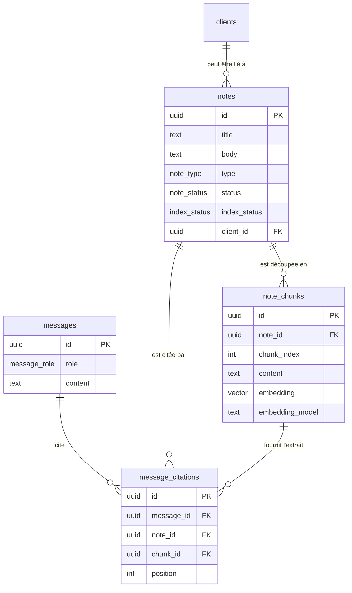
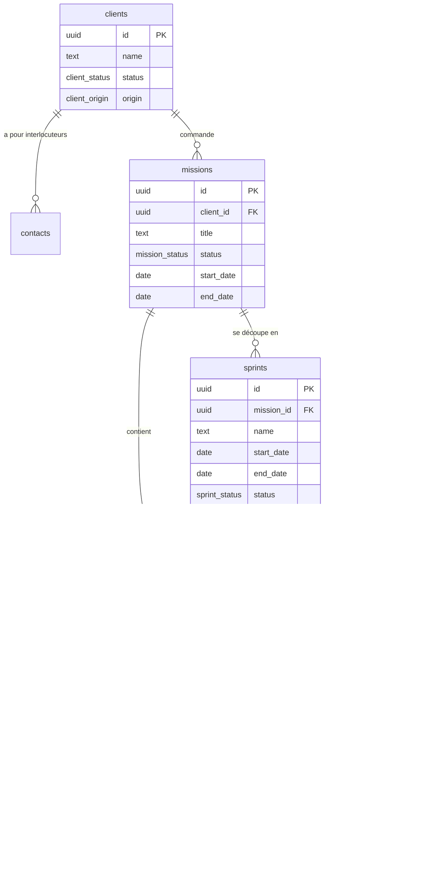
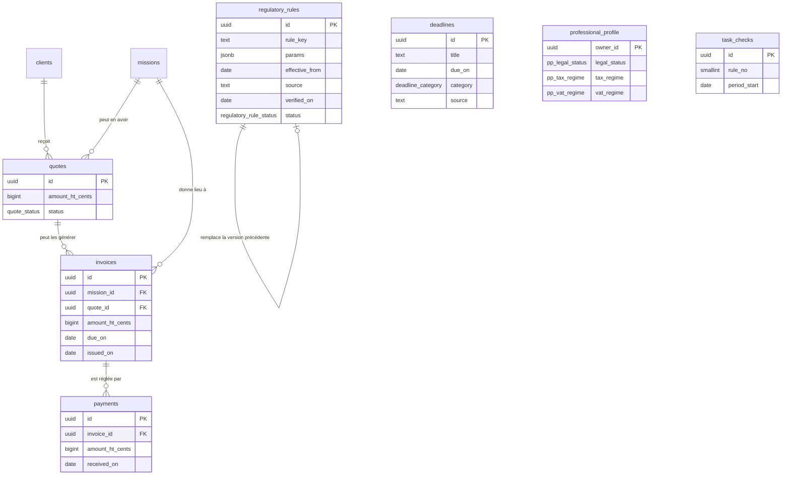
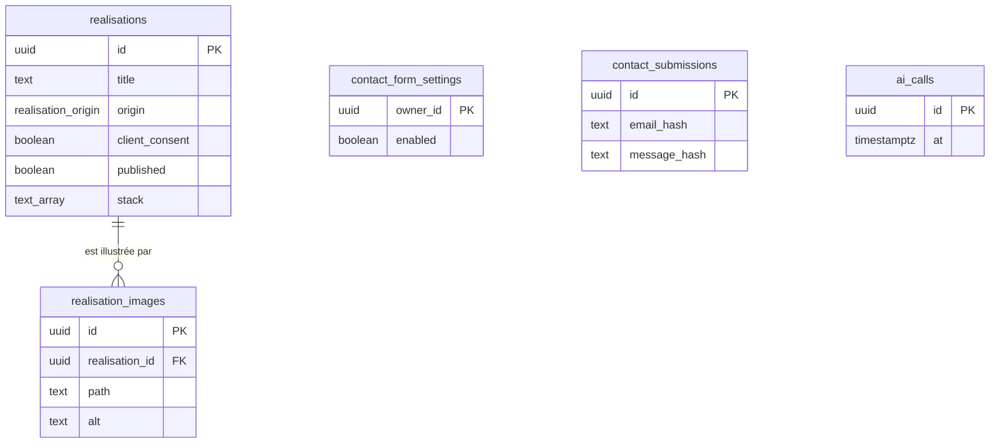

# Schéma de données

> **Ce que ce chapitre montre.** Le modèle de données de LogMerry : 22 tables dans le schéma `public`, toutes protégées par la sécurité par ligne (RLS). Il a été relu directement dans la base Supabase du projet le 4 novembre 2026, et non reconstitué de mémoire.

## Vue d'ensemble

LogMerry sépare trois mondes, qui ne se mélangent jamais.

- **Mes données de travail** : notes, clients, missions, factures, échéances. Chaque ligne appartient à un compte (`owner_id`).
- **L'assistant IA** : les extraits de mes notes, transformés en vecteurs, et l'historique des échanges avec leurs sources.
- **Ce qui est public** : les réalisations publiées avec l'accord du client et le formulaire de contact. Le public n'a accès à aucune table : seulement à deux vues en lecture et à une fonction.

Toutes les tables pointent vers `auth.users`, la table des comptes gérée par Supabase Auth. C'est ce lien qui rend possible l'isolation entre comptes.

| Domaine | Tables | Rôle |
|---|---|---|
| Connaissances et assistant | `notes`, `note_chunks`, `messages`, `message_citations` | Base de connaissances interrogeable par l'IA, historique et citations |
| Clients et missions agiles | `clients`, `contacts`, `missions`, `sprints`, `user_stories`, `tasks` | CRM léger et pilotage des missions en agile |
| Finances et échéances | `quotes`, `invoices`, `payments`, `deadlines`, `task_checks`, `regulatory_rules`, `professional_profile` | Suivi des devis, factures, encaissements, obligations administratives |
| Portfolio, contact, technique | `realisations`, `realisation_images`, `contact_form_settings`, `contact_submissions`, `ai_calls` | Vitrine publique, formulaire de contact, quota d'appels à l'IA |

## Modèle conceptuel (MCD)

Chaque diagramme montre les liens entre les tables d'un domaine. Le lien vers `auth.users` (le propriétaire) existe sur toutes les tables et n'est pas redessiné à chaque fois.

### Connaissances et assistant

### Clients et missions agiles

### Finances et échéances

### Portfolio public, contact et technique

## Dictionnaire de données

Les colonnes communes ne sont pas répétées : `id` (identifiant unique généré), `owner_id` (propriétaire, valeur par défaut `auth.uid()`), `created_at` et `updated_at`.

### Connaissances et assistant

| Table | Rôle | Colonnes principales | Règles d'intégrité |
|---|---|---|---|
| `notes` | Une note de la base de connaissances | `title`, `body`, `type` (note, procédure, modèle, FAQ), `status` (brouillon, active), `index_status` (en attente, indexée, échec), `client_id` (facultatif), `search` (index plein texte français généré) | Titre de 1 à 200 caractères, texte de 50 000 caractères au plus ; le client lié doit appartenir au même propriétaire |
| `note_chunks` | Un extrait d'une note, avec son vecteur | `note_id`, `chunk_index`, `content`, `embedding` (vecteur), `embedding_model` | Index positif, contenu non vide, modèle d'embeddings obligatoire |
| `messages` | Un message de l'historique du chat | `role` (utilisateur, assistant), `content` | De 1 à 20 000 caractères |
| `message_citations` | Les sources d'une réponse | `message_id`, `note_id`, `chunk_id`, `position` | Position positive ; supprimée avec son message ; si la note ou l'extrait cité disparaît, la citation reste, avec un lien vide |

### Clients et missions agiles

| Table | Rôle | Colonnes principales | Règles d'intégrité |
|---|---|---|---|
| `clients` | Un prospect ou un client | `name`, `status` (prospect, client), `origin` (client réel, formation, ami, démo) | Nom de 1 à 200 caractères |
| `contacts` | Un interlocuteur chez un client | `client_id`, `name`, `job_title`, `email`, `phone`, `address` | E-mail de 254 caractères au plus avec une arobase entourée de texte ; téléphone 30 caractères au plus ; adresse 500 au plus |
| `missions` | Une mission pour un client | `client_id`, `title`, `status` (prévue, en cours, terminée, annulée), `start_date`, `end_date` | Titre de 1 à 200 caractères |
| `sprints` | Un sprint d'une mission | `mission_id`, `name`, `goal`, `start_date`, `end_date`, `status` | Nom de 1 à 120 caractères ; un seul sprint actif par mission (index unique partiel) |
| `user_stories` | Une user story du backlog | `mission_id`, `sprint_id`, `source_note_id`, `title`, `role`, `benefit`, `acceptance_criteria`, `points`, `status`, `position` | Points limités à 1, 2, 3, 5, 8 ou 13 ; critères de 4 000 caractères au plus |
| `tasks` | Une tâche d'une story | `story_id`, `title`, `done`, `done_at`, `position` | Titre de 1 à 200 caractères |

### Finances et échéances

| Table | Rôle | Colonnes principales | Règles d'intégrité |
|---|---|---|---|
| `quotes` | Un devis | `client_id`, `mission_id`, `amount_ht_cents`, `tax_cents`, `status` (brouillon, envoyé, accepté, refusé) | Montants en centimes : strictement positif pour le montant, positif ou nul pour la taxe |
| `invoices` | Une facture de suivi | `mission_id`, `quote_id`, `amount_ht_cents`, `tax_cents`, `due_on`, `issued_on`, `reference` | Montant de 1 centime à 1 000 000 euros ; référence de 60 caractères au plus |
| `payments` | Un encaissement | `invoice_id`, `amount_ht_cents`, `tax_cents`, `received_on` | Mêmes bornes de montant que les factures |
| `deadlines` | Une échéance administrative | `title`, `due_on`, `category`, `priority`, `recurrence`, `series_id`, `series_day`, `source` | La source est une adresse en `https://` ; jour de série de 1 à 31 |
| `regulatory_rules` | Une règle réglementaire versionnée | `rule_key`, `activity_category`, `params` (JSON), `effective_from`, `effective_to`, `source`, `verified_on`, `revalidate_after`, `status` | Source obligatoire ; statut : à vérifier, vérifiée, essai ; une version peut pointer vers la précédente |
| `professional_profile` | Le profil professionnel (une ligne par compte) | Statut juridique, régime fiscal, TVA, ACRE, fréquence URSSAF, etc., chacun avec sa date de confirmation | Une donnée inconnue reste vide : jamais préremplie ; seuils d'alerte validés par une fonction |
| `task_checks` | Les contrôles du cockpit déjà faits | `rule_no`, `source_id`, `period_start`, `ceiling_key`, `threshold` | Numéro de règle de 1 à 8 ; seuil : 50, 75, 90 ou 100 |

### Portfolio public, contact et technique

| Table | Rôle | Colonnes principales | Règles d'intégrité |
|---|---|---|---|
| `realisations` | Une réalisation du portfolio | `title`, `description`, `origin`, `status`, `problem`, `design_choice`, `tests`, `validation`, `result_figure`, `stack`, `link_url`, `client_consent`, `published` | Champs texte de 600 caractères au plus ; adresse en `https://` ; 12 outils au plus ; visible du public seulement si publiée **et** accord du client (filtre des vues publiques) |
| `realisation_images` | Une capture d'une réalisation | `realisation_id`, `path`, `alt` | Chemin au format imposé (dossier du propriétaire), unique ; texte alternatif obligatoire |
| `contact_form_settings` | Qui reçoit les messages du formulaire | `owner_id`, `enabled` | Un seul destinataire activé à la fois (index unique partiel) |
| `contact_submissions` | Journal des envois du formulaire | `email_hash`, `message_hash` | Aucun texte de message : des empreintes seulement ; lignes de plus de 30 jours supprimées |
| `ai_calls` | Un appel à l'IA, pour le quota | `at` | Compté par une fonction (`consume_ai_quota`) |

## Règles d'intégrité transversales

- **Un propriétaire sur chaque ligne.** `owner_id` vaut `auth.uid()` par défaut et pointe vers `auth.users`. La suppression d'un compte supprime en cascade toutes ses données (vérifié sur les 22 tables).
- **Sécurité par ligne partout.** Les 22 tables ont la RLS activée. Chaque politique est réservée aux comptes connectés et relie les lignes à `auth.uid()`. Aucune politique n'est ouverte à tous. Un test automatique le vérifie à chaque modification des migrations.
- **Montants en centimes entiers.** Jamais de nombre décimal pour l'argent.
- **Textes bornés.** Chaque texte a une longueur minimale et maximale, contrôlée par la base, pas seulement par l'interface.
- **Valeurs fermées.** Les statuts et les types sont des énumérations : la base refuse toute autre valeur.
- **Rien d'inventé.** Une donnée personnelle inconnue reste vide (« À confirmer »). Les règles fiscales sont dans une table versionnée, avec source et date de vérification : aucun taux ni plafond n'est écrit dans le code.
- **Le vecteur dépend du modèle.** La dimension des vecteurs est liée au modèle d'embeddings (`mistral-embed`, 1 024 dimensions). Changer de modèle impose de tout réindexer : `embedding_model` garde la trace du modèle utilisé pour chaque extrait.
- **Le public ne touche aucune table.** Il lit deux vues (`public_realisations`, `public_realisation_images`) qui filtrent « publiée **et** accord du client », et exécute une seule fonction, `submit_contact_message`.

## Évolution du schéma

Le schéma évolue par migrations versionnées, dans le dossier `supabase/migrations/` (55 fichiers, du 13 octobre au 7 novembre 2026). Après chaque migration, les types TypeScript sont régénérés, si bien qu'un schéma qui diverge du code est détecté à la compilation.
