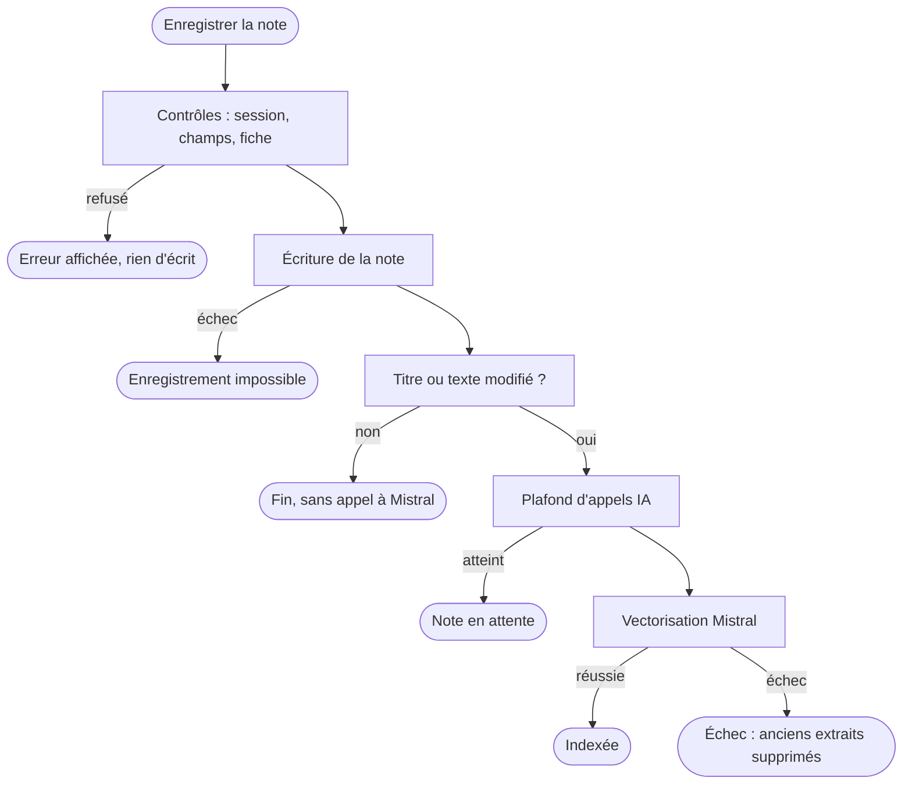
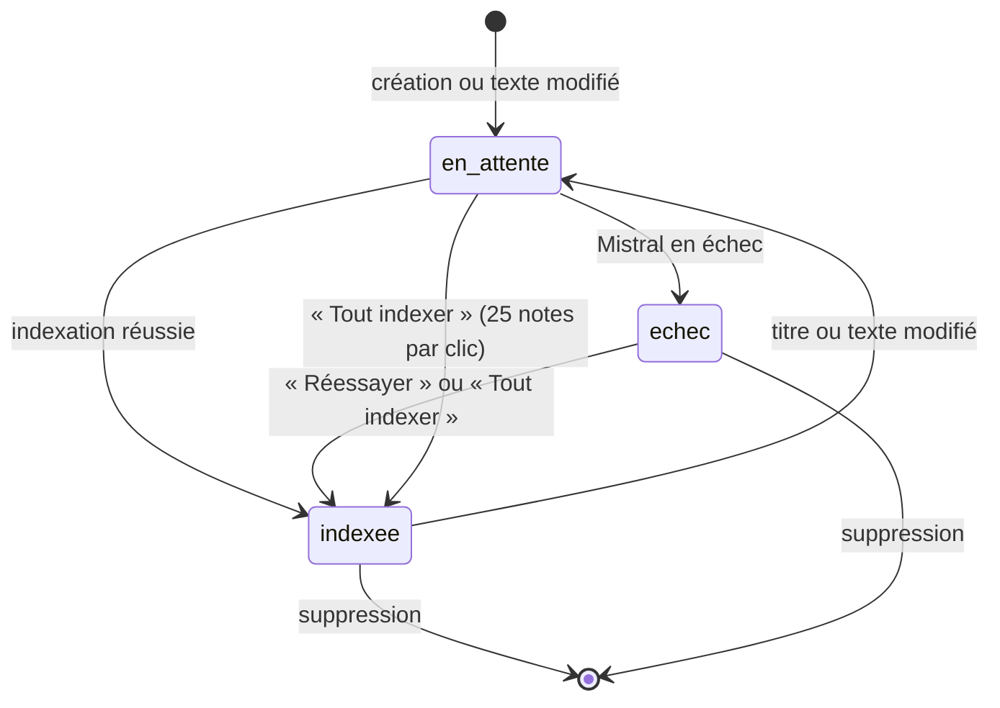
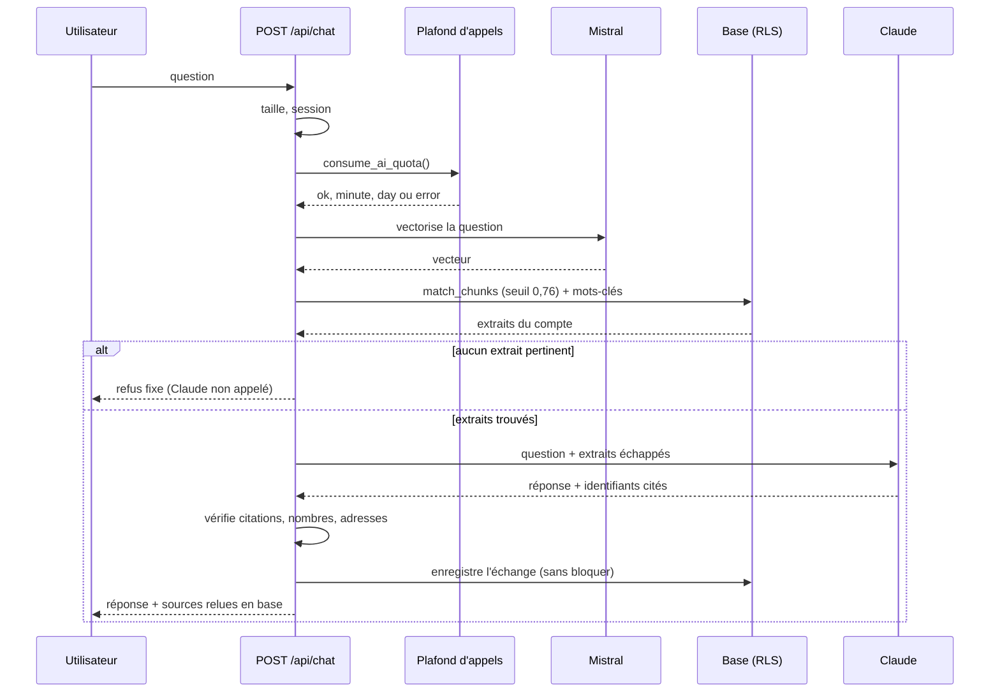
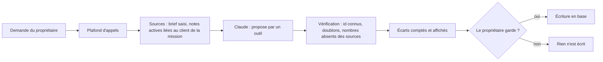

# Workflows : saisie des documents et gestion de l'IA (RAG)

> **En deux phrases.** Une note suit un chemin court : elle est **enregistrée d'abord**, puis vectorisée ; l'IA ne peut jamais empêcher l'enregistrement. Une question suit un chemin plus long, où chaque étape peut échouer sans casser le reste (refus propre, pas de réponse fausse). Aucun **MCP** n'est intégré à l'application : le MCP Supabase ne sert qu'au développement.

Faits relevés dans le code et les tests le 5 novembre 2026. Les délais annoncés sont des **délais d'attente du code** ou des **mesures** ; il n'existe aucun engagement de service (SLA) contractuel.

## Les trois workflows

| N° | Workflow | Déclencheur | Résultat |
|---|---|---|---|
| A | Saisie et indexation d'une note | Le propriétaire enregistre, modifie ou supprime une note | Note enregistrée, extraits vectorisés (ou état « échec » rattrapable) |
| B | Question à l'assistant | Le propriétaire pose une question | Réponse sourcée et vérifiée, ou refus clair ; échange enregistré |
| C | Propositions de l'IA (stories, tâches, ordre, sprint, prompt, résumé) | Le propriétaire demande une proposition | Proposition **éphémère**, rien d'écrit tant qu'elle n'est pas gardée |

## A. Saisie et indexation d'une note

**Règles.**
- Titre obligatoire, 200 caractères au plus ; texte de 50 000 caractères au plus ; type parmi note, procédure, modèle, FAQ. La base **refuse** aussi ces limites (double contrôle).
- `owner_id` est posé par la base, jamais par l'écran.
- La fiche client liée est facultative ; on peut en créer une comme **prospect** dans le même geste (deux écritures : si la note échoue, la fiche reste, supprimable).
- Une modification qui ne touche ni le titre ni le texte d'une note déjà indexée **n'appelle pas Mistral**.
- Les vecteurs sont calculés **avant** toute écriture d'extraits ; l'échec supprime les anciens extraits plutôt que de laisser un texte périmé.
- Supprimer une note supprime ses extraits (cascade) ; les citations qui la visaient deviennent vides, les réponses restent.

### États d'une note

Un second état existe, **indépendant** : `draft` (brouillon) ou `active`. Un brouillon naît de deux façons : le bouton « Créer une note à documenter plus tard » de l'assistant (titre « À documenter : … », texte vide, jamais citable) ou un message du formulaire de contact public. **Constat** : aucune action de l'application ne fait passer une note de `draft` à `active` (la modification ne change pas ce statut) ; les propositions agiles, qui n'utilisent que des notes `active`, ne verront donc pas un brouillon complété. **À confirmer avec Alex** : comportement voulu ou manque.

## B. Question à l'assistant

**Règles.**
- Deux voies de recherche : par le **sens** (vecteurs, seuil 0,76, 8 extraits au plus) et par **mots-clés** (5 au plus) ; les extraits trouvés par les deux sont fusionnés sans doublon.
- Sans extrait pertinent : message fixe « Je n'ai trouvé aucune procédure documentée correspondant à cette requête », **sans appel à Claude**, avec l'offre de créer une note à documenter.
- Claude ne renvoie que des **identifiants** de sources ; le texte des sources est relu en base.
- La réponse est vérifiée (citations envoyées, nombres, adresses) **avant** l'affichage ; sinon rejet.
- Une réponse sans citation s'affiche avec « Aucune de tes notes ne soutient cette réponse ».
- L'enregistrement de l'historique **ne bloque jamais** la réponse.

### Exceptions

| Situation | Ce que voit l'utilisateur | Statut |
|---|---|---|
| Pas de session (session expirée) | « Ta session a expiré. Recharge la page pour te reconnecter. » | 401 |
| Question vide | « Écris une question. » | 400 |
| Question ou corps trop longs | « Question trop longue. » | 413 |
| Plafond atteint (20 par minute, 300 par jour) | Message dédié, réessayer plus tard | 429 |
| Compteur de plafond indisponible | « Le compteur d'appels à l'IA est indisponible. » (on bloque plutôt que de laisser passer) | 503 |
| Mistral ou Claude en échec ou en délai (20 s, 60 s) | « L'assistant n'a pas pu répondre pour le moment. » | 502 |
| Réponse rejetée par la vérification | « La réponse n'a pas pu être vérifiée par rapport à tes notes, elle n'est pas affichée. Réessaie. » | 502 |
| Échec de l'enregistrement de l'historique | Rien : la réponse s'affiche ; journal sans contenu | 200 |

## C. Propositions de l'IA

Propositions : user stories (avec tâches si demandé), tâches d'une story, ordre du backlog, composition d'un sprint, relecture d'une story, prompt de mission, résumé d'une note. Règles communes : **éphémères** tant que le propriétaire ne les garde pas ; seules les notes **actives liées à la fiche du client de la mission** sont envoyées ; un chiffre absent des sources fait écarter la proposition (ou sa raison) ; texte fourni traité comme **donnée**. Détail au chapitre 9.

## Événements qui déclenchent un traitement

| Événement | Traitement | Synchrone ? |
|---|---|---|
| Note enregistrée ou modifiée | Indexation (workflow A) | **Oui** : l'enregistrement attend la fin de l'indexation avant de rendre la main |
| Clic sur « Réessayer » ou « Tout indexer » | Indexation de la note, ou de 25 notes au plus par clic | Oui |
| Question posée | Workflow B | Oui, sans flux : la réponse arrive en une fois |
| « Vider la conversation » | Suppression de tout l'historique du compte | Oui |
| Message du formulaire de contact | Note en brouillon chez le destinataire (non indexée tant qu'on ne relance pas l'indexation) | Oui |

Il n'existe **aucune tâche planifiée ni file d'attente** dans l'application : tout se passe à la demande. Rappels et résumé hebdomadaire (n8n) sont hors du MVP.

## Délais et niveaux de service (SLA)

| Mesure | Valeur | Nature |
|---|---|---|
| Réponse de l'assistant | Environ 3,4 s en moyenne ; 6 à 7 s pour la plus lente des 20 questions | **Mesurée** sur deux exécutions du 4 novembre 2026 (chapitre 7) : ordre de grandeur, pas une garantie |
| Délai maximal d'un appel à Claude | 60 s | Réglage du code |
| Délai maximal d'un appel à Mistral | 20 s par lot de 16 textes | Réglage du code |
| Plafond d'appels à l'IA | 20 par minute, 300 par jour, par compte | Règle de la base |
| Disponibilité de l'application | Aucun engagement ; offre gratuite de Supabase, pause possible après une semaine d'inactivité | Voir chapitre 12 |
| Temps d'indexation d'une note | **À confirmer** : non mesuré (un appel Mistral, au plus 20 s) | — |

## MCP : ce qu'il en est

Aucun serveur MCP n'est intégré à LogMerry : pas de fichier `.mcp.json`, pas de dépendance, aucun appel dans le code de l'application. Le **MCP Supabase** est utilisé **uniquement pendant le développement** (migrations, types, lecture de la base, avis de sécurité), en lecture seule hors modification du schéma, avec approbation manuelle des appels. Si un MCP était un jour intégré à l'application, il faudrait décrire ici ses droits et ses flux.

## Limites et suite

| Limite | Conséquence | Piste |
|---|---|---|
| Indexation synchrone dans l'enregistrement | Enregistrer une note peut durer jusqu'à 20 s si Mistral est lent | Indexer en arrière-plan (file d'attente), si l'usage le justifie |
| Pas de nouvelle tentative automatique | Une panne brève se voit tout de suite | Une reprise unique avec attente |
| Aucun passage de `draft` à `active` | Un brouillon complété n'alimente pas les propositions agiles | À trancher avec Alex |
| Pas de flux de réponse | L'utilisateur attend la réponse complète | Flux (streaming), après le MVP |
