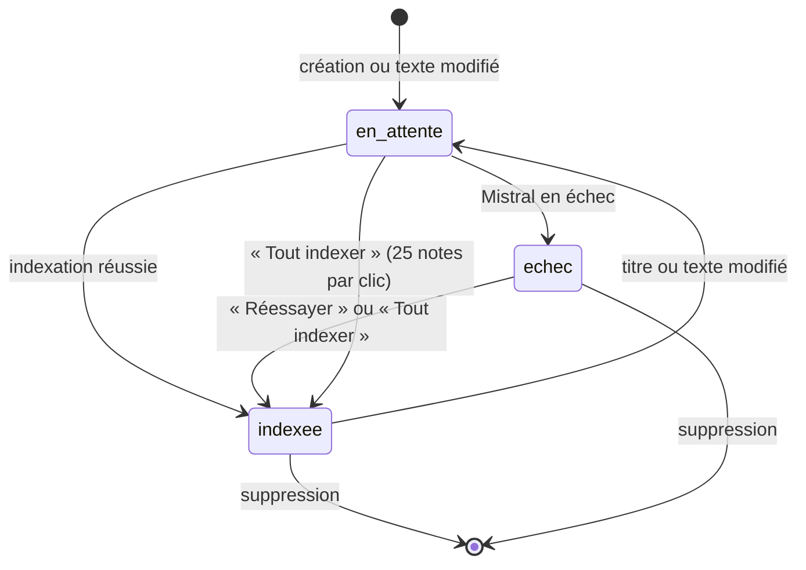
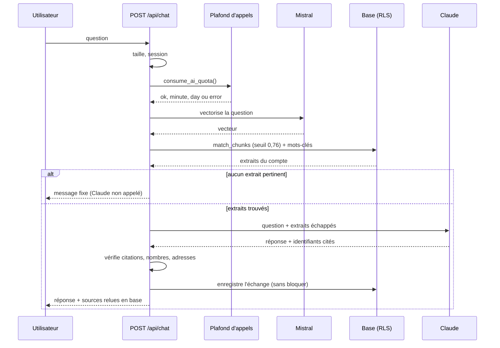
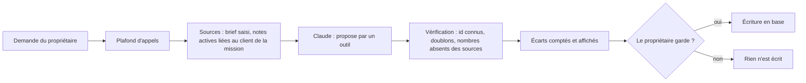
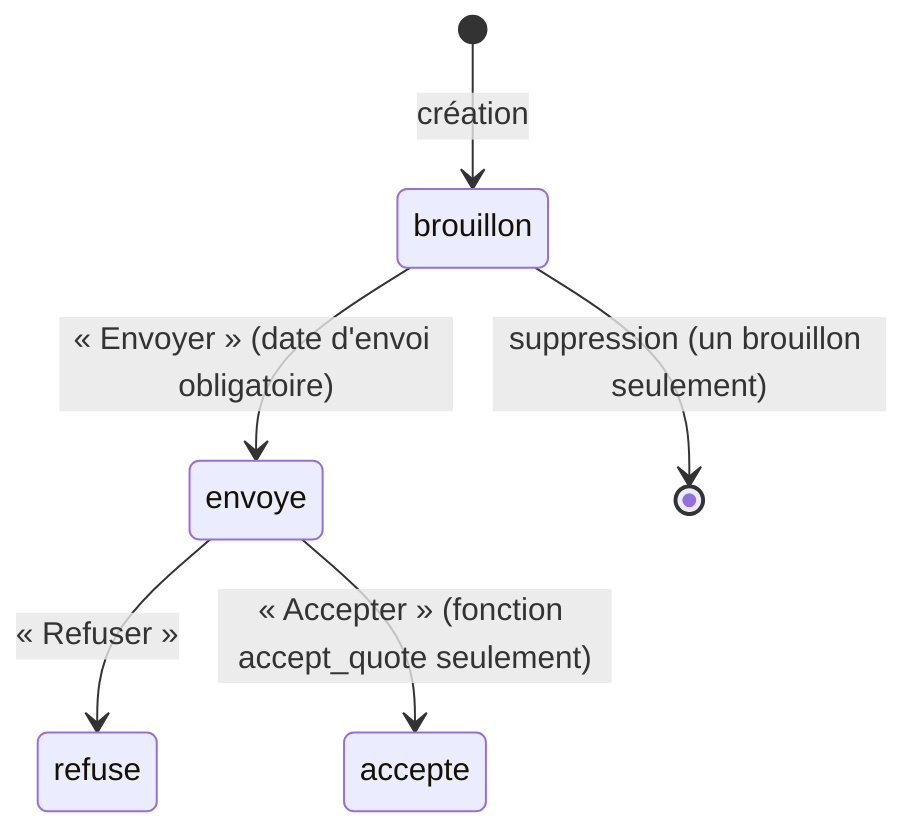
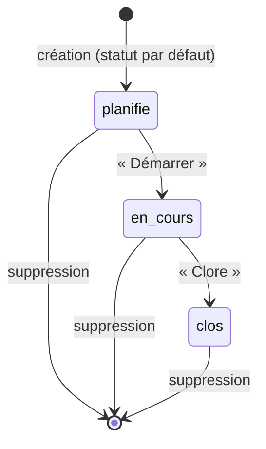
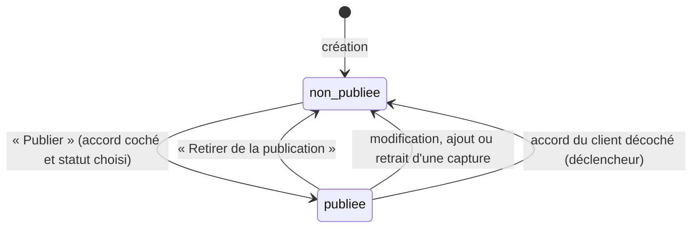

# Workflows : saisie des documents et gestion de l'IA (RAG)

> **En deux phrases.** Une note suit un chemin court : elle est **enregistrée d'abord**, puis vectorisée ; l'IA ne peut jamais empêcher l'enregistrement. Une question suit un chemin plus long, où chaque étape peut échouer sans casser le reste (message d'erreur explicite). Aucun **MCP** n'est intégré à l'application : le MCP Supabase ne sert qu'au développement.

Faits relevés dans le code et les tests le 5 novembre 2026. Les délais annoncés sont des **délais d'attente du code** ou des **mesures** ; il n'existe aucun engagement de service (SLA) contractuel.

## Les trois workflows

| N° | Workflow | Déclencheur | Résultat |
|---|---|---|---|
| A | Saisie et indexation d'une note | Le propriétaire enregistre, modifie ou supprime une note | Note enregistrée, extraits vectorisés (ou état « échec » rattrapable) |
| B | Question à l'assistant | Le propriétaire pose une question | Réponse sourcée et vérifiée, message fixe sans appel à Claude, ou réponse prudente accompagnée d'un avertissement ; échange enregistré |
| C | Propositions de l'IA (stories, tâches, ordre, sprint, prompt, résumé) | Le propriétaire demande une proposition | Proposition **éphémère**, rien d'écrit tant qu'elle n'est pas gardée |

## A. Saisie et indexation d'une note

**Règles.**
- Titre obligatoire, 200 caractères au plus ; texte de 50 000 caractères au plus ; type parmi note, procédure, modèle, FAQ. La base **refuse** aussi ces limites (double contrôle).
- `owner_id` est posé par la base, jamais par l'écran.
- La fiche client liée est facultative ; on peut en créer une comme **prospect** dans le même geste (deux écritures : si la note échoue, la fiche reste, supprimable).
- Une modification qui ne touche ni le titre ni le texte d'une note déjà indexée **n'appelle pas Mistral**.
- Les vecteurs sont calculés **avant** toute écriture d'extraits ; l'échec supprime les anciens extraits plutôt que de laisser un texte périmé.
- Supprimer une note supprime ses extraits (cascade) ; les citations qui la visaient deviennent vides, les réponses restent.

### États d'une note

Un second état existe, **indépendant** : `draft` (brouillon) ou `active`. Un brouillon naît de deux façons : le bouton « Créer une note à documenter plus tard » de l'assistant (titre « À documenter : … », texte vide, jamais citable) ou un message du formulaire de contact public. **Constat** : aucune action de l'application ne fait passer une note de `draft` à `active` (la modification ne change pas ce statut) ; les propositions agiles, qui n'utilisent que des notes `active`, ne verront donc pas un brouillon complété. **Décision du 10 novembre 2026** : limite connue, non corrigée avant la soutenance.

## B. Question à l'assistant

**Règles.**
- Deux voies de recherche : par le **sens** (vecteurs, seuil 0,76, 8 extraits au plus) et par **mots-clés** (5 au plus) ; les extraits trouvés par les deux sont fusionnés sans doublon.
- Sans extrait pertinent : message fixe « Je n'ai trouvé aucune procédure documentée correspondant à cette requête », **sans appel à Claude**, avec l'offre de créer une note à documenter.
- Claude ne renvoie que des **identifiants** de sources ; le texte des sources est relu en base.
- La réponse est vérifiée (citations envoyées, nombres, adresses) **avant** l'affichage ; sinon rejet.
- **Deux comportements à ne pas confondre quand la réponse n'est pas dans les notes.** (1) **Aucun extrait n'est retrouvé** (ni par le sens, avec un seuil de similarité de 0,76 : `MATCH_THRESHOLD` dans `lib/domain/matching.ts`, ni par mots-clés) : la fonction `answerQuestion` de `lib/domain/chat-flow.ts` renvoie le message fixe « Je n'ai trouvé aucune procédure documentée correspondant à cette requête. » **avant** d'appeler Claude. **Statut : lu dans le code et vérifié par un test unitaire local** (`chat-flow.test.ts`, dépendances simulées). **Non observé sur la production** : ce message figurait dans l'historique de la production pour deux questions plus anciennes (relevé le 9 novembre 2026, lecture seule), mais l'absence d'appel à Claude n'a pas pu y être constatée. (2) **Des extraits sont retrouvés, mais ils ne contiennent pas l'information** : Claude est appelé (**déduit du contenu de la réponse, qui rappelle des faits de la note ; l'appel n'a pas été observé directement**) et répond avec prudence (la note ne contient pas l'information, parfois en rappelant un fait voisin), puis le code ajoute « Aucune de tes notes ne soutient cette réponse » avec l'offre de créer une note à documenter. **Statut : observé sur la production le 9 novembre 2026** (deux questions, une exécution chacune) et lu dans le code (`showsNoSourceNotice`). **Le cas (2) n'est pas un refus à phrase fixe** : c'est une limite connue, avec une amélioration possible (refuser plutôt que répondre quand aucune source n'est citée), **non réalisée** (périmètre gelé). Détail au chapitre 7.
- L'enregistrement de l'historique **ne bloque jamais** la réponse.

### Exceptions

| Situation | Ce que voit l'utilisateur | Statut |
|---|---|---|
| Pas de session (session expirée) | « Ta session a expiré. Recharge la page pour te reconnecter. » | 401 |
| Question vide | « Écris une question. » | 400 |
| Question ou corps trop longs | « Question trop longue. » | 413 |
| Plafond atteint (20 par minute, 300 par jour) | Message dédié, réessayer plus tard | 429 |
| Compteur de plafond indisponible | « Le compteur d'appels à l'IA est indisponible. » (on bloque plutôt que de laisser passer) | 503 |
| Mistral ou Claude en échec ou en délai (20 s, 60 s) | « L'assistant n'a pas pu répondre pour le moment. » | 502 |
| Réponse rejetée par la vérification | « La réponse n'a pas pu être vérifiée par rapport à tes notes, elle n'est pas affichée. Réessaie. » | 502 |
| Échec de l'enregistrement de l'historique | Rien : la réponse s'affiche ; journal sans contenu | 200 |

## C. Propositions de l'IA

Propositions : user stories (avec tâches si demandé), tâches d'une story, ordre du backlog, composition d'un sprint, relecture d'une story, prompt de mission, résumé d'une note. Règles communes : **éphémères** tant que le propriétaire ne les garde pas ; seules les notes **actives liées à la fiche du client de la mission** sont envoyées ; un chiffre absent des sources fait écarter la proposition (ou sa raison) ; texte fourni traité comme **donnée**. Détail au chapitre 9.

## Workflows métier existants

Cette section décrit, d'après le code et les migrations relus le 10 novembre 2026, les états des entités métier qui existent réellement. Elle ne décrit rien qui n'existe pas (voir « Ce qui n'existe pas » en fin de section). **Rendu des diagrammes non contrôlé** : aucun outil de rendu n'a été lancé pour cette section ; la syntaxe suit celle des diagrammes ci-dessus.

### Devis

- Statuts : `supabase/migrations/20261018100100_quotes.sql:2` ; libellés `lib/domain/quotes.ts:5-7`. Dès que le statut n'est plus « brouillon », la date d'envoi est obligatoire (`quotes.sql:16`).
- La base impose les transitions : brouillon vers envoyé, envoyé vers refusé, envoyé vers accepté **seulement** quand `accept_quote` a posé le réglage `app.accepting_quote` (`quotes.sql:48-66`) ; un devis accepté ou refusé est figé (`quotes.sql:54-56`) ; déclencheur `quotes_guard` (`quotes.sql:68-69`). Seul un brouillon se supprime (règle d'accès `quotes.sql:44-46`).
- Ce que l'interface permet selon le statut : modifier un brouillon ou un devis envoyé, envoyer un brouillon, refuser ou accepter un devis envoyé, supprimer un brouillon (`lib/domain/quotes.ts:10-14`). Actions : `sendQuote` (`app/(app)/clients/quote-actions.ts:97-101`), `refuseQuote` (`:105-106`), `acceptQuote` (`:110-113`, appelle `accept_quote`), `deleteQuote` (`:129-132`).
- `accept_quote` (version en vigueur : `supabase/migrations/20261029210000_accept_quote_title.sql:4-33`, qui remplace celle de `quotes.sql:73-102` pour le seul titre de la mission) : un devis déjà accepté renvoie sa mission sans rien créer (`:15`) ; un devis qui n'est pas « envoyé » est refusé (`:16`) ; si le devis n'est lié à aucune mission (`:20`), la fiche passe de prospect à client (`:22-24`) et une mission au statut « planned » est créée, titrée « {nom du client} — devis du JJ/MM/AAAA » (`:25-27`) ; le devis devient accepté et pointe vers la mission (`:29`). L'acceptation est faite « en une action, tout ou rien » (`quotes.sql:71`).

### Sprint

Lecture préalable des actions : `app/(app)/missions/sprint-actions.ts` (`startSprint` `:93-117`, `closeSprint` `:124-160`, `deleteSprint` `:163-187`).

- Statuts : `supabase/migrations/20261017120000_sprints.sql:2` ; statut par défaut « planned » (`:12`) ; libellés `lib/domain/sprints.ts:7-9`. À la création, l'action n'écrit pas le statut (`sprint-actions.ts:65`).
- **Démarrer** : `startSprint` ne change que les sprints « planned » (`sprint-actions.ts:96`). **Un seul sprint en cours par mission** : index unique `sprints_one_active_per_mission` (`sprints.sql:20-21`) ; son refus (code 23505) donne « Un sprint est déjà en cours » (`sprint-actions.ts:97,113`). Dans un second temps, une mission « planned » passe à « in_progress » (`:101`) ; l'échec de cette seconde écriture ne défait pas le démarrage (`:99-104`).
- **Clore** : seulement un sprint « active » (`sprint-actions.ts:130`). Les stories non terminées sont déplacées **avant** le changement d'état, vers le backlog ou vers un sprint « planned » de la même mission (`:133-148`, contrôle de la cible `:139`) ; en cas d'échec le sprint reste en cours (`:119-122`). Puis le statut passe à « closed » (`:149`).
- **Sprint clos** : seuls le nom et l'objectif se modifient (`sprint-actions.ts:85`) ; son contenu est figé **en base** par le déclencheur `user_stories_guard_closed_sprint`, qui refuse l'entrée comme la sortie d'une story (`supabase/migrations/20261017150000_user_stories_closed_sprint_guard.sql:5-23`).
- **Suppression** : `deleteSprint` ne vérifie aucun statut (`sprint-actions.ts:163-187`) ; les stories retournent au backlog (`:162,166-177`).
- Dans le code de l'application (`app/`), seules deux actions écrivent le statut d'un sprint : `startSprint` (`:96`) et `closeSprint` (`:149`) ; la création laisse le statut par défaut et `updateSprint` n'envoie jamais le statut (`:85-86`). Les scripts de données de démonstration, eux, insèrent des sprints avec un statut choisi (`scripts/seed-demo-backlog.ts:199`, `scripts/seed-demo-to-invoice.ts:51`).

### Mission : valeurs de statut seulement

**Statut libre, aucune transition imposée.**

- Valeurs : `in_progress`, `done`, `cancelled` (`supabase/migrations/20261015162137_missions.sql:2`) et `planned` (`supabase/migrations/20261018100000_mission_status_planned.sql:3`) ; libellés « À planifier », « En cours », « Terminée », « Annulée » (`lib/domain/missions.ts:6-9`). Valeur par défaut en base : « in_progress » (`missions.sql:9`).
- Aucun déclencheur ne contrôle le statut : seul `missions_set_updated_at` existe (`missions.sql:20`). Le formulaire écrit le statut choisi (`app/(app)/missions/actions.ts:83-89`, validation `lib/domain/missions.ts:42`).
- **Deux écritures automatiques existent pourtant** : l'acceptation d'un devis crée une mission « planned » (`supabase/migrations/20261029210000_accept_quote_title.sql:25-27`), et le démarrage d'un sprint fait passer une mission « planned » à « in_progress » (`sprint-actions.ts:101`). Elles ne sont pas des transitions imposées : le statut reste modifiable à la main.

### Facture : un statut calculé, pas une machine d'états stockée

- La table `invoices` n'a aucune colonne de statut (`lib/supabase/database.types.ts:197`, et dictionnaire du chapitre 1). Le statut est **déduit des encaissements** par `invoiceBalance` (`lib/domain/payments.ts:77-91`) : sans encaissement, « Non payée » ; total encaissé au moins égal au dû, « Payée » ; sinon « Partiellement payée » (`:81`). Le dû est calculé toutes taxes comprises si la taxe de la facture est connue, hors taxe sinon (`:78-80`). Libellés `:52-54`.
- **Échue** : pas totalement payée et échéance strictement avant aujourd'hui (`lib/domain/invoices.ts:73-74`). C'est une règle de date, pas un état stocké.
- Garde des encaissements : `payments_guard` (`supabase/migrations/20261023110000_payments.sql:43-67`) : un encaissement ne change ni de facture ni de propriétaire (`:50-57`), sa date n'est jamais dans le futur, jour de Paris (`:58-61`) ; un encaissement est toujours supprimable (`:39-41`). Un trop-perçu déclenche un avertissement, rien ne le bloque (`lib/domain/payments.ts:93-95`).

### Réalisation du portfolio

- Publier exige l'accord du client et un statut : `setRealisationPublication` (`app/(app)/realisations/actions.ts:90-110`, filtre `:102`) ; la base refuse de toute façon une publication sans accord (contrainte `realisations_publish_needs_consent`, `supabase/migrations/20261030130000_realisations.sql:21-22`).
- Retirer l'accord d'une réalisation publiée la **dépublie d'office** (`supabase/migrations/20261030160000_realisations_unpublish_on_consent_removed.sql:8-10`) ; la date de publication est posée à la publication et effacée à la dépublication (`:11-15`).
- Toute modification enregistre la réalisation non publiée (`realisations/actions.ts:79-80`), de même que l'ajout ou le retrait d'une capture (`:164`, `:193`) : il faut republier ensuite.
- La page publique ne montre que les réalisations publiées, avec accord et un statut (`supabase/migrations/20261106100000_realisation_design_choice.sql:34`).

### Ce qui n'existe pas

- **Aucune machine d'états de facture stockée** : le statut est calculé (voir ci-dessus).
- **Aucune transition imposée pour une mission** : statut libre (voir ci-dessus).
- **Aucune transition imposée pour une story** : son statut (« todo », « in_progress », « done » : `lib/domain/user-stories.ts:6`) change librement par le menu de statut (`app/(app)/missions/story-actions.ts:167-176`) ou le formulaire (`:153-163`). Seule protection : le contenu d'un sprint clos est figé (`20261017150000_user_stories_closed_sprint_guard.sql:5-23`).
- **Aucun garde-fou contre la suppression d'un sprint, y compris en cours** : ni côté serveur (`app/(app)/missions/sprint-actions.ts:163-187` ne contrôle aucun statut), ni côté interface (le bouton « Supprimer » est affiché quel que soit le statut : `components/sprint-block.tsx:146-148` ; seule une confirmation « Supprimer ce sprint ? C'est définitif. » est demandée : `:195-208`), ni dans les migrations du dépôt (la politique `sprints_delete` ne contrôle que le propriétaire : `supabase/migrations/20261017120000_sprints.sql:42-43` ; le seul déclencheur posé sur `sprints` est `sprints_set_updated_at`, avant mise à jour, `:23-24`, et la garde `user_stories_guard_closed_sprint` porte sur les stories, pas sur la suppression d'un sprint : `20261017150000_user_stories_closed_sprint_guard.sql:3-4`, `:21-22`). Relevé fait sur les 56 fichiers de `supabase/migrations/` le 12 novembre 2026 ; la base déployée n'a pas été interrogée : **non vérifié** pour elle. Les stories d'un sprint supprimé retournent au backlog (`sprints.sql:45-46`).
- **Aucune réouverture d'un sprint clos** : aucune écriture ne remet un sprint à « planned » ou « active » (voir « Sprint »).
- Un devis accepté ou refusé ne peut plus changer (`quotes.sql:54-56`).

## Événements qui déclenchent un traitement

| Événement | Traitement | Synchrone ? |
|---|---|---|
| Note enregistrée ou modifiée | Indexation (workflow A) | **Oui** : l'enregistrement attend la fin de l'indexation avant de rendre la main |
| Clic sur « Réessayer » ou « Tout indexer » | Indexation de la note, ou de 25 notes au plus par clic | Oui |
| Question posée | Workflow B | Oui, sans flux : la réponse arrive en une fois |
| « Vider la conversation » | Suppression de tout l'historique du compte | Oui |
| Message du formulaire de contact | Note en brouillon chez le destinataire, **jamais indexée** : ni « Tout indexer » (`lib/domain/index-batch.ts:10`), ni l'enregistrement, ni « Réessayer » (`lib/domain/index-note.ts:24`, état « skipped ») n'envoient le message à Mistral ; repère : le titre « Message reçu · » (`lib/domain/contact-message.ts:8`, `:13`) ; correction déployée le 12 novembre 2026 (n° 103) | Oui |

Il n'existe **aucune tâche planifiée ni file d'attente** dans l'application : tout se passe à la demande. Rappels et résumé hebdomadaire (n8n) sont hors du MVP.

## Délais et niveaux de service (SLA)

| Mesure | Valeur | Nature |
|---|---|---|
| Réponse de l'assistant | Environ 3,4 s en moyenne ; 6 à 7 s pour la plus lente des 20 questions | **Mesurée** sur deux exécutions du 4 novembre 2026 (chapitre 7) : ordre de grandeur, pas une garantie |
| Délai maximal d'un appel à Claude | 60 s | Réglage du code |
| Délai maximal d'un appel à Mistral | 20 s par lot de 16 textes | Réglage du code |
| Plafond d'appels à l'IA | 20 par minute, 300 par jour, par compte | Règle de la base |
| Disponibilité de l'application | Aucun engagement ; offre gratuite de Supabase, pause possible après une semaine d'inactivité | Voir chapitre 12 |
| Temps d'indexation d'une note | **À confirmer** : non mesuré (un appel Mistral, au plus 20 s) | — |

## MCP : ce qu'il en est

Aucun serveur MCP n'est intégré à LogMerry : pas de fichier `.mcp.json`, pas de dépendance, aucun appel dans le code de l'application. Le **MCP Supabase** est utilisé **uniquement pendant le développement** (migrations, types, lecture de la base, avis de sécurité), en lecture seule hors modification du schéma, avec approbation manuelle des appels. Si un MCP était un jour intégré à l'application, il faudrait décrire ici ses droits et ses flux.

## Limites et suite

| Limite | Conséquence | Piste |
|---|---|---|
| Indexation synchrone dans l'enregistrement | Enregistrer une note peut durer jusqu'à 20 s si Mistral est lent | Indexer en arrière-plan (file d'attente), si l'usage le justifie |
| Pas de nouvelle tentative automatique | Une panne brève se voit tout de suite | Une reprise unique avec attente |
| Aucun passage de `draft` à `active` | Un brouillon complété n'alimente pas les propositions agiles | Limite connue (décision du 10 novembre 2026) |
| Hors corpus avec des extraits retrouvés : réponse prudente et avertissement, pas un refus sec (observé sur la production) | Un fait voisin peut être rappelé ; la réponse reste signalée comme non soutenue par les notes | Refuser plutôt que répondre quand aucune source n'est citée (non fait : périmètre gelé) |
| Pas de flux de réponse | L'utilisateur attend la réponse complète | Flux (streaming), après le MVP |
