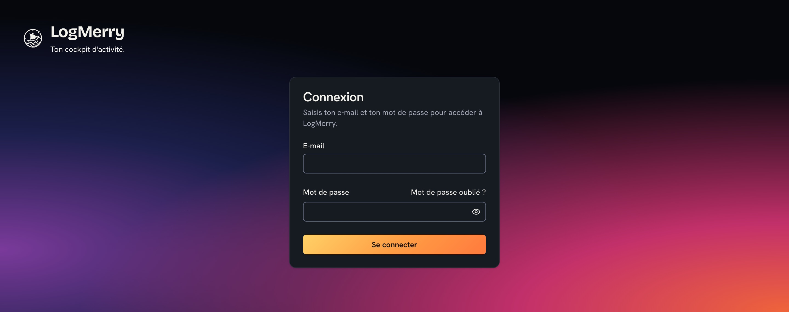
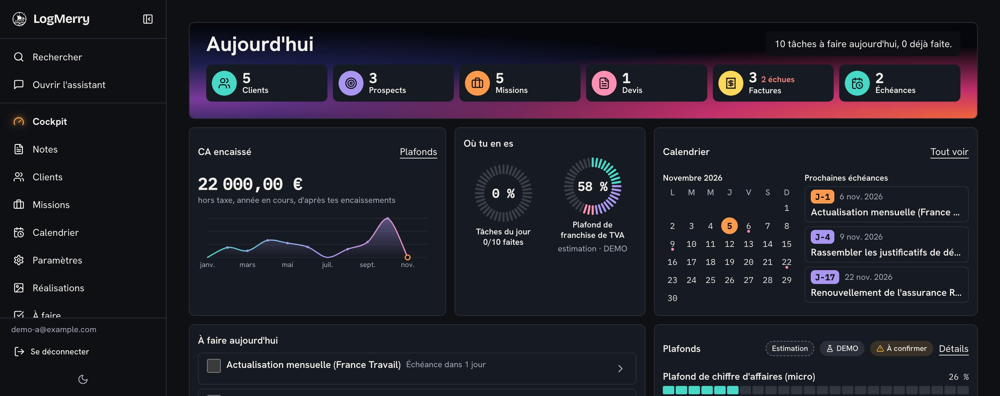
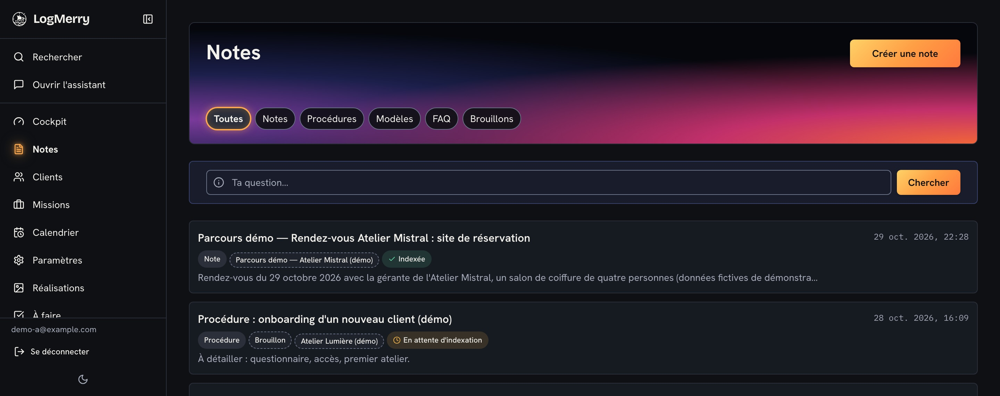
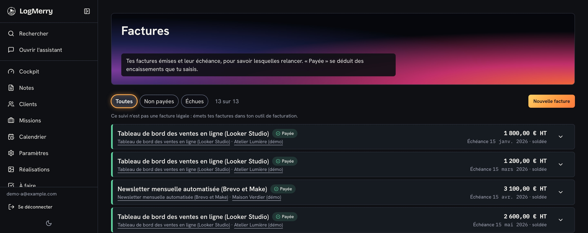
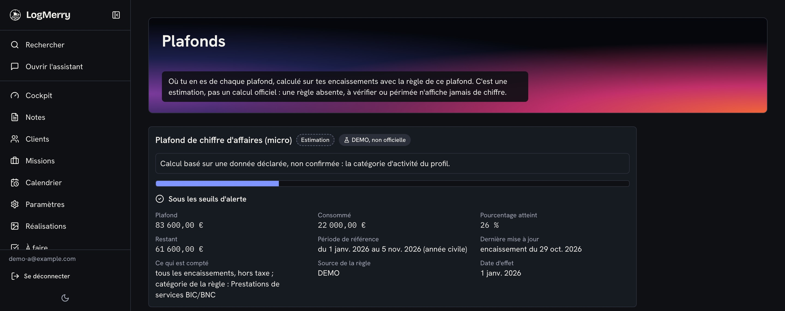
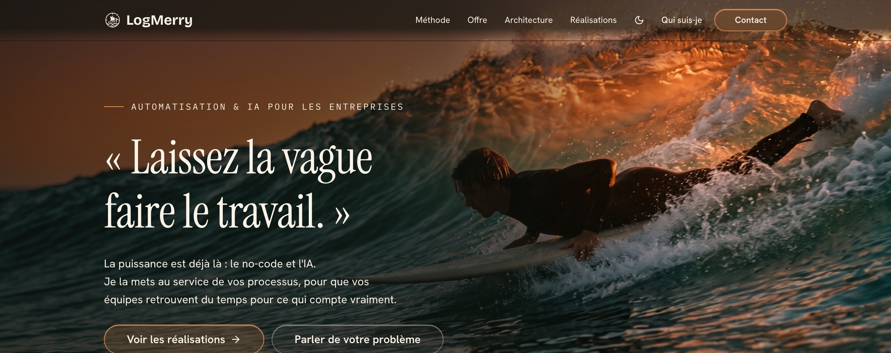

# UX, maquettes et système de design

> **En deux phrases.** LogMerry est pensé **ordinateur d'abord**, en français, avec une barre latérale, un assistant qui s'ouvre depuis toute page et un cockpit « Aujourd'hui » pour premier écran de travail. L'interface obéit à un **système de jetons** (aucune couleur ou police écrite en dur) et à un **plancher d'accessibilité** WCAG 2.1 AA, mesuré le 29 octobre 2026 : Lighthouse accessibilité à 100 sur les cinq pages testées, avec des limites de méthode écrites plus bas.

Sources : `DESIGN.md` (aspect, statut « final », mis à jour le 18 octobre 2026), `EXPERIENCE.md` (comportement), `docs/ui-rules.md` (contrat court), `docs/audit-accessibilite.md` (audit du 29 octobre 2026), `docs/ux-resume.md`. Quand ces documents divergent, `DESIGN.md` et `EXPERIENCE.md` font foi.

## Principes

| Principe | Traduction dans l'interface |
|---|---|
| Un cockpit, pas un tableau de bord chargé | « Aujourd'hui » liste les tâches du jour **avec leur motif** (« facture échue depuis 1 jour ») ; cocher une tâche réordonne la liste |
| Un assistant toujours à portée | Panneau ouvrable depuis toute page, réponse d'abord en 2 ou 3 puces, sources dessous, « Copier le texte » et « Ouvrir » la note complète |
| Dire quand on ne sait pas | Refus clair de l'assistant, « paramètre manquant » plutôt qu'un chiffre douteux, « À confirmer » pour une donnée inconnue |
| Jamais la couleur seule | Un statut = une icône + un mot + sa couleur |
| Aucun montant calculé sans étiquette | Tout montant calculé porte « estimation » |
| Sobre et net | Grille nette, fort contraste, traits marine de 2 px et ombre dure en thème clair |

## Architecture de l'information

Barre latérale fixe à gauche (repliable en icônes), le cockpit en première entrée, assistant en panneau poussé à droite (décision d'Alex, déclarée ; non revérifiée dans cette version).

| Surface | Rôle |
|---|---|
| Connexion, mot de passe oublié | Accès sécurisé (pas d'inscription : voir ci-dessous) |
| **Aujourd'hui** | Tâches du jour avec motif, jauges de plafond, lignes « paramètre manquant » |
| **Assistant** + historique | Question, réponse citée, échanges conservés |
| **Notes** | Base de connaissances, recherche (mots et sens), résumé généré |
| **Clients** (prospects, contacts, devis) | CRM minimal |
| **Missions** | Backlog agile (stories, tâches, sprints), glisser-déposer, propositions de l'IA, prompt de mission |
| **Factures** et encaissements | Montants, statut « payée » déduit des encaissements |
| **Calendrier** | Échéances administratives, source unique des obligations |
| **Profil**, **Règles**, **Plafonds** | Données personnelles, règles réglementaires versionnées, jauges de plafond |
| **Réalisations** | Édition du portfolio, accord du client, publication |
| **À faire** | Éléments à documenter plus tard (notes en brouillon) |
| **Portfolio public** | Vitrine en lecture seule et formulaire de contact, sans connexion |

> **Écart entre la conception et l'application.** `EXPERIENCE.md` mentionne un écran d'inscription et une page « Finances » (estimation de cotisations). **Aucun des deux n'existe dans l'application** : il n'y a pas de page d'inscription (l'inscription est désactivée dans Supabase, chapitre 11), et le dossier `app/(app)/` n'a pas de page « Finances ». La spécification est donc en avance sur le code sur ces deux points.

## Parcours clés

**1. Le cockpit du lundi matin.** Connexion, arrivée sur « Aujourd'hui », lecture des tâches et de leur motif, cochage (retour de satisfaction, la liste se réordonne), message « Bravo, tu as fait toutes tes tâches du jour. » à la dernière.

**2. Retrouver une procédure pendant une visioconférence.** Ouvrir l'assistant dans un coin de l'écran, taper des mots-clés, lire la réponse en 2 ou 3 puces, copier le texte dans le chat de la visio, ouvrir ensuite la note complète. Si rien n'est trouvé : l'assistant le dit et propose « Créer une note à documenter plus tard ».

**3. Un visiteur consulte une réalisation (personnage fictif).** Ouverture du lien reçu par e-mail ; en dix secondes, l'impression d'une personne rigoureuse et soignée ; lecture d'une réalisation (description, captures, chiffre de résultat, outils) ; message à Alex par le formulaire de contact. Le nom du client n'apparaît jamais sans son accord.

**4. Concevoir une mission en agile avec l'IA.** Backlog en une ligne par story ; propositions de stories par l'IA à partir d'un brief et de notes cochées, à garder, modifier ou rejeter ; tâches proposées une par une ; glisser-déposer à la souris, au doigt ou **au clavier** (Espace, flèches, Espace, Échap annule), chaque déplacement annoncé ; génération d'un prompt à confier à un autre assistant, avec une case « sans le nom du client ».

Le texte complet des parcours, étape par étape, est dans `EXPERIENCE.md` (section Key Flows).

## Système de design

### Jetons et règles

Le contrat tient en 13 règles (`docs/ui-rules.md`), dont :

| Règle | Contenu | Contrôle automatique |
|---|---|---|
| 1 | **Aucune valeur de couleur, de police ou de rayon dans un composant** : uniquement des jetons | `lib/theme.test.ts` |
| 3 | Un statut = icône + mot + couleur | Revue |
| 5 | Texte ≥ 4,5:1, éléments d'interface ≥ 3:1, en clair et en sombre | `lib/theme.test.ts` (paires de jetons) |
| 7 | Montants, dates et durées en police à chiffres alignés ; montant calculé étiqueté « estimation » | Revue |
| 8 | Chaque jeton existe en clair **et** en sombre | `lib/theme.test.ts` |
| 9 | Focus visible partout, navigation complète au clavier | Audit du 29 octobre 2026 |
| 13 | `prefers-reduced-motion` et `forced-colors` respectés | Revue |

### Identité visuelle (état au 18 octobre 2026)

| Élément | Choix |
|---|---|
| Thème clair « Arcade clair » | Fond ciel très pâle, encre marine, traits marine de 2 px, ombre dure, accents turquoise, violet, orange, rose, jaune (décoratifs, jamais du texte) |
| Thème sombre « Cobalt » (thème par défaut) | Cobalt en signature (lien, élément actif, case cochée) ; focus orange |
| Signature | Le cobalt (`#1D3BFF` en clair) marque ce qui est actif, jamais un statut ni une série de graphique |
| Statuts | Succès `#097145`, attention `#954F00`, erreur `#B3261E` (valeurs du thème clair, `DESIGN.md`) |
| Graphiques | Cinq jetons de série seulement, avec légende ou étiquette directe |
| Polices | Hanken Grotesk (texte), IBM Plex Mono (chiffres), Pixelify Sans (titres de bandeau, thème clair), Bricolage Grotesque (logotype) |
| Composants | shadcn/ui (style new-york, icônes lucide), recolorés par les jetons ; on ne redessine pas sans raison de marque |

> **Mise à jour du 5 novembre 2026.** `docs/ux-resume.md` décrivait encore l'ancienne palette (Chalk, Dawn, Forest, Kyuri) de la session du 11 octobre ; il a été corrigé d'après `DESIGN.md`. En cas de doute, `DESIGN.md` et `ui-rules.md` font foi.

## Accessibilité

### Plancher fixé par la conception (`EXPERIENCE.md`)

WCAG 2.1 AA sur tous les écrans ; `lang="fr"` partout ; un seul titre de niveau 1 par page ; lien d'évitement « Aller au contenu » ; repères (`nav`, `main`, `aside`) ; libellés associés et récapitulatif d'erreurs en tête de formulaire ; mot de passe collable, gestionnaires de mots de passe acceptés, aucun CAPTCHA ; cibles tactiles de 44 px sur téléphone ; reflow à 320 px ; glisser-déposer doublé d'une alternative clavier.

### Revue de la conception

`review-accessibility.md` a relu les documents de conception avant le code et listé **29 écarts** de spécification : 0 critique, 7 élevés, 16 moyens, 6 faibles (revue de spécification, pas du code).

### Audit du code (29 octobre 2026, story 7.2)

Réalisé sur une version de production locale, compte de démonstration, WCAG 2.1 AA, parcours cockpit, saisie après un rendez-vous et paiement.

| Mesure | Résultat |
|---|---|
| Lighthouse accessibilité (cockpit, calendrier, clients, fiche mission, factures) | **100** sur les 5 pages |
| Débordement horizontal à 400 px | Aucun sur les 14 pages mesurées |
| `tabindex` positif | Aucun |
| Contraste du texte sur fond uni | ≥ 4,5:1 sur les 14 pages, deux thèmes |
| Focus visible | Présent sur tous les éléments tabulables des 9 pages mesurées |
| Statuts | Mot ou icône en plus de la couleur (« Payée », « Échue », « Prospect »…) |

| # | Constat | Suite |
|---|---|---|
| 1 | Le focus tombait sur la page à l'ouverture d'un formulaire (le bouton d'ouverture disparaissait) | **Corrigé** |
| 2 | Titre de page orange sur bleu pâle à 2,73:1 (3:1 exigé) en thème clair | **Corrigé** : couleur passée de `#E4600B` à `#C44A00` (3,77:1 au pire point), option A choisie par Alex |
| 3 | Focus non rendu au bouton d'ouverture après « Annuler » (factures, devis, règles) | **Corrigé** le 30 octobre 2026 |
| 4 | Liens d'en-tête de colonne plus étroits que 44 px sur téléphone | Dette connue |
| 5 | Anneau de focus des champs de 1 px, visible mais fin | Dette, à juger à l'usage |
| 6 | Sur iOS, le focus d'un menu déroulant n'a pas d'effet visible | Noté |

### Ce que l'audit ne prouve pas

- **Un seul parcours** a été fait au clavier touche par touche (une facture). Les parcours du cockpit et de la saisie après un rendez-vous n'ont pas été parcourus de bout en bout sans souris : **à faire par Alex** (`docs/controles-visuels.md`, section 11).
- **Non testés** : lecteur d'écran réel (VoiceOver), glisser-déposer au toucher, panneaux de l'IA, assistant, page de connexion, palette de commandes ⌘K, Lighthouse à 400 px.
- **L'outil automatique axe-core n'a pas pu être chargé** ; seuls Lighthouse et des scripts maison ont servi. Un audit automatique ne détecte qu'une partie des défauts.
- Le script de contraste ne voit pas le texte en transparence, les états de survol et désactivé, ni les panneaux fermés.

## Adaptation aux écrans

| Largeur | Comportement |
|---|---|
| Ordinateur (cible : Mac) | Barre latérale fixe et repliable, assistant à droite, tableaux pleine largeur |
| Téléphone (sous 768 px) | Barre du haut fixe, barre latérale en tiroir, cibles de 44 px, marges de 16 px, colonne de date masquée dans les tableaux ; consultation et saisie légère (saisie lourde non optimisée au MVP) |
| Tablette | Barre latérale en icônes ; **le point de rupture n'est pas fixé** (point ouvert de la conception) |

Vérification annoncée dans `ui-rules.md` : émulation Pixel 6a (412 × 915) dans Chrome, clair et sombre, puis essai sur un vrai téléphone ; **l'essai sur le vrai téléphone n'est pas documenté** (À confirmer).

## Aperçu de l'application réelle

Captures prises le 5 novembre 2026 sur une version de production locale (`next build` puis `next start`), avec des données **fictives** (compte de démonstration) ; elles montrent donc l'état du code du jour, qui n'est pas celui de la production Vercel (voir le chapitre 10).

## Maquettes

Cinq maquettes interactives (HTML) existent dans `_bmad-output/planning-artifacts/ux-designs/ux-logmerry-2026-10-11/mockups/` : l'assistant, le cockpit, le portfolio, une référence de palette et une référence de dégradés.

> **Elles ne sont pas reprises dans ce document.** Les cinq datent du **12 octobre 2026**, avant la refonte visuelle des 15 à 18 octobre : elles ne reflètent plus l'identité actuelle. Les captures de l'application réelle ci-dessus les remplacent.

## Points ouverts de la conception

| Point | État |
|---|---|
| Raccourci ⌘K (recherche et assistant) sur Safari, Chrome et Firefox Mac | À tester |
| Largeur du passage en mode tablette | À fixer |
| Écran d'inscription et page « Finances » décrits mais non réalisés | À mettre à jour dans `EXPERIENCE.md` ou à construire |
| Parcours clavier complets (cockpit, saisie) | À faire par Alex |
