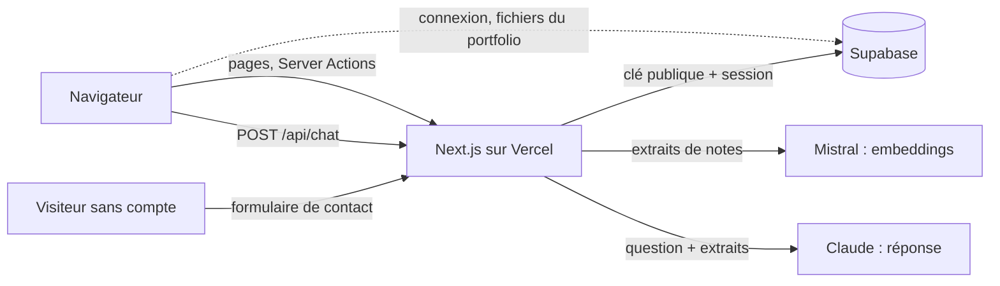

# Intégration : API Supabase et authentification

> **En deux phrases.** LogMerry n'expose **qu'une seule API HTTP** (`POST /api/chat`) ; tout le reste passe par des Server Actions Next.js qui parlent à Supabase avec la session de l'utilisateur, jamais avec une clé d'administration. Il n'y a **aucun webhook** ni aucun service qui appelle l'application de l'extérieur : les seuls appels sortants vont vers Supabase, Anthropic (Claude) et Mistral.

Faits relevés dans le code et la base réelle le 5 novembre 2026 (lecture seule).

## Vue d'ensemble des échanges

| Lien | Qui appelle | Avec quoi | Contenu |
|---|---|---|---|
| Navigateur vers Supabase | Le navigateur, **cinq composants seulement** | Clé publique | Connexion, déconnexion, mot de passe oublié, nouveau mot de passe ; envoi et retrait des images du portfolio (Storage) |
| Next.js vers Supabase | Server Actions, Route Handler, pages | Clé publique + cookies de la session | Toutes les lectures et écritures de données |
| Next.js vers Mistral | Serveur seulement | Clé `MISTRAL_API_KEY` | Textes à vectoriser (modèle `mistral-embed`, 1 024 dimensions) |
| Next.js vers Claude | Serveur seulement | Clé `ANTHROPIC_API_KEY` | Question et extraits retrouvés ; modèle réglé par `AI_CHAT_MODEL` |
| Visiteur vers Next.js | Page publique `/portfolio` | Aucune session | Message du formulaire de contact |

Les clés des services d'IA ne quittent jamais le serveur (voir le chapitre 11).

## Les trois formes d'appel

### 1. La Route API : `POST /api/chat`

Seul Route Handler de l'application. Contrat :

| Élément | Valeur |
|---|---|
| Entrée | JSON `{ "question": "…" }`, 300 caractères au plus après nettoyage ; corps limité à 10 000 octets (en-tête puis lecture bornée) |
| Authentification | Session obligatoire (le proxy refuse déjà sans session ; la route revérifie) |
| Sortie en cas de succès | JSON de la réponse, avec ses sources (les textes viennent des extraits lus en base, pas du modèle) |
| Pas de flux | La réponse arrive en une fois |

| Statut | Cas |
|---|---|
| 200 | Réponse vérifiée et sources |
| 400 | Question vide |
| 401 | Pas de session |
| 413 | Corps ou question trop longs |
| 429 | Plafond d'appels à l'IA atteint (20 par minute ou 300 par jour) |
| 502 | Mistral ou Claude en échec, ou réponse rejetée par la vérification des citations |
| 503 | Le compteur de plafond lui-même est indisponible (on bloque plutôt que de laisser passer sans compter) |

L'historique de l'échange est enregistré après la réponse ; son échec **ne bloque jamais** la réponse (journal sans contenu).

### 2. Les Server Actions

**76 actions dans 27 fichiers** (`app/(app)/**/…actions.ts` et `app/portfolio/contact-action.ts`). Elles suivent toutes le même schéma, fourni par `withSession` (`lib/supabase/with-session.ts`) :

1. créer un client Supabase à partir des cookies de la requête (un client **par appel**, jamais global) ;
2. vérifier la session (`getClaims`) ; sans session, l'action n'est jamais exécutée et l'utilisateur est renvoyé à la connexion ;
3. valider les champs (fonctions de `lib/domain/`, testées) ;
4. écrire ou lire sous RLS : `owner_id` est rempli par la base (`default auth.uid()`), jamais par le client ;
5. renvoyer un état (`errors`, `message`) ou rediriger.

| Domaine | Actions (exemples) |
|---|---|
| Clients et contacts | création, modification, suppression, passage de prospect à client, contacts |
| Devis | création, envoi, refus, acceptation (`accept_quote`), suppression |
| Missions agiles | missions, user stories, tâches, sprints, ordre du backlog |
| Factures | factures et paiements |
| Notes et assistant | notes, relance de l'indexation, brouillon issu d'une question, recherche, résumé, purge de l'historique |
| Finances et échéances | profil professionnel, règles versionnées, échéances du calendrier, cases du cockpit |
| Réalisations | réalisations, publication, images |
| Public | `sendContactMessage` (sans session) |

Dix fichiers d'actions déclenchent des appels à l'IA (propositions de stories, de tâches, d'ordre du backlog, de sprint, relecture de story, prompt de mission, résumé, recherche par le sens, indexation) : **chacun consomme d'abord le plafond** (`consume_ai_quota`) avant tout appel à Mistral ou à Claude.

### 3. Les fonctions SQL appelées par `rpc()`

Sept fonctions sont appelées par l'application ; les droits d'exécution sont ceux de la base réelle.

| Fonction | Rôle | Exécutable par | Droits d'exécution |
|---|---|---|---|
| `search_notes(query)` | Recherche plein texte sans accents (20 résultats au plus) | Comptes connectés | Ceux de l'appelant (RLS) |
| `match_chunks(query_embedding, match_threshold, match_count)` | Recherche vectorielle dans **ses** extraits | Comptes connectés | Ceux de l'appelant (RLS) ; le seuil de similarité utilisé par l'assistant est 0,76 |
| `consume_ai_quota()` | Compte, refuse ou enregistre un appel à l'IA | Comptes connectés | Propriétaire (`SECURITY DEFINER`), limitée à `auth.uid()` |
| `accept_quote(p_quote_id)` | Accepte un devis (transaction unique) | Comptes connectés | Ceux de l'appelant (RLS) |
| `create_rule_version(…)` | Crée une version d'une règle réglementaire | Comptes connectés | Ceux de l'appelant (RLS) |
| `delete_deadline_series(p_series_id)` | Supprime une série d'échéances | Comptes connectés | Ceux de l'appelant (RLS) |
| `submit_contact_message(p_name, p_email, p_message)` | Reçoit le message d'un visiteur | **Visiteurs sans compte** et comptes connectés | Propriétaire (`SECURITY DEFINER`, `search_path` vide) |

Autres fonctions de la base, non appelées par le code de l'application : `rls_audit()` (utilisée par le test nocturne), `rule_version_is_mine()` (utilisée dans une politique de sécurité), et trois fonctions d'aide (`immutable_unaccent`, `pp_thresholds_ok`, `realisation_tags_ok`) utilisées par des contraintes et des index.

**Le formulaire de contact** est la seule porte ouverte aux visiteurs sans compte. La fonction valide (nom de 1 à 200 caractères, e-mail d'au plus 254, message de 10 à 4 000), refuse au-delà de 5 messages par heure, 30 par jour au total et 3 par jour pour une même adresse, ignore sans rien écrire un doublon (même adresse et même texte en moins de 24 h) (erreur `54000`, affichée comme « trop de messages »), et écrit une **note en brouillon** chez l'unique destinataire activé (table `contact_form_settings`). Côté application, un champ piège et un délai minimum d'ouverture écartent les robots (même réponse qu'un succès, rien n'est écrit). Le texte reçu est marqué « non vérifié » : c'est une donnée, jamais une consigne.

## Mappings

Relevé fait dans le code et les migrations le 10 novembre 2026, fonction par fonction. Il n'existe **pas de table de mappings générale** ni de webhook : seuls les cas où une saisie devient plusieurs écritures, ou une écriture composée, sont décrits.

### Formulaire de contact vers note

| Étape | Ce que fait le code |
|---|---|
| Champs du formulaire | `name`, `email`, `message` ; deux champs de contrôle (`website`, piège ; `openedAt`, délai) ne sont **pas** transmis à la base (`app/portfolio/contact-action.ts:19-20`) |
| Appel | `rpc("submit_contact_message", { p_name, p_email, p_message })` (`contact-action.ts:26`) ; plafond atteint (code 54000) : message dédié (`:27`) |
| Fonction en vigueur | `supabase/migrations/20261107110000_contact_form_limits.sql:21-81`. Elle **remplace** la version de `20261107100000_contact_form.sql:17-60` (même insertion de la note, mais plafond de 10 messages par heure, remplacé par le journal d'envois) |
| Nettoyage | Nom : retours à la ligne et tabulations remplacés par une espace, espaces retirées (`:29`) ; e-mail : espaces retirées, 254 caractères au plus, une arobase (`:30`, `:36`) ; message : espaces retirées, de 10 à 4 000 caractères (`:31`, `:37`) |
| Écriture 1 : journal d'envois | `contact_submissions(owner_id, email_hash, message_hash)` : `md5(lower(e-mail))` et `md5(message)`, jamais le texte (`:46-47`, `:65`) |
| Écriture 2 : note | `notes(owner_id, title, body, status, type)` (`:67-78`). `owner_id` : le destinataire désigné dans `contact_form_settings` (`:41`) ; `title` : « Message reçu · » suivi du nom, 200 caractères au plus (`:70`) ; `body` : « Texte reçu d'un visiteur via le formulaire du portfolio, non vérifié. », puis « De : » nom, « E-mail : » adresse, « Reçu le : » date et heure de Paris, puis le message (`:71-75`) ; `status` : « draft » ; `type` : « note » (`:76-77`) |
| Réponses | `true` : écrit, ou doublon de moins de 24 heures ignoré (`:51-56`) ; `false` : formulaire non activé (`:42-44`) ; erreur 22023 : champ invalide (`:35-39`) |

### Devis accepté vers mission

`accept_quote` (version en vigueur : `supabase/migrations/20261029210000_accept_quote_title.sql:4-33`) : si le devis n'a pas de mission liée (`:20`), la mission créée reprend `client_id` du devis, un titre « {nom du client, 170 caractères au plus} — devis du JJ/MM/AAAA » construit avec la date d'envoi (`:25-27`) et le statut « planned » ; la fiche passe de prospect à client (`:22-24`) ; le devis reçoit `mission_id` et le statut « accepted » (`:29`). Si le devis avait déjà une mission, il la garde et aucune n'est créée.

### Note vers nouvelle fiche prospect

| Étape | Ce que fait le code |
|---|---|
| Champs du formulaire de note | `client_id` (la valeur « new » ouvre la création d'une fiche : `lib/domain/note-link.ts:5`), `new_name`, `new_origin` (`app/(app)/notes/actions.ts:60-69`) |
| Validation | `validateLink` (`lib/domain/note-link.ts:12-21`) passe `new_name` et `new_origin` à `validateClientInput` avec le statut imposé « prospect » (`:15`) ; le nom est nettoyé du caractère nul et des espaces (`lib/domain/clients.ts:32`) |
| Écriture de la fiche | `clients.insert({ name, status: "prospect", origin })` (`app/(app)/notes/actions.ts:80-84`) |
| Écriture de la note | L'identifiant de la fiche créée devient `notes.client_id` (`:105`, `:136`). Les deux écritures sont successives : si la note échoue, la fiche reste (commentaire `:79`) |

### Champ de formulaire vers colonne : fiche client et mission

Pour la fiche client, les clés du formulaire portent le nom des colonnes : `ClientInput` (`lib/domain/clients.ts:19`) devient `ClientValues` (`:20`) par `validateClientInput` (`:31-42`), qui nettoie le nom et n'accepte que des statuts et des origines connus, puis `clients.insert(value)` (`app/(app)/clients/actions.ts:57-62`). Pour la mission, de même : `MissionInput` (`lib/domain/missions.ts:18`) devient `MissionValues` (`:19`) par `validateMissionInput` (`:33-47`), avec les dates vides converties en `null` (`:47`), puis `missions.insert(value)` (`app/(app)/missions/actions.ts:74-79`) ; à la modification, `client_id` est retiré (`:87`). `owner_id` n'est jamais envoyé : la base le pose (`:75`).

Ce n'est pas vrai pour tous les formulaires. Relevé du 12 novembre 2026, fait en lisant les fonctions de validation de `lib/domain/` et les actions qui écrivent, pour les onze entités ci-dessous. Dans tous les cas, `owner_id` n'est jamais envoyé : la base le pose. Les tâches n'ont pas de formulaire à plusieurs champs : l'action reçoit un titre (texte) en argument ; le profil s'enregistre un champ à la fois.

| Entité | Identité champ vers colonne ? | Conversions et valeurs vides (fichier:ligne) | Écriture |
|---|---|---|---|
| Fiche client | Oui : `name`, `status`, `origin` | Nom : caractère nul retiré, espaces retirées (`lib/domain/clients.ts:32`), 200 points de code au plus (`:37`) ; statut et origine : valeur connue ou erreur (`:33-34`, `:38-39`). Aucun champ facultatif | `clients.insert(value)` (`app/(app)/clients/actions.ts:60`), `update` (`:68`) |
| Mission | Oui : `client_id`, `title`, `status`, `start_date`, `end_date` | Dates vides en `null` (`lib/domain/missions.ts:47`), date inexistante refusée (`:25-30`, `:43-44`), fin avant début refusée (`:45`), titre de 200 points de code au plus (`:41`) | `missions.insert(value)` (`app/(app)/missions/actions.ts:77`) ; à la modification, `client_id` est retiré (`:87`) |
| Devis | **Non** : `amount_ht` et `tax` (euros saisis) deviennent `amount_ht_cents` et `tax_cents` | Montant en centimes entiers, virgule ou point, deux décimales au plus, négatif et texte refusés (`lib/domain/quotes.ts:23-28`) ; montant hors taxe obligatoire, strictement positif, 100 000 000 € au plus (`:45-49`) ; taxe vide : `null`, jamais 0 (`:51`, `:61`) ; date d'envoi vide : `null`, obligatoire seulement si le devis est envoyé (`:55-56`, `:61`) ; mission vide : `null` (`:58`, `:61`) | `quotes.insert({ client_id, ...value })` (`app/(app)/clients/quote-actions.ts:46`), `update` (`:67`) |
| Encaissement | **Non** : mêmes conversions en centimes (`lib/domain/payments.ts:32`, `:38`) | Taxe vide : `null` (`:38`, `:49`) ; date obligatoire, valide, jamais dans le futur (`:42-44`) ; remarque vide : `null`, 500 points de code au plus (`:46`, `:49`) ; hors taxe de 1 000 000 € au plus (`:6`, `:36`) | `payments.insert(value)` (`app/(app)/factures/payment-actions.ts:43`) ; à la modification, `invoice_id` n'est pas envoyé (`:62`) |
| User story | **Non** : texte nettoyé et points convertis | Mots de liaison retirés du début : « je veux » (`lib/domain/user-stories.ts:35`), « en tant que » (`:36`), « afin de » (`:37`, `:23-29`) ; rôle, bénéfice et critères vides : `null` (`:52`) ; points : chiffres seulement, parmi 1, 2, 3, 5, 8, 13, vide : `null` (`:11`, `:42`, `:49`) | `user_stories.insert({ ...value, mission_id, position, source_note_id })` (`app/(app)/missions/story-actions.ts:91-93`) : position à la dernière place, note d'origine gardée seulement si elle est une note de la fiche de la mission (`:84-87`) ; à la modification, le statut n'est écrit que s'il a changé dans le formulaire (`:155`, `:159`) |
| Réalisation | **Non** : `stack` (texte à virgules) devient une liste, les cases à cocher deviennent des booléens | Texte nettoyé : nul, espaces de largeur nulle retirés, `\r\n` en `\n` (`lib/domain/realisations.ts:78-85`) ; champs facultatifs vides : `null` (`:123`) ; étiquettes : doublons retirés, 12 au plus, 40 points de code chacune (`:106-117`, `:150-151`) ; adresse publique : https seulement, sans identifiant (`:95-103`) ; « on » devient `true` (`:156`) | `realisations.insert(value)` (`app/(app)/realisations/actions.ts:70`) ; à la modification, `published: false` est ajouté (`:80`) |
| Note | Oui pour `title`, `body`, `type` | Titre : nul retiré, espaces retirées, 200 points de code au plus ; texte : nul retiré, **espaces gardées**, 50 000 au plus (`lib/domain/notes.ts:69-70`, `:1-2`) ; type : l'un des quatre connus (`:4`, `:80`). Le champ `client_id` vient d'un autre champ du formulaire (voir « Note vers nouvelle fiche prospect ») | `notes.insert({ ...value, client_id })` (`app/(app)/notes/actions.ts:136`) ; à la modification, `index_status` passe à « pending » si le titre ou le texte a changé (`:152-155`) |
| Facture | **Non** : `amount_ht` et `tax` (euros) deviennent `amount_ht_cents` et `tax_cents` | Mêmes conversions que le devis (`lib/domain/invoices.ts:48-56`), 1 000 000 € au plus (`:8`, `:52`) ; taxe vide : `null` (`:54`, `:69`) ; échéance obligatoire et valide (`:58-59`) ; émission vide : `null`, jamais dans le futur, échéance jamais avant l'émission (`:61-63`, `:69`) ; devis vide : `null` (`:46`, `:69`) ; référence (60 points de code) et remarque (500) vides : `null` (`:65-66`, `:69`) | `invoices.insert(value)` (`app/(app)/factures/actions.ts:46`) ; `update(value)` avec le même objet (`:62`) |
| Sprint | Oui : `name`, `goal`, `start_date`, `end_date` | Nom de 120 points de code au plus, objectif de 300 au plus et vide : `null` (`lib/domain/sprints.ts:26-28`, `:35`) ; deux dates obligatoires et valides, fin jamais avant début (`:29-33`) ; à la création, nom vide ou « Sprint N » déjà pris : remplacé par le prochain numéro libre, calculé côté serveur (`app/(app)/missions/sprint-actions.ts:69-74`, `lib/domain/sprints.ts:106-111`) | `sprints.insert({ ...value, mission_id })` (`sprint-actions.ts:65`) ; pour un sprint clos, seuls `name` et `goal` sont envoyés (`:85-86`) |
| Tâche | Pas de formulaire à plusieurs champs : le titre (texte) est un argument de l'action | Valeur qui n'est pas du texte : titre vide ; nul retiré, espaces retirées, 200 points de code au plus, titre vide refusé (`lib/domain/tasks.ts:8-14`) ; lot de 1 à 50 titres (`:30-39`) | `tasks.insert({ story_id, title, position })`, position à la dernière place (`app/(app)/missions/task-actions.ts:57-59`) ; `update({ title })` (`:96`) ; `update({ done })` (`:110`) |
| Profil | **Non** : un champ à la fois ; `value` et `other` deviennent `<clé>` et `<clé>_other` | Valeur vide : `null`, c'est-à-dire « À confirmer » (`lib/domain/profile.ts:67`, `:78`, `:82`) ; choix : valeur de la liste ou « autre » avec un texte de 200 points de code au plus (`:68-75`) ; choix sans « Autre » : `<clé>_other` remis à `null` (`:75`) ; date valide, une date future est acceptée (`:27`, `:77-80`) ; texte libre de 2 000 points de code au plus (`:83`) ; seuils d'alerte : sous-ensemble de 50, 75, 90 et 100, sans doublon, triés (`:88-91`) | `professional_profile.update(...)` (`app/(app)/profil/actions.ts:53-58`) ; la confirmation pose `<clé>_confirmed_at` (`:37`) ; le retour en « Déclaré » à la modification est fait par un déclencheur de la base, d'après le commentaire de l'action (`:17`) : déclencheur **non relu** |

Une valeur vide devient donc `null` presque partout, et le montant en euros n'est jamais gardé comme nombre à virgule : la base ne reçoit que des centimes entiers. Seuls les cas relus sont affirmés ici.

## Authentification

Voir le détail et le schéma du proxy au chapitre 11. Ce qui compte pour l'intégration :

| Étape | Mécanisme |
|---|---|
| Connexion | Composant navigateur : `signInWithPassword` (e-mail et mot de passe d'au moins 12 caractères) ; Supabase dépose la session dans des cookies |
| Session côté serveur | Le proxy (`proxy.ts`) appelle `getClaims()` à chaque requête, rafraîchit les cookies et applique `accessDecision` |
| Utilisation de la session | `createClient()` (serveur) relit les cookies : **la base reconnaît l'utilisateur** via `auth.uid()` et applique la RLS |
| Réinitialisation du mot de passe | Lien par e-mail vers `/auth/confirm` (échange d'un code PKCE contre une session), puis `/auth/update-password` ; en cas d'échec : `/auth/error` |
| Déconnexion | `signOut()` côté navigateur |
| Session expirée pendant le chat | L'API répond 401 en JSON (le proxy ne redirige jamais une requête d'API) ; l'interface affiche « Ta session a expiré » |

## Contrat de sécurité de l'intégration

- **Un seul type de clé** côté Supabase : l'adresse du projet et la clé **publique**. La clé d'administration n'existe pas dans le projet (test).
- **Le serveur n'a pas plus de droits que l'utilisateur** : une Server Action qui oublie de filtrer ne peut de toute façon lire que les lignes du compte, car la RLS s'applique.
- **Une entrée ne devient jamais un propriétaire** : `owner_id` est posé par la base ; une insertion au nom d'un autre compte est refusée (test d'isolation).
- **Les textes venus de l'extérieur sont des données** : message du formulaire de contact, notes, extraits.

## Délais, erreurs et reprises

| Appel | Délai | Échec | Nouvelle tentative automatique |
|---|---|---|---|
| Claude (`api.anthropic.com/v1/messages`) | 60 s | Erreur sans contenu ni clé dans le journal ; l'utilisateur voit un message fixe | Aucune |
| Mistral (`api.mistral.ai/v1/embeddings`) | 20 s par lot | Idem ; une note non indexée passe à « échec » et se relance à la main | Aucune |
| Supabase (Server Actions) | Aucun délai propre posé par l'application sur ses appels Supabase (constat de code (lecture du code le 12 novembre 2026, par l'assistant) ; supabase-js 2.117.3, valeurs par défaut du client) ; durée maximale de la fonction Vercel : défaut de la plateforme, non vérifié | L'action renvoie « Enregistrement impossible. Réessaie. » ; côté navigateur, « Le serveur ne répond pas » | Aucune |

Aucune nouvelle tentative automatique n'existe nulle part : c'est un choix de simplicité, et une limite (voir ci-dessous).

## Ce qui n'existe pas

| Élément | État |
|---|---|
| Webhooks entrants ou sortants | **Aucun** : un seul Route Handler (`/api/chat`) |
| Tâches planifiées de l'application | **Aucune** (rappels et résumé hebdomadaire : n8n, hors du MVP) |
| Versionnement de l'API | **Aucun** : l'unique API est interne à l'application |
| Limitation de débit des routes HTTP en général | Seulement le plafond d'appels à l'IA et celui du formulaire de contact (5 messages par heure, 30 par jour au total et 3 par jour pour une même adresse) |
| Documentation d'API générée (OpenAPI) | **Aucune** : ce chapitre en tient lieu |

## Limites et suite

| Limite | Conséquence | Piste |
|---|---|---|
| Aucune nouvelle tentative sur les appels sortants | Une panne brève de Claude ou de Mistral se voit tout de suite par l'utilisateur | Une reprise unique avec attente, si l'usage le justifie |
| Délai d'une Server Action complète vers Supabase non mesuré | **À confirmer** | Un appel simple à l'interface publique de Supabase a été mesuré le 5 novembre 2026 (médianes de 104 ms et 113 ms sur 30 requêtes : `05-qos.md:16-23`) ; le délai d'une Server Action complète n'a pas été mesuré (encadré « À confirmer » du chapitre 5) |
| Plafond du formulaire de contact calculé sur la table `contact_submissions` (empreintes d'adresses et de messages, supprimées après 30 jours), indépendante des notes | Supprimer une note ne libère pas de place dans le plafond ; un robot qui change d'adresse reste limité à 30 messages par jour | Un captcha, si le volume l'exige |
