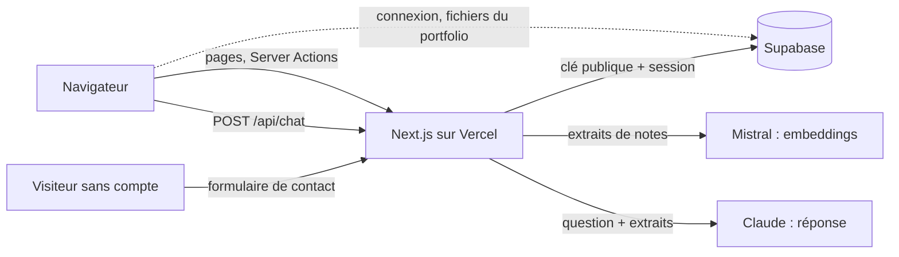

# Intégration : API Supabase et authentification

> **En deux phrases.** LogMerry n'expose **qu'une seule API HTTP** (`POST /api/chat`) ; tout le reste passe par des Server Actions Next.js qui parlent à Supabase avec la session de l'utilisateur, jamais avec une clé d'administration. Il n'y a **aucun webhook** ni aucun service qui appelle l'application de l'extérieur : les seuls appels sortants vont vers Supabase, Anthropic (Claude) et Mistral.

Faits relevés dans le code et la base réelle le 5 novembre 2026 (lecture seule).

## Vue d'ensemble des échanges

| Lien | Qui appelle | Avec quoi | Contenu |
|---|---|---|---|
| Navigateur vers Supabase | Le navigateur, **cinq composants seulement** | Clé publique | Connexion, déconnexion, mot de passe oublié, nouveau mot de passe ; envoi et retrait des images du portfolio (Storage) |
| Next.js vers Supabase | Server Actions, Route Handler, pages | Clé publique + cookies de la session | Toutes les lectures et écritures de données |
| Next.js vers Mistral | Serveur seulement | Clé `MISTRAL_API_KEY` | Textes à vectoriser (modèle `mistral-embed`, 1 024 dimensions) |
| Next.js vers Claude | Serveur seulement | Clé `ANTHROPIC_API_KEY` | Question et extraits retrouvés ; modèle réglé par `AI_CHAT_MODEL` |
| Visiteur vers Next.js | Page publique `/portfolio` | Aucune session | Message du formulaire de contact |

Les clés des services d'IA ne quittent jamais le serveur (voir le chapitre 11).

## Les trois formes d'appel

### 1. La Route API : `POST /api/chat`

Seul Route Handler de l'application. Contrat :

| Élément | Valeur |
|---|---|
| Entrée | JSON `{ "question": "…" }`, 300 caractères au plus après nettoyage ; corps limité à 10 000 octets (en-tête puis lecture bornée) |
| Authentification | Session obligatoire (le proxy refuse déjà sans session ; la route revérifie) |
| Sortie en cas de succès | JSON de la réponse, avec ses sources (les textes viennent des extraits lus en base, pas du modèle) |
| Pas de flux | La réponse arrive en une fois |

| Statut | Cas |
|---|---|
| 200 | Réponse vérifiée et sources |
| 400 | Question vide |
| 401 | Pas de session |
| 413 | Corps ou question trop longs |
| 429 | Plafond d'appels à l'IA atteint (20 par minute ou 300 par jour) |
| 502 | Mistral ou Claude en échec, ou réponse rejetée par la vérification des citations |
| 503 | Le compteur de plafond lui-même est indisponible (on bloque plutôt que de laisser passer sans compter) |

L'historique de l'échange est enregistré après la réponse ; son échec **ne bloque jamais** la réponse (journal sans contenu).

### 2. Les Server Actions

**76 actions dans 27 fichiers** (`app/(app)/**/…actions.ts` et `app/portfolio/contact-action.ts`). Elles suivent toutes le même schéma, fourni par `withSession` (`lib/supabase/with-session.ts`) :

1. créer un client Supabase à partir des cookies de la requête (un client **par appel**, jamais global) ;
2. vérifier la session (`getClaims`) ; sans session, l'action n'est jamais exécutée et l'utilisateur est renvoyé à la connexion ;
3. valider les champs (fonctions de `lib/domain/`, testées) ;
4. écrire ou lire sous RLS : `owner_id` est rempli par la base (`default auth.uid()`), jamais par le client ;
5. renvoyer un état (`errors`, `message`) ou rediriger.

| Domaine | Actions (exemples) |
|---|---|
| Clients et contacts | création, modification, suppression, passage de prospect à client, contacts |
| Devis | création, envoi, refus, acceptation (`accept_quote`), suppression |
| Missions agiles | missions, user stories, tâches, sprints, ordre du backlog |
| Factures | factures et paiements |
| Notes et assistant | notes, relance de l'indexation, brouillon issu d'une question, recherche, résumé, purge de l'historique |
| Finances et échéances | profil professionnel, règles versionnées, échéances du calendrier, cases du cockpit |
| Réalisations | réalisations, publication, images |
| Public | `sendContactMessage` (sans session) |

Dix fichiers d'actions déclenchent des appels à l'IA (propositions de stories, de tâches, d'ordre du backlog, de sprint, relecture de story, prompt de mission, résumé, recherche par le sens, indexation) : **chacun consomme d'abord le plafond** (`consume_ai_quota`) avant tout appel à Mistral ou à Claude.

### 3. Les fonctions SQL appelées par `rpc()`

Sept fonctions sont appelées par l'application ; les droits d'exécution sont ceux de la base réelle.

| Fonction | Rôle | Exécutable par | Droits d'exécution |
|---|---|---|---|
| `search_notes(query)` | Recherche plein texte sans accents (20 résultats au plus) | Comptes connectés | Ceux de l'appelant (RLS) |
| `match_chunks(query_embedding, match_threshold, match_count)` | Recherche vectorielle dans **ses** extraits | Comptes connectés | Ceux de l'appelant (RLS) ; le seuil de similarité utilisé par l'assistant est 0,76 |
| `consume_ai_quota()` | Compte, refuse ou enregistre un appel à l'IA | Comptes connectés | Propriétaire (`SECURITY DEFINER`), limitée à `auth.uid()` |
| `accept_quote(p_quote_id)` | Accepte un devis (transaction unique) | Comptes connectés | Ceux de l'appelant (RLS) |
| `create_rule_version(…)` | Crée une version d'une règle réglementaire | Comptes connectés | Ceux de l'appelant (RLS) |
| `delete_deadline_series(p_series_id)` | Supprime une série d'échéances | Comptes connectés | Ceux de l'appelant (RLS) |
| `submit_contact_message(p_name, p_email, p_message)` | Reçoit le message d'un visiteur | **Visiteurs sans compte** et comptes connectés | Propriétaire (`SECURITY DEFINER`, `search_path` vide) |

Autres fonctions de la base, non appelées par le code de l'application : `rls_audit()` (utilisée par le test nocturne), `rule_version_is_mine()` (utilisée dans une politique de sécurité), et trois fonctions d'aide (`immutable_unaccent`, `pp_thresholds_ok`, `realisation_tags_ok`) utilisées par des contraintes et des index.

**Le formulaire de contact** est la seule porte ouverte aux visiteurs sans compte. La fonction valide (nom de 1 à 200 caractères, e-mail d'au plus 254, message de 10 à 4 000), refuse au-delà de 5 messages par heure, 30 par jour au total et 3 par jour pour une même adresse, ignore sans rien écrire un doublon (même adresse et même texte en moins de 24 h) (erreur `54000`, affichée comme « trop de messages »), et écrit une **note en brouillon** chez l'unique destinataire activé (table `contact_form_settings`). Côté application, un champ piège et un délai minimum d'ouverture écartent les robots (même réponse qu'un succès, rien n'est écrit). Le texte reçu est marqué « non vérifié » : c'est une donnée, jamais une consigne.

## Authentification

Voir le détail et le schéma du proxy au chapitre 11. Ce qui compte pour l'intégration :

| Étape | Mécanisme |
|---|---|
| Connexion | Composant navigateur : `signInWithPassword` (e-mail et mot de passe d'au moins 12 caractères) ; Supabase dépose la session dans des cookies |
| Session côté serveur | Le proxy (`proxy.ts`) appelle `getClaims()` à chaque requête, rafraîchit les cookies et applique `accessDecision` |
| Utilisation de la session | `createClient()` (serveur) relit les cookies : **la base reconnaît l'utilisateur** via `auth.uid()` et applique la RLS |
| Réinitialisation du mot de passe | Lien par e-mail vers `/auth/confirm` (échange d'un code PKCE contre une session), puis `/auth/update-password` ; en cas d'échec : `/auth/error` |
| Déconnexion | `signOut()` côté navigateur |
| Session expirée pendant le chat | L'API répond 401 en JSON (le proxy ne redirige jamais une requête d'API) ; l'interface affiche « Ta session a expiré » |

## Contrat de sécurité de l'intégration

- **Un seul type de clé** côté Supabase : l'adresse du projet et la clé **publique**. La clé d'administration n'existe pas dans le projet (test).
- **Le serveur n'a pas plus de droits que l'utilisateur** : une Server Action qui oublie de filtrer ne peut de toute façon lire que les lignes du compte, car la RLS s'applique.
- **Une entrée ne devient jamais un propriétaire** : `owner_id` est posé par la base ; une insertion au nom d'un autre compte est refusée (test d'isolation).
- **Les textes venus de l'extérieur sont des données** : message du formulaire de contact, notes, extraits.

## Délais, erreurs et reprises

| Appel | Délai | Échec | Nouvelle tentative automatique |
|---|---|---|---|
| Claude (`api.anthropic.com/v1/messages`) | 60 s | Erreur sans contenu ni clé dans le journal ; l'utilisateur voit un message fixe | Aucune |
| Mistral (`api.mistral.ai/v1/embeddings`) | 20 s par lot | Idem ; une note non indexée passe à « échec » et se relance à la main | Aucune |
| Supabase (Server Actions) | Aucun délai propre à l'application : **À confirmer** (valeurs par défaut du client) | L'action renvoie « Enregistrement impossible. Réessaie. » ; côté navigateur, « Le serveur ne répond pas » | Aucune |

Aucune nouvelle tentative automatique n'existe nulle part : c'est un choix de simplicité, et une limite (voir ci-dessous).

## Ce qui n'existe pas

| Élément | État |
|---|---|
| Webhooks entrants ou sortants | **Aucun** : un seul Route Handler (`/api/chat`) |
| Tâches planifiées de l'application | **Aucune** (rappels et résumé hebdomadaire : n8n, hors du MVP) |
| Versionnement de l'API | **Aucun** : l'unique API est interne à l'application |
| Limitation de débit des routes HTTP en général | Seulement le plafond d'appels à l'IA et celui du formulaire de contact (5 messages par heure, 30 par jour au total et 3 par jour pour une même adresse) |
| Documentation d'API générée (OpenAPI) | **Aucune** : ce chapitre en tient lieu |

## Limites et suite

| Limite | Conséquence | Piste |
|---|---|---|
| Aucune nouvelle tentative sur les appels sortants | Une panne brève de Claude ou de Mistral se voit tout de suite par l'utilisateur | Une reprise unique avec attente, si l'usage le justifie |
| Délai des appels à Supabase non mesuré | **À confirmer** | Mesurer lors du chapitre 5 (qualité de service) |
| Plafond du formulaire de contact calculé en comptant les notes au titre « Message reçu · … » | Un message supprimé par le propriétaire libère de la place dans le plafond ; accepté, noté dans la migration | Table de journal si le volume l'exige |
