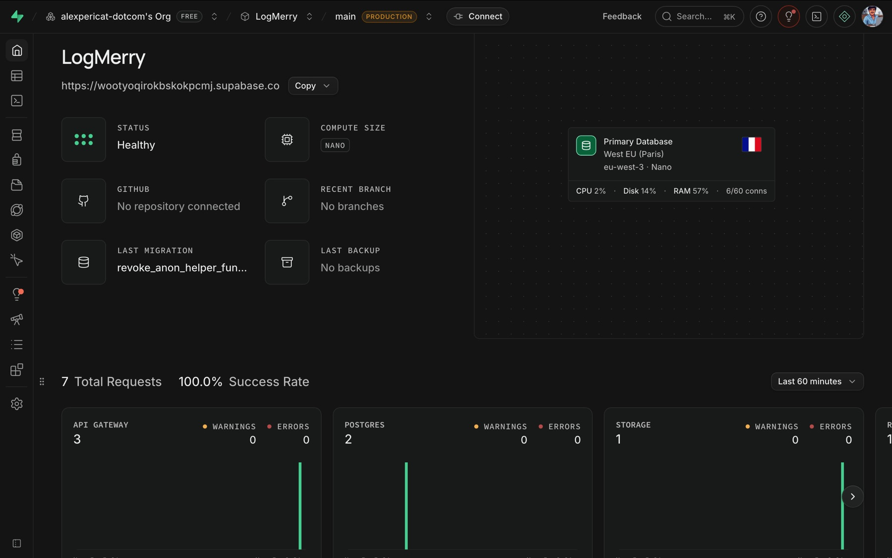

# Qualité de service

> **En deux phrases.** Ce chapitre donne les délais **mesurés** (appels à Supabase, réponse de l'assistant, pages publiques), les plafonds **réglés dans le code**, les contrôles qui tournent à chaque envoi, et dit ce qui n'est **pas** surveillé. Il n'existe **aucun engagement de disponibilité** : LogMerry tourne sur l'offre gratuite de Supabase.

## Comment lire les chiffres

| Étiquette | Sens |
|---|---|
| **Mesuré** | Chronométré, avec la date et la méthode |
| **Réglage** | Valeur écrite dans le code ou la base ; ce n'est pas une mesure |
| **Objectif proposé** | Seuil que je propose ; à valider par l'auteur, aucun engagement |
| **À confirmer** | Pas de mesure ni de source |

## Délais mesurés

### Appels à Supabase (5 novembre 2026)

Méthode : 30 requêtes successives vers l'interface publique du projet (clé publique, aucune donnée privée), depuis le Mac de l'auteur en France (aller-retour réseau vers un serveur public voisin : environ 10 ms). Mesure du temps total de chaque requête, du départ à la fin de la réponse.

| Appel | Médiane | 95e centile | Maximum | Réponses |
|---|---|---|---|---|
| Santé de l'authentification (`/auth/v1/health`) | 104 ms | 134 ms | 334 ms | 30 sur 30 en 200 |
| Lecture de la vue publique des réalisations (REST) | 113 ms | 178 ms | 316 ms | 30 sur 30 en 200 |

Lecture : un appel simple à Supabase prend **environ 0,1 seconde** de bout en bout depuis la France. Ce n'est pas le délai des Server Actions : elles tournent sur Vercel (Paris, `cdg1`), dans la même région que la base (Paris, `eu-west-3`), donc plus près que ce Mac, mais **ce trajet n'a pas été mesuré**.

> **À confirmer.** Délai d'une Server Action complète (navigateur, Vercel, Supabase), de la connexion avec mot de passe, et de la recherche vectorielle seule. Les requêtes de l'application n'apparaissent pas parmi les plus lentes des statistiques de la base (`pg_stat_statements`, dix requêtes les plus lentes avec plus de 20 appels : toutes des requêtes du tableau de bord et de l'outillage Supabase, de 24 à 517 ms en moyenne). Je n'en tire pas de durée pour l'application : je n'ai pas isolé ses requêtes une à une.

### Réponse de l'assistant (4 novembre 2026)

Détail au chapitre « Rapport d'évaluation » : **3,4 secondes en moyenne** par question, 95e centile entre **6,1 et 7,0 secondes**, dont environ 2,9 à 3,0 secondes pour l'appel à Claude. Deux exécutions seulement : ce sont des ordres de grandeur.

### Pages publiques (portfolio)

Mesures du journal, sur un build de production local, Lighthouse mobile :

| Page | Mesure | Date |
|---|---|---|
| « Qui suis-je » | Performance 95 à 98 ; accessibilité, bonnes pratiques et SEO à 100 ; environ 390 Ko | 4 novembre 2026 |
| Page d'accueil (hero) | Plus grand élément affiché (LCP) 1 547 ms après correction (1 971 ms avant), décalage de mise en page (CLS) 0 | 30 octobre 2026 |

**Limites.** Mesures locales, pas sur le site en production ; la performance des pages **connectées** (cockpit, notes, factures) n'a pas été mesurée, seulement leur accessibilité.

## Plafonds et délais réglés dans le code

| Élément | Réglage | Où |
|---|---|---|
| Appels à l'assistant par utilisateur | 20 par minute, 300 par jour ; au-delà, refus (statut 429) | `consume_ai_quota` (base) |
| Appel à Claude | Délai de 60 s, aucune nouvelle tentative | `lib/ai/claude-tool.ts` |
| Appel à Mistral | Délai de 20 s par lot de 16 extraits, aucune nouvelle tentative | `lib/ai/embeddings.ts` |
| Formulaire de contact | 5 messages par heure, 30 par jour au total et 3 par jour pour une même adresse, délai minimum de 3 s avant l'envoi | `submit_contact_message` |
| Appels à Supabase depuis l'application | Aucun délai propre (valeurs par défaut du client) | **À confirmer** |

Conséquence à connaître : l'enregistrement d'une note attend l'indexation. Si Mistral est lent, l'enregistrement peut durer **jusqu'à 20 secondes** avant de passer à l'état « échec » (la note, elle, est conservée).

## Objectifs proposés

Aucun budget n'a été fixé jusqu'ici. Je propose des seuils **proches de ce qui est mesuré**, pour qu'ils servent de repère, pas de promesse.

| Mesure | Objectif proposé | Mesuré aujourd'hui |
|---|---|---|
| Réponse de l'assistant, moyenne | Moins de 5 s | 3,4 s |
| Réponse de l'assistant, 95e centile | Moins de 10 s | 6,1 à 7,0 s |
| Pages publiques, performance Lighthouse mobile | 90 ou plus | 95 à 98 (une page) |
| Pages publiques, accessibilité | 100 | 100 |
| Exactitude de l'assistant sur le jeu de 20 questions | 19 sur 20 ou plus, sans fuite | 20 sur 20, aucune fuite |
| Disponibilité | **Aucun objectif** : aucun engagement possible sur l'offre gratuite | Non mesurée |

## Contrôles automatiques à chaque envoi

Fichier `.github/workflows/ci.yml`, déclenché par chaque envoi et chaque demande de fusion :

| Tâche | Contenu |
|---|---|
| `check` | Typage (`tsc`), analyse du code (`lint`), tests (`npm test`), construction de l'application (`next build`) |
| `audit` | `npm audit` sur les dépendances de production, niveau « élevé » ; séparé du reste pour qu'une panne du registre ne passe pas pour un échec du code |

Le test d'isolation entre deux comptes a son propre fichier (`isolation.yml`) : voir le chapitre « Déploiement ». **Aucun test de charge** n'existe, et la CI ne mesure ni la performance ni la latence.

## Observabilité : ce qui existe

| Source | Ce qu'on y lit | Limite |
|---|---|---|
| Tableau de bord Supabase | Journaux de l'API, de la base et de l'authentification ; avis de sécurité et de performance (« advisors ») | Conservation des journaux : d'après la documentation de Supabase consultée le 12 novembre 2026 : 1 jour sur l'offre gratuite (non relevé dans le tableau de bord du projet) |
| Vercel | Journaux d'exécution des fonctions, état de chaque déploiement | Idem |
| Table `ai_calls` | Nombre d'appels à l'assistant par utilisateur (comptage, pas de contenu) | Sert au plafond, pas à la mesure de latence |
| Journal applicatif | Erreurs des appels sortants, sans contenu ni clé | Aucune agrégation ni alerte |

**Avis de performance de Supabase au 5 novembre 2026** (lecture seule, niveau « info », aucun avertissement) :

| Avis | Détail | Décision |
|---|---|---|
| 3 clés étrangères sans index | `message_citations.owner_id`, `realisation_images.owner_id`, `regulatory_rules.previous_version_id` | À ajouter si ces tables grossissent ; sans effet visible avec les volumes de démonstration |
| 4 index jamais utilisés | `note_chunks_embedding_idx`, `notes_search_idx`, `message_citations_note_idx`, `message_citations_chunk_idx` | **Pas supprimés** : l'index vectoriel et l'index de recherche servent quand le volume monte ; avec quelques notes, la base lit la table entière, ce qui est plus rapide |

### Capture du tableau de bord (fournie par l'auteur, 5 novembre 2026)

| Ce que la capture montre | Lecture |
|---|---|
| État « Healthy », calcul **Nano**, base principale à Paris (`eu-west-3`) | Cohérent avec l'offre gratuite et la région annoncée |
| CPU 2 %, disque 14 %, mémoire 57 %, 6 connexions sur 60 | Instantané d'un moment de faible activité, **pas une mesure de charge**. La mémoire à 57 % est normale pour un petit calcul mais laisse peu de marge si le volume monte |
| « Last backup : **No backups** » | **Confirme l'absence de sauvegarde automatique** (voir le chapitre « Continuité ») |
| « GitHub : No repository connected » | Les migrations ne passent pas par l'intégration GitHub de Supabase : elles sont appliquées à la main (voir « Déploiement ») |
| Dernière migration : `revoke_anon_helper_fun…` | Correspond à la migration qui a retiré les droits d'`anon` sur quatre fonctions d'aide |
| 7 requêtes sur 60 minutes, taux de réussite 100 % | Trafic quasi nul au moment de la capture ; aucun avertissement ni erreur |

Les autres chiffres de ce chapitre viennent de requêtes en lecture seule et de mesures faites depuis le poste de l'auteur.

## Ce qui n'existe pas

| Élément | État |
|---|---|
| Alertes (panne, erreurs, quotas) | **Aucune** : personne n'est prévenu d'une panne |
| Surveillance de disponibilité depuis l'extérieur | **Aucune** |
| Mesure de performance en production (utilisateurs réels) | **Aucune** |
| Test de charge | **Aucun** |
| Mesure de la latence des Server Actions | **Aucune** (à confirmer ci-dessus) |
| Engagement de disponibilité (SLA) | **Aucun**, ni chez Supabase gratuit ni dans l'application |

## Modes dégradés

Détail au chapitre « Continuité » : en cas de panne de Claude ou de Mistral, l'assistant affiche un message fixe et le reste de l'application fonctionne ; une note dont l'indexation échoue est enregistrée et se relance à la main ; une panne de Supabase rend l'application indisponible.

## Limites et suite

| Limite | Piste |
|---|---|
| Une seule mesure de latence réseau, depuis un seul lieu, hors Vercel | Mesurer une Server Action depuis le navigateur sur la production |
| Deux exécutions seulement pour la latence de l'assistant | En refaire quelques-unes avant la soutenance (appels payants, avec l'accord de l'auteur) |
| Aucune alerte | Une surveillance externe gratuite de l'adresse publique, une fois l'alias de production confirmé |
| Projet mis en pause après une semaine sans activité (offre gratuite) | Voir le chapitre « Continuité » ; un appel quotidien anti-pause reste une **question ouverte** pour l'auteur |
