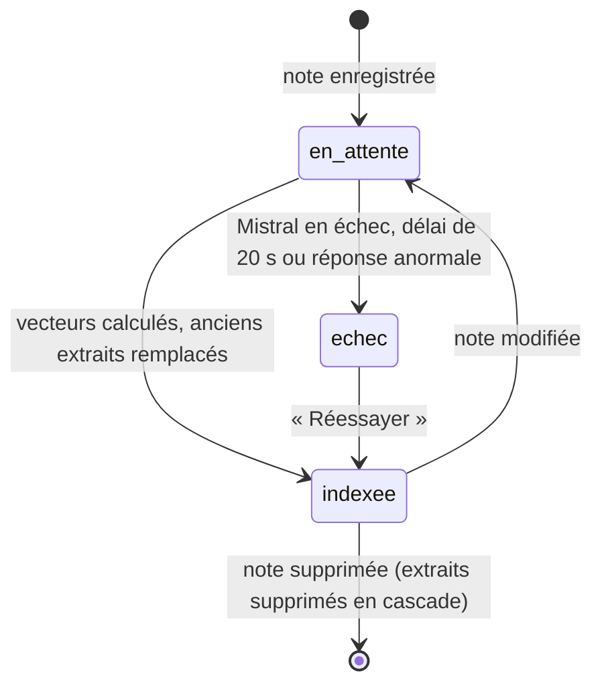

# Registre des données et index RAG, gouvernance

> **En deux phrases.** Le RAG de LogMerry repose sur **cinq tables** (notes, extraits vectorisés, historique des échanges, citations, compteur d'appels), toutes sous sécurité par ligne : chaque compte n'y voit que ses lignes, la recherche vectorielle comprise. Ce chapitre dit quelles données existent, où elles vont (dont **deux prestataires d'IA**), combien de temps elles vivent et comment on les purge ; la mention RGPD sur les envois à Anthropic et Mistral reste **à rédiger**.

Faits relevés dans le code et la base réelle le 5 novembre 2026 (lecture seule).

## Registre des données du RAG

| Table | Ce qu'elle contient | Donnée personnelle ? | Qui l'écrit | Durée de vie |
|---|---|---|---|---|
| `notes` | Titre, texte, type (note, procédure, modèle, FAQ), statut (brouillon ou active), fiche client liée, état d'indexation | **Possible** : le texte est libre (noms, e-mails de clients). Les messages du formulaire de contact y arrivent en brouillon | Le propriétaire ; la fonction `submit_contact_message` pour les messages de visiteurs | Jusqu'à suppression par le propriétaire |
| `note_chunks` | Extraits de 1 000 caractères au plus (chevauchement de 150), leur vecteur de 1 024 valeurs, le modèle d'embeddings utilisé | Oui, **copie du texte des notes** | Le serveur, à l'enregistrement d'une note ; remplacés à chaque modification | Supprimés avec leur note (cascade) |
| `messages` | Les questions posées à l'assistant et ses réponses | **Possible** : une question peut citer un nom | Le serveur, après chaque échange | Jusqu'à « Vider la conversation » (aucune expiration automatique) |
| `message_citations` | Quelle note et quel extrait ont soutenu quelle réponse | Non (références) | Le serveur | Supprimées avec le message ; si la note disparaît, la référence devient vide (`set null`), la réponse reste |
| `ai_calls` | Une ligne par appel à l'IA : compte et heure, **aucun contenu** | Non | La fonction `consume_ai_quota` seulement | Lignes de plus de 2 jours supprimées par la fonction elle-même |

Volumes réels au 5 novembre 2026 (tous comptes confondus, base de démonstration) : 4 notes (dont 3 marquées indexées et 1 en attente), 2 extraits, 10 messages, 2 citations, 120 appels enregistrés. Une note indexée peut n'avoir aucun extrait : celle-ci est un brouillon au texte vide, qui n'a rien à découper.

## L'index vectoriel

| Paramètre | Valeur | Où c'est fixé |
|---|---|---|
| Modèle d'embeddings | `mistral-embed` (Mistral AI), enregistré **dans chaque extrait** (`embedding_model`) : un seul modèle présent en base | `lib/ai/embeddings.ts` |
| Dimensions | 1 024 (colonne `vector(1024)`, vérifiée à chaque réponse de Mistral) | `lib/domain/embeddings.ts`, migration `note_chunks` |
| Index | HNSW, distance cosinus (`note_chunks_embedding_idx`) | migration `note_chunks` |
| Découpage | 1 000 caractères au plus, chevauchement de 150, coupe à une fin de phrase quand c'est possible, pas d'extrait minuscule | `lib/domain/chunking.ts` |
| Texte vectorisé | Le titre de la note puis l'extrait | `lib/domain/index-note.ts` |
| Filtre de propriété | `owner_id = auth.uid()` **dans la fonction** de recherche, en plus de la RLS | `match_chunks` |
| Seuil de similarité | 0,76 (décision d'Alex du 13 octobre 2026, réglé sur le jeu de test) | `lib/domain/matching.ts` |
| Résultats retenus | 8 extraits au plus (la fonction plafonne à 20) | `lib/domain/matching.ts`, `match_chunks` |
| Recherche complémentaire | Par mots-clés (5 au plus, plein texte français) pour les questions courtes que le seuil écarterait ; les extraits trouvés ainsi n'ont pas de score | `lib/domain/keywords.ts` |

Changer de modèle d'embeddings change la dimension et impose de **tout réindexer** (règle du projet, `CLAUDE.md`). Le bouton « Tout indexer » des paramètres sert à cela.

## Cycle de vie d'une note dans l'index

- Les vecteurs sont calculés **avant** toute écriture : en cas d'échec, les anciens extraits sont supprimés plutôt que conservés périmés (jamais de réponse fondée sur un texte qui n'existe plus).
- L'enregistrement de la note **ne dépend jamais** de l'IA : un échec d'indexation n'empêche pas d'enregistrer.

## Qui reçoit quoi : les flux vers des tiers

| Destinataire | Ce qui part | Quand | Ce qui ne part jamais |
|---|---|---|---|
| **Mistral AI** (embeddings) | Titre + extraits des notes à indexer ; la question posée à l'assistant | À l'enregistrement d'une note, à une recherche par le sens, à une question | Clients, factures, missions, historique |
| **Anthropic** (Claude) | La question et les extraits retrouvés (8 au plus) ; pour les propositions agiles, les notes cochées **liées à la fiche du client de la mission** et actives | À chaque question, résumé ou proposition | Notes d'un autre client, brouillons, notes d'un autre compte |

Règles appliquées dans le code :

- Les extraits viennent de la base, lus sous RLS : un identifiant forgé d'un autre compte est ignoré.
- Pour les propositions, seules les notes **actives** et **liées à la fiche de cette mission** sont envoyées (`notesForProposal`).
- Le texte des notes est traité comme une **donnée**, jamais comme une consigne (note piégée « IGNORE TES CONSIGNES » dans le jeu de test).
- Les appels se font **côté serveur uniquement** ; les clés ne sont jamais visibles du navigateur.

> **À confirmer.** Conditions d'Anthropic et de Mistral sur la conservation des données envoyées (durée, usage pour l'entraînement) : **non relevées à ce jour**. La mention RGPD correspondante est un point ouvert du projet (`CLAUDE.md`) ; elle sera rédigée au chapitre 13, avec la validation d'Alex.

## Gouvernance

| Sujet | Règle ou état |
|---|---|
| Propriétaire des données | Le compte qui les a créées (`owner_id`) ; aucune donnée partagée entre comptes |
| Isolation | 22 tables sous RLS ; la recherche vectorielle filtre aussi par propriétaire ; test de fuite entre deux comptes fictifs, lancé à la main (le test nocturne est prévu mais en échec faute de secrets : chapitres 10 et 11) |
| Historique | `messages` et `message_citations` ne se modifient jamais (aucune politique de modification) ; ils se lisent, s'ajoutent, se suppriment |
| Droit à l'effacement | « Vider la conversation » supprime tout l'historique **du compte seulement**, citations comprises (test `tests/purge.test.ts`, qui vérifie que l'historique de l'autre compte reste intact) ; la suppression d'une note supprime ses extraits |
| Purge au passage à l'outil pro | Décision du projet : purge complète de la base (embeddings et historique inclus), seul le portfolio est conservé, puis saisie des vraies données. Démo et réel sont isolés par la RLS, sans colonne « fictif ». **Procédure non encore exécutée** |
| Données de démonstration | Fictives ou anonymisées, étiquetées ; aucune vraie donnée client pendant le Workshop 8 |
| Journaux | Jamais le contenu d'une question, d'une note ou d'une clé : seulement la nature d'un échec |
| Durée de conservation de l'historique | **Aucune expiration automatique** ; décision à prendre avant l'usage réel (**À confirmer** avec Alex) |
| Sauvegarde de ces données | Aucune automatique sur l'offre gratuite (chapitre 12) |

## Limites et suite

| Limite | Conséquence | Piste |
|---|---|---|
| Historique conservé sans limite de durée | Des questions anciennes restent en base tant que le propriétaire ne vide pas la conversation | Expiration après N jours, une fois la durée décidée |
| Conditions des prestataires d'IA non relevées | La mention RGPD ne peut pas être complète | Relever les pages officielles de Mistral et d'Anthropic, puis valider avec Alex |
| Texte des notes copié dans `note_chunks` | Une donnée personnelle existe deux fois ; la suppression d'une note les supprime ensemble (cascade), mais une copie de sauvegarde, si elle existait, contiendrait les deux | À traiter avec la politique de sauvegarde (chapitre 12) |
| Un seul modèle d'embeddings, sans plan de migration automatisé | Un changement impose une réindexation manuelle de toutes les notes | Le bouton « Tout indexer » existe ; mesurer sa durée si le volume grandit |
