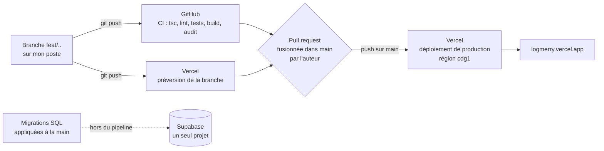

# Déploiement et retour arrière

> **En deux phrases.** Une fusion sur la branche `main` met automatiquement le code en production sur Vercel (Paris), après une vérification de GitHub qui **ne bloque pas** la fusion. La production tourne depuis le 5 novembre 2026 sur le dernier commit de `main` (fusion des pull requests n° 96, 97, 99 et 102 : portfolio public, « Qui suis-je » et formulaire de contact) ; le retour arrière existe mais **n'a jamais été exercé**, et **le test d'isolation de nuit a échoué du 30 octobre au 5 novembre** faute de secrets ; les secrets ont été créés le 5 novembre et le test passe depuis (158 contrôles sur 158).

Faits relevés le 5 novembre 2026 par la ligne de commande de Vercel, l'API de GitHub et des requêtes sur l'adresse publique (lecture seule). Aucune action de déploiement n'a été lancée pour écrire ce chapitre.

## De mon poste à la production

| Étape | Qui ou quoi | Preuve |
|---|---|---|
| 1. Développement | Une branche par fonctionnalité, petits commits | Dépôt GitHub `alexpericat-dotcom/logmerry` |
| 2. Vérification | `ci.yml` à chaque envoi et chaque pull request | Dernière exécution sur `main` (5 novembre, après la fusion du n° 99) : succès en 2 min 40 s |
| 3. Préversion | Vercel déploie chaque branche à une adresse propre | Alias du type `logmerry-git-<branche>-new-team-adce.vercel.app` |
| 4. Fusion | L'auteur fusionne la pull request dans `main` | Aucune règle de protection de branche (voir plus bas) |
| 5. Production | Vercel déploie `main` tout seul, région `cdg1` | Dernier commit déployé au 12 novembre 2026 : `7d0558e` (API des déploiements de GitHub, statut « success ») ; au 9 novembre : `89bd458` ; au 5 novembre : `59c9d8c` ; statut « Deployment has completed » (Vercel) |
| 6. Base de données | Les migrations de `supabase/migrations/` sont appliquées **à la main**, après que le SQL m'a été montré | Journal : « appliquée par Alex » ; aucune étape de migration dans la CI |

## Ce que la CI contrôle

| Fichier | Quand | Contenu | Limite |
|---|---|---|---|
| `.github/workflows/ci.yml`, tâche `check` | Chaque envoi, chaque pull request | Typage (`tsc`), analyse (`lint`), tests (`npm test`), construction (`next build`), Node 24 | Aucune base ni clé : les tests qui interrogent la vraie base n'y tournent pas |
| `ci.yml`, tâche `audit` | Idem | `npm audit` des dépendances de production, niveau « élevé » | Séparée pour qu'une panne du registre ne passe pas pour un échec du code |
| `.github/workflows/isolation.yml` | Chaque nuit (cron 3 h 17 UTC) et à la demande | Rejoue `npm run test:isolation` contre la vraie base, avec deux comptes fictifs ; option `leak` (appelle Claude et Mistral, quelques centimes) | **Réparé le 5 novembre, voir ci-dessous** |

### Le test d'isolation de nuit : réparé le 5 novembre

| Constat | Détail |
|---|---|
| Avant le 5 novembre | **7 exécutions sur 7 en échec**, du 30 octobre au 5 novembre 2026 : « Secret manquant : SUPABASE_URL », `gh secret list` vide. Le test n'avait **jamais tourné** contre la vraie base ; une régression de la sécurité par ligne n'aurait pas été vue en moins de 24 h |
| Réparation (l'auteur, 5 novembre) | Les six secrets (`SUPABASE_URL`, `SUPABASE_PUBLISHABLE_KEY`, `TEST_A_EMAIL`, `TEST_A_PASSWORD`, `TEST_B_EMAIL`, `TEST_B_PASSWORD`) ont été créés dans GitHub ; `gh secret list` les montre tous |
| Première exécution à la main (5 novembre, `main` avant les fusions) | **151 contrôles sur 152 passent**, dont tous ceux d'isolation entre deux comptes. 1 échec (statut des réalisations) |
| Seconde exécution (5 novembre, `main` après les n° 96 et 97) | **157 contrôles sur 158 passent** : l'échec du statut a disparu ; un autre apparaît (colonnes de la vue publique) |
| Troisième exécution (5 novembre, `main` après la n° 99) | **158 contrôles sur 158 passent**, aucun échec. Run GitHub 42094696418 |
| L'échec de la seconde exécution | La vue publique exposait deux colonnes de plus que celles attendues par le test (`design_choice`, `validation`), ajoutées à la base par la migration de la branche `feat/realisation-design-choice`, appliquée avant d'être fusionnée. Ce n'était pas une fuite (deux champs texte facultatifs) ; corrigé par la fusion de la pull request n° 99 (le test est mis à jour dans la même branche) |
| Conséquence | Le test de nuit est **entièrement vert** depuis le 5 novembre. Il prouve que la base et le code de `main` sont alignés : tout écart futur (migration appliquée avant sa fusion) le fera échouer, ce qui est son rôle |

Les notifications d'échec de GitHub n'ont pas servi : sept échecs d'affilée, du 30 octobre au 5 novembre, sont restés sans réaction. **Constaté** (captures d'écran de l'auteur, 12 novembre 2026) : les notifications des workflows Actions sont activées par GitHub et par e-mail, échecs uniquement (Settings > Notifications du compte GitHub, vers 21:37) ; la recherche Gmail « from:notifications@github.com "failed" » (22:10) donne 26 résultats, dont ceux du 3, 4, 5 novembre et du 12 novembre 14:58 dans la boîte de réception, la plupart non lus (un seul lu, du 4 novembre). **Déclaré** (auteur, 12 novembre 2026 à 22:24, non vérifié) : filtre Gmail créé sur ces e-mails (expéditeur notifications@github.com, mot « failed ») : suivi (étoile), marqué important, jamais en spam, catégorie Principale ; il ne s'applique qu'aux nouveaux e-mails, n'est pas testé et n'envoie pas de notification sur téléphone. Effet du filtre : **non vérifié**. Conclusion : la réception est établie ; la réaction dépend de la lecture des e-mails ; le filtre vise à la faciliter, effet non constaté.

## Configuration de production

| Élément | Valeur relevée |
|---|---|
| Hébergeur | Vercel, projet `logmerry`, équipe `new-team-adce` |
| Région des fonctions | `cdg1` (Paris), fixée dans `vercel.json` (`{ "regions": ["cdg1"] }`) et confirmée sur le déploiement |
| Framework, Node | Next.js, Node 24 |
| Branche de production | `main` |
| Adresse publique de production | **`https://logmerry.vercel.app`** (alias Vercel gratuit) ; autres alias : `logmerry-new-team-adce.vercel.app`, `logmerry-git-main-new-team-adce.vercel.app` |
| Nom de domaine propre | **Constaté** le 12 novembre 2026 sur la page Overview du projet Vercel (capture de l'auteur, 22:14) : un seul domaine listé, `logmerry.vercel.app` ; la recommandation « Add Custom Domain » n'est pas cochée : aucun domaine propre |
| Accès aux préversions et aux adresses de déploiement | **Protégés** par la connexion Vercel (réponse 302 vers l'identification) ; seul l'alias de production est ouvert au public. Un visiteur arrive sur la page de connexion de l'application |
| Variables d'environnement (noms seulement) | `ANTHROPIC_API_KEY`, `MISTRAL_API_KEY` (production seulement), `AI_CHAT_MODEL`, `NEXT_PUBLIC_SUPABASE_URL` (production et préversion), `NEXT_PUBLIC_SUPABASE_PUBLISHABLE_KEY` (**production seulement**) (constat du 5 novembre 2026, `docs/journal.md:820`, non revérifié à ce jour) |
| Base de données | **Un seul projet Supabase** (« LogMerry », Paris, `eu-west-3`) : il n'existe **pas de base de recette distincte** |

Deux écarts à connaître :

1. **Les préversions ne sont pas équipées comme la production.** Les clés Anthropic et Mistral et la clé publique Supabase ne sont définies que pour la production : une préversion ne peut pas faire tout ce que fait la production (assistant, connexion) ; l'effet exact n'a pas été essayé (**À confirmer**). Constat du 5 novembre 2026 (`docs/journal.md:820`), **non revérifié à ce jour**. Observé le 10 novembre 2026 (par l'assistant de code, dans le navigateur piloté, après une connexion Vercel saisie par l'utilisateur) : l'aperçu de `feat/portfolio-image-zoom` affichait des réalisations ; l'origine des données et la configuration des variables n'ont pas été relues.
2. **Il n'y a pas d'environnement de recette.** Les préversions et la production, quand elles parlent à Supabase, parlent au même projet. Le code de développement et les tests visent la même base que la démonstration.

## Compte rendu de mise en production (état au 5 novembre 2026)

| Élément | Valeur |
|---|---|
| Dernier déploiement de production | 5 novembre 2026, après la fusion des n° 96, 97, 99 puis 102 par l'auteur (accords donnés dans la conversation) ; statut **Ready** (capture Vercel pour le n° 97 : construction 33 s) |
| Commit déployé | `59c9d8c`, fusion de la pull request n° 102 (formulaire de contact et « Qui suis-je »), précédée des n° 96 (page publique du portfolio), 97 (statut des réalisations) et 99 (« Choix de conception » et « Validation ») |
| CI sur ces commits | Succès. La CI de `main` a échoué une première fois sur un test (« double clic sur Ajouter », attente d'une seconde) puis réussi à la relance : test **instable**, noté |
| Adresse | `https://logmerry.vercel.app` : `/` et `/portfolio/qui-suis-je` renvoient à la connexion, `/auth/login` répond 200, **`/portfolio` répond 200 sans connexion** (vérifié le 5 novembre) |
| Historique | Avant le 5 novembre : une vingtaine de déploiements « Ready » du 29 au 30 octobre |
| **Ce qui n'est pas en production** | Rien de planifié : tout ce qui est fusionné est déployé. La pull request n° 98 (`feat/about-page`) devient redondante, ses commits étant dans la n° 102 (fermée le 12 novembre 2026) ; état à jour au 12 novembre : voir « Mises en production du 12 novembre 2026 » |
| Migrations déjà appliquées à la base partagée | Plus d'écart connu : la base et `main` sont alignés (test de nuit : 158 sur 158 après la fusion de la n° 102) |

> **À savoir.** Rien n'est fusionné, ouvert ni poussé sans l'accord explicite de l'auteur ; les n° 96, 97, 99 et 102 l'ont été avec cet accord le 5 novembre. La n° 101 (livrables) a été fusionnée le 9 novembre 2026 avec son accord, et la n° 100 (brouillon) fermée.

## Mises en production du 12 novembre 2026

Toutes avec l'accord explicite de l'auteur, une à la fois. Après chacune : CI de `main`, déploiement Vercel de production, comparaison du SHA déployé à celui de `main` (API des déploiements de GitHub), puis `tsc`, `eslint` et `npm test` lancés sur `main` en local (sans fichier d'environnement ni réseau).

| Étape | Commit sur `main` | CI (`check`, `audit`) | Vercel, production | Tests locaux |
|---|---|---|---|---|
| Envoi de `main` (44 commits de documentation et d'outillage du PDF ; 0 fichier de `app/`, `lib/`, `components/`, `supabase/`, `public/`, `package.json`, lockfile) | `3a6c503` | succès | succès, SHA déployé = `3a6c503` | 1 177, 0 échec (mesuré avant les fusions) |
| Pull request n° 103 : les messages du formulaire de contact ne sont jamais indexés, quel que soit le chemin (correctif « T4 » : `be839b8`, `0907aa7`) | `9f3eb14` | succès | succès, SHA déployé = `9f3eb14` | 1 179, 0 échec |
| Pull request n° 104 : le texte du portfolio dit que l'assistant signale quand les notes ne soutiennent pas la réponse (`b849391`) | `ce283a2` | succès | succès, SHA déployé = `ce283a2` | 1 179, 0 échec |
| Pull request n° 105 : la mention « Ouvre un site externe » près de « Voir en direct » (`0ba9b5b`) | `7d0558e` | succès | succès, SHA déployé = `7d0558e` | 1 180, 0 échec |

- **Dernier commit applicatif déployé : `7d0558e`** (fusion de la n° 105, dont les commits de code sont `be839b8`, `0907aa7`, `b849391` et `0ba9b5b`). Les commits qui suivent ne touchent que la documentation.
- **Pas fusionnée** : `feat/portfolio-image-zoom` (agrandissement des miniatures du portfolio, `01f1886`) ; elle n'est donc pas en production. La pull request n° 98 a été fermée le 12 novembre (redondante : son contenu est dans `main` par la n° 102, `59c9d8c`).
- **Test instable** : sur la pull request n° 105, la CI a échoué une fois sur « double clic sur Ajouter » (exécution 43232018357), puis réussi à la relance sans changement de code ; le même test avait déjà échoué le 3 novembre (exécution 41661178343, commit `9766ea4`, vert dans l'exécution 41661167369 du même commit). 2 échecs sur 300 exécutions de la CI examinées (du 23 octobre au 12 novembre 2026) ; les 15 autres échecs de cette période viennent d'autres tests. Chaque échec est survenu à environ 1 050 ms, l'attente par défaut d'une seconde. Aucun code corrigé.

## Retour arrière

| Question | Réponse |
|---|---|
| Comment | Rétablir un déploiement précédent de production : tableau de bord Vercel (Deployments, « Instant Rollback ») ou `vercel rollback <adresse-du-déploiement>` ; `vercel rollback status` indique l'état |
| Quoi revenir | Le code seulement. Les déploiements précédents restent disponibles (une vingtaine listés) |
| **Ce qui ne revient pas** | **La base de données.** Une migration appliquée ne se défait pas avec le déploiement : le schéma n'avance que dans un sens. Un retour arrière du code après une migration qui supprime ou renomme une colonne peut donc casser l'application ancienne |
| Exercé ? | **Non, jamais.** Je ne l'ai pas lancé : il modifierait la production |
| Durée attendue | **À confirmer** (non mesurée) |
| Protection de la branche `main` | **Impossible aujourd'hui** : GitHub répond que cette fonction demande l'offre Pro ou un dépôt public. Rien n'empêche donc une fusion malgré une CI en échec ; seule la discipline de l'auteur le fait |

Procédure d'exercice proposée, à faire avec ton accord, hors des heures de démonstration : noter le déploiement actuel, rétablir le précédent, vérifier `/auth/login` et `/api/chat`, puis rétablir le déploiement noté. Durée mesurée à reporter ici.

## Ce qui n'existe pas

| Élément | État |
|---|---|
| Migrations dans le pipeline | **Aucune** : appliquées à la main |
| Environnement de recette ou base de recette | **Aucun** |
| Protection de la branche `main` | **Impossible** sur l'offre actuelle de GitHub |
| Alertes de déploiement ou de panne | **Aucune configurée** (GitHub : **constaté** (captures de l'auteur, 12 novembre 2026) : notifications des workflows activées par GitHub et par e-mail, échecs uniquement ; recherche Gmail : 26 résultats, la plupart non lus (un seul lu, du 4 novembre) ; **déclaré** (22:24, non vérifié) : filtre Gmail créé, non testé, sans notification sur téléphone ; la réaction dépend de la lecture des e-mails, effet du filtre non constaté ; Vercel : page Alerts du projet (plan Hobby), **constatée** (capture de l'auteur, 12 novembre 2026, 22:11) : elle ne propose que « Upgrade to Pro » ; aucune alerte n'est configurée ; la création d'alertes semble réservée au plan Pro (déduit de la page, pas de la documentation) ; notifications d'échec de déploiement du compte : **non vérifiées**) |
| Déploiement progressif (« rolling release ») | **Non utilisé** |
| Test automatique après déploiement (« smoke test ») | **Aucun** |

## Limites et suite

| Limite | Piste |
|---|---|
| Fusion possible malgré une CI rouge | Protection de `main` impossible sur l'offre GitHub actuelle ; discipline, ou offre GitHub payante, ce que je ne recommande pas pour un projet de démonstration |
| Préversions sans clés | Ajouter les variables manquantes aux préversions, si on veut les utiliser pour la démonstration |
| Retour arrière jamais essayé | Exercice décrit ci-dessus |
| Écart entre la base et le code publié | Aucun écart de schéma connu (voir « Migrations déjà appliquées ») ; les quatre branches qui attendaient le 10 novembre ne contenaient aucune migration (`git diff --name-only` : 0 fichier `supabase/`). Au 12 novembre, trois ont été fusionnées (n° 103, 104 et 105, voir « Mises en production du 12 novembre 2026 ») ; `feat/portfolio-image-zoom` (commit `01f1886`) **n'est pas fusionnée et n'est pas en production** |
| Test de composants instable | « double clic sur Ajouter » (`tests/components/realisation-images.test.tsx:90`) : 2 échecs sur 300 exécutions de la CI examinées, chaque fois vert au même commit ou à la relance ; aucun code corrigé. À garder en tête : un échec isolé de la CI sur ce test se relance, sans conclure à une régression |
