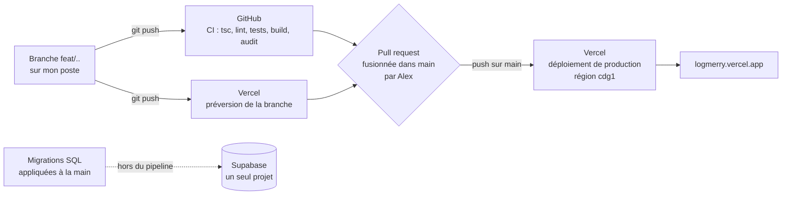

# Déploiement et retour arrière

> **En deux phrases.** Une fusion sur la branche `main` met automatiquement le code en production sur Vercel (Paris), après une vérification de GitHub qui **ne bloque pas** la fusion. La production tourne depuis le 5 novembre 2026 sur le dernier commit de `main` (fusion des pull requests n° 96, 97 et 99, avec le portfolio public) ; le retour arrière existe mais **n'a jamais été exercé**, et **le test d'isolation de nuit a échoué du 30 octobre au 5 novembre** faute de secrets ; les secrets ont été créés le 5 novembre et le test passe depuis (158 contrôles sur 158).

Faits relevés le 5 novembre 2026 par la ligne de commande de Vercel, l'API de GitHub et des requêtes sur l'adresse publique (lecture seule). Aucune action de déploiement n'a été lancée pour écrire ce chapitre.

## De mon poste à la production

| Étape | Qui ou quoi | Preuve |
|---|---|---|
| 1. Développement | Une branche par fonctionnalité, petits commits | Dépôt GitHub `alexpericat-dotcom/logmerry` |
| 2. Vérification | `ci.yml` à chaque envoi et chaque pull request | Dernière exécution sur `main` : succès en 1 min 34 s |
| 3. Préversion | Vercel déploie chaque branche à une adresse propre | Alias du type `logmerry-git-<branche>-new-team-adce.vercel.app` |
| 4. Fusion | Alex fusionne la pull request dans `main` | Aucune règle de protection de branche (voir plus bas) |
| 5. Production | Vercel déploie `main` tout seul, région `cdg1` | Déploiement `dpl_2EvRdV7zKFvkzzBg21ADVGMstVhF` |
| 6. Base de données | Les migrations de `supabase/migrations/` sont appliquées **à la main**, après que le SQL m'a été montré | Journal : « appliquée par Alex » ; aucune étape de migration dans la CI |

## Ce que la CI contrôle

| Fichier | Quand | Contenu | Limite |
|---|---|---|---|
| `.github/workflows/ci.yml`, tâche `check` | Chaque envoi, chaque pull request | Typage (`tsc`), analyse (`lint`), tests (`npm test`), construction (`next build`), Node 24 | Aucune base ni clé : les tests qui interrogent la vraie base n'y tournent pas |
| `ci.yml`, tâche `audit` | Idem | `npm audit` des dépendances de production, niveau « élevé » | Séparée pour qu'une panne du registre ne passe pas pour un échec du code |
| `.github/workflows/isolation.yml` | Chaque nuit (cron 3 h 17 UTC) et à la demande | Rejoue `npm run test:isolation` contre la vraie base, avec deux comptes fictifs ; option `leak` (appelle Claude et Mistral, quelques centimes) | **Réparé le 5 novembre, voir ci-dessous** |

### Le test d'isolation de nuit : réparé le 5 novembre

| Constat | Détail |
|---|---|
| Avant le 5 novembre | **7 exécutions sur 7 en échec**, du 30 octobre au 5 novembre 2026 : « Secret manquant : SUPABASE_URL », `gh secret list` vide. Le test n'avait **jamais tourné** contre la vraie base ; une régression de la sécurité par ligne n'aurait pas été vue en moins de 24 h |
| Réparation (Alex, 5 novembre) | Les six secrets (`SUPABASE_URL`, `SUPABASE_PUBLISHABLE_KEY`, `TEST_A_EMAIL`, `TEST_A_PASSWORD`, `TEST_B_EMAIL`, `TEST_B_PASSWORD`) ont été créés dans GitHub ; `gh secret list` les montre tous |
| Première exécution à la main (5 novembre, `main` avant les fusions) | **151 contrôles sur 152 passent**, dont tous ceux d'isolation entre deux comptes. 1 échec (statut des réalisations) |
| Seconde exécution (5 novembre, `main` après les n° 96 et 97) | **157 contrôles sur 158 passent** : l'échec du statut a disparu ; un autre apparaît (colonnes de la vue publique) |
| Troisième exécution (5 novembre, `main` après la n° 99) | **158 contrôles sur 158 passent**, aucun échec. Run GitHub 42094696418 |
| L'échec de la seconde exécution | La vue publique exposait deux colonnes de plus que celles attendues par le test (`design_choice`, `validation`), ajoutées à la base par la migration de la branche `feat/realisation-design-choice`, appliquée avant d'être fusionnée. Ce n'était pas une fuite (deux champs texte facultatifs) ; corrigé par la fusion de la pull request n° 99 (le test est mis à jour dans la même branche) |
| Conséquence | Le test de nuit est **entièrement vert** depuis le 5 novembre. Il prouve que la base et le code de `main` sont alignés : tout écart futur (migration appliquée avant sa fusion) le fera échouer, ce qui est son rôle |

Les notifications d'échec de GitHub n'ont pas servi : sept échecs d'affilée, du 30 octobre au 5 novembre, sont restés sans réaction (aucune alerte lue ou configurée : **À confirmer**).

## Configuration de production

| Élément | Valeur relevée |
|---|---|
| Hébergeur | Vercel, projet `logmerry`, équipe `new-team-adce` |
| Région des fonctions | `cdg1` (Paris), fixée dans `vercel.json` (`{ "regions": ["cdg1"] }`) et confirmée sur le déploiement |
| Framework, Node | Next.js, Node 24 |
| Branche de production | `main` |
| Adresse publique de production | **`https://logmerry.vercel.app`** (alias Vercel gratuit) ; autres alias : `logmerry-new-team-adce.vercel.app`, `logmerry-git-main-new-team-adce.vercel.app` |
| Nom de domaine propre | **Aucun relevé** : **À confirmer** |
| Accès aux préversions et aux adresses de déploiement | **Protégés** par la connexion Vercel (réponse 302 vers l'identification) ; seul l'alias de production est ouvert au public. Un visiteur arrive sur la page de connexion de l'application |
| Variables d'environnement (noms seulement) | `ANTHROPIC_API_KEY`, `MISTRAL_API_KEY` (production seulement), `AI_CHAT_MODEL`, `NEXT_PUBLIC_SUPABASE_URL` (production et préversion), `NEXT_PUBLIC_SUPABASE_PUBLISHABLE_KEY` (**production seulement**) |
| Base de données | **Un seul projet Supabase** (« LogMerry », Paris, `eu-west-3`) : il n'existe **pas de base de recette distincte** |

Deux écarts à connaître :

1. **Les préversions ne sont pas équipées comme la production.** Les clés Anthropic et Mistral et la clé publique Supabase ne sont définies que pour la production : une préversion ne peut pas faire tout ce que fait la production (assistant, connexion) ; l'effet exact n'a pas été essayé (**À confirmer**).
2. **Il n'y a pas d'environnement de recette.** Les préversions et la production, quand elles parlent à Supabase, parlent au même projet. Le code de développement et les tests visent la même base que la démonstration.

## Compte rendu de mise en production (état au 5 novembre 2026)

| Élément | Valeur |
|---|---|
| Dernier déploiement de production | 5 novembre 2026, après la fusion des n° 96, 97 puis 99 par Alex (accords donnés dans la conversation) ; statut **Ready** (capture Vercel pour le n° 97 : construction 33 s) |
| Commit déployé | `475a7f9`, fusion de la pull request n° 99 (champs « Choix de conception » et « Validation »), précédée des n° 96 (`7a2103e`, page publique du portfolio) et 97 (`da3614c`, statut des réalisations) |
| CI sur ces commits | Succès. La CI de `main` a échoué une première fois sur un test (« double clic sur Ajouter », attente d'une seconde) puis réussi à la relance : test **instable**, noté |
| Adresse | `https://logmerry.vercel.app` : `/` et `/portfolio/qui-suis-je` renvoient à la connexion, `/auth/login` répond 200, **`/portfolio` répond 200 sans connexion** (vérifié le 5 novembre) |
| Historique | Avant le 5 novembre : une vingtaine de déploiements « Ready » du 29 au 30 octobre |
| **Ce qui n'est pas en production** | Les branches `feat/about-page` (n° 98) et `feat/contact-form`, **non fusionnées** |
| Migrations déjà appliquées à la base partagée | Celles du formulaire de contact (branche non fusionnée) : la base reste en avance sur le code publié pour cette seule fonction. Le test de nuit le signalerait s'il portait dessus |

Une méprise à noter : juste après la fusion, ma première vérification (API de GitHub et de Vercel) n'a pas montré le déploiement et m'a fait croire à tort qu'il n'avait pas eu lieu. La capture de Vercel et une nouvelle requête sur l'adresse l'ont corrigé.

> **À décider avant la soutenance.** Ce qui doit encore être mis en production le 16 novembre (« Qui suis-je », formulaire de contact), et dans quel ordre le fusionner. Je ne fusionne rien, n'ouvre aucune pull request et ne pousse rien sans ton accord explicite.

## Retour arrière

| Question | Réponse |
|---|---|
| Comment | Rétablir un déploiement précédent de production : tableau de bord Vercel (Deployments, « Instant Rollback ») ou `vercel rollback <adresse-du-déploiement>` ; `vercel rollback status` indique l'état |
| Quoi revenir | Le code seulement. Les déploiements précédents restent disponibles (une vingtaine listés) |
| **Ce qui ne revient pas** | **La base de données.** Une migration appliquée ne se défait pas avec le déploiement : le schéma n'avance que dans un sens. Un retour arrière du code après une migration qui supprime ou renomme une colonne peut donc casser l'application ancienne |
| Exercé ? | **Non, jamais.** Je ne l'ai pas lancé : il modifierait la production |
| Durée attendue | **À confirmer** (non mesurée) |
| Protection de la branche `main` | **Impossible aujourd'hui** : GitHub répond que cette fonction demande l'offre Pro ou un dépôt public. Rien n'empêche donc une fusion malgré une CI en échec ; seule la discipline d'Alex le fait |

Procédure d'exercice proposée, à faire avec ton accord, hors des heures de démonstration : noter le déploiement actuel, rétablir le précédent, vérifier `/auth/login` et `/api/chat`, puis rétablir le déploiement noté. Durée mesurée à reporter ici.

## Ce qui n'existe pas

| Élément | État |
|---|---|
| Migrations dans le pipeline | **Aucune** : appliquées à la main |
| Environnement de recette ou base de recette | **Aucun** |
| Protection de la branche `main` | **Impossible** sur l'offre actuelle de GitHub |
| Alertes de déploiement ou de panne | **Aucune configurée** (**À confirmer** : notifications GitHub et Vercel) |
| Déploiement progressif (« rolling release ») | **Non utilisé** |
| Test automatique après déploiement (« smoke test ») | **Aucun** |

## Limites et suite

| Limite | Piste |
|---|---|
| Écart base / code restant : le formulaire de contact | Fusionner `feat/contact-form` (décision d'Alex) ; relancer ensuite `gh workflow run isolation.yml` |
| Fusion possible malgré une CI rouge | Discipline ; ou offre GitHub payante, ce que je ne recommande pas pour un projet de démonstration |
| Préversions sans clés | Ajouter les variables manquantes aux préversions, si on veut les utiliser pour la démonstration |
| Retour arrière jamais essayé | Exercice décrit ci-dessus |
| Écart entre la base et le code publié | Décider du contenu de la mise en production avant le 16 novembre |
