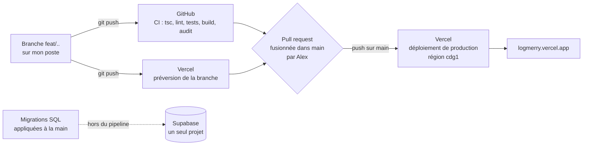

# Déploiement et retour arrière

> **En deux phrases.** Une fusion sur la branche `main` met automatiquement le code en production sur Vercel (Paris), après une vérification de GitHub qui **ne bloque pas** la fusion. La production tourne aujourd'hui sur le dernier commit de `main` (30 octobre 2026) ; le retour arrière existe mais **n'a jamais été exercé**, et **le test d'isolation de nuit est en échec depuis le 30 octobre** parce que ses secrets n'ont jamais été créés.

Faits relevés le 5 novembre 2026 par la ligne de commande de Vercel, l'API de GitHub et des requêtes sur l'adresse publique (lecture seule). Aucune action de déploiement n'a été lancée pour écrire ce chapitre.

## De mon poste à la production

| Étape | Qui ou quoi | Preuve |
|---|---|---|
| 1. Développement | Une branche par fonctionnalité, petits commits | Dépôt GitHub `alexpericat-dotcom/logmerry` |
| 2. Vérification | `ci.yml` à chaque envoi et chaque pull request | Dernière exécution sur `main` : succès en 1 min 34 s |
| 3. Préversion | Vercel déploie chaque branche à une adresse propre | Alias du type `logmerry-git-<branche>-new-team-adce.vercel.app` |
| 4. Fusion | Alex fusionne la pull request dans `main` | Aucune règle de protection de branche (voir plus bas) |
| 5. Production | Vercel déploie `main` tout seul, région `cdg1` | Déploiement `dpl_2EvRdV7zKFvkzzBg21ADVGMstVhF` |
| 6. Base de données | Les migrations de `supabase/migrations/` sont appliquées **à la main**, après que le SQL m'a été montré | Journal : « appliquée par Alex » ; aucune étape de migration dans la CI |

## Ce que la CI contrôle

| Fichier | Quand | Contenu | Limite |
|---|---|---|---|
| `.github/workflows/ci.yml`, tâche `check` | Chaque envoi, chaque pull request | Typage (`tsc`), analyse (`lint`), tests (`npm test`), construction (`next build`), Node 24 | Aucune base ni clé : les tests qui interrogent la vraie base n'y tournent pas |
| `ci.yml`, tâche `audit` | Idem | `npm audit` des dépendances de production, niveau « élevé » | Séparée pour qu'une panne du registre ne passe pas pour un échec du code |
| `.github/workflows/isolation.yml` | Chaque nuit (cron 3 h 17 UTC) et à la demande | Rejoue `npm run test:isolation` contre la vraie base, avec deux comptes fictifs ; option `leak` (appelle Claude et Mistral, quelques centimes) | **En échec, voir ci-dessous** |

### Le test d'isolation de nuit ne fonctionne pas

| Constat | Détail |
|---|---|
| État | **7 exécutions sur 7 en échec**, du 30 octobre au 5 novembre 2026 |
| Cause | Le journal de la dernière exécution dit : « Secret manquant : SUPABASE_URL ». La liste des secrets du dépôt (`gh secret list`) est **vide** : les six secrets décrits dans l'en-tête du fichier n'ont jamais été créés |
| Conséquence | Ce test n'a **jamais tourné** automatiquement contre la vraie base. Les contrôles d'isolation réels reposent sur `npm run test:isolation`, lancé à la main sur le poste d'Alex. Une régression de la sécurité par ligne ne serait donc pas vue en moins de 24 h, contrairement à ce que dit l'en-tête du fichier |
| Réparation | Créer dans GitHub (Settings, Secrets and variables, Actions) `SUPABASE_URL`, `SUPABASE_PUBLISHABLE_KEY`, `TEST_A_EMAIL`, `TEST_A_PASSWORD`, `TEST_B_EMAIL`, `TEST_B_PASSWORD`. Je ne peux pas le faire à ta place et je ne manipule aucun mot de passe. **Décision d'Alex** |

Les notifications d'échec de GitHub n'ont pas servi : sept échecs d'affilée sont restés sans réaction (aucune alerte lue ou configurée : **À confirmer**).

## Configuration de production

| Élément | Valeur relevée |
|---|---|
| Hébergeur | Vercel, projet `logmerry`, équipe `new-team-adce` |
| Région des fonctions | `cdg1` (Paris), fixée dans `vercel.json` (`{ "regions": ["cdg1"] }`) et confirmée sur le déploiement |
| Framework, Node | Next.js, Node 24 |
| Branche de production | `main` |
| Adresse publique de production | **`https://logmerry.vercel.app`** (alias Vercel gratuit) ; autres alias : `logmerry-new-team-adce.vercel.app`, `logmerry-git-main-new-team-adce.vercel.app` |
| Nom de domaine propre | **Aucun relevé** : **À confirmer** |
| Accès aux préversions et aux adresses de déploiement | **Protégés** par la connexion Vercel (réponse 302 vers l'identification) ; seul l'alias de production est ouvert au public. Un visiteur arrive sur la page de connexion de l'application |
| Variables d'environnement (noms seulement) | `ANTHROPIC_API_KEY`, `MISTRAL_API_KEY` (production seulement), `AI_CHAT_MODEL`, `NEXT_PUBLIC_SUPABASE_URL` (production et préversion), `NEXT_PUBLIC_SUPABASE_PUBLISHABLE_KEY` (**production seulement**) |
| Base de données | **Un seul projet Supabase** (« LogMerry », Paris, `eu-west-3`) : il n'existe **pas de base de recette distincte** |

Deux écarts à connaître :

1. **Les préversions ne sont pas équipées comme la production.** Les clés Anthropic et Mistral et la clé publique Supabase ne sont définies que pour la production : une préversion ne peut pas faire tout ce que fait la production (assistant, connexion) ; l'effet exact n'a pas été essayé (**À confirmer**).
2. **Il n'y a pas d'environnement de recette.** Les préversions et la production, quand elles parlent à Supabase, parlent au même projet. Le code de développement et les tests visent la même base que la démonstration.

## Compte rendu de mise en production (état au 5 novembre 2026)

| Élément | Valeur |
|---|---|
| Dernier déploiement de production | 30 octobre 2026 à 12 h 39 (heure de Paris), statut **Ready**, construction 38 s |
| Commit déployé | `5db86bf`, fusion de la pull request n° 95 (captures d'écran des réalisations, texte alternatif obligatoire) |
| CI sur ce commit | Succès (1 min 34 s) |
| Adresse | `https://logmerry.vercel.app` : répond (la racine renvoie vers `/auth/login`, qui répond en 200 ; `/api/chat` sans connexion répond 401, comme prévu) |
| Historique | Une vingtaine de déploiements de production visibles, tous « Ready », de 19 à 54 secondes, du 29 au 30 octobre |
| **Ce qui n'est pas en production** | Tout ce qui a été fait depuis le 30 octobre et n'est pas fusionné dans `main` : au 5 novembre, `main` n'a aucun commit après la pull request n° 95. Les branches `feat/about-page`, `feat/realisation-status`, `feat/realisation-design-choice` et `feat/contact-form` ont des préversions mais **ne sont pas fusionnées** |
| Migrations déjà appliquées à la base partagée | Certaines migrations de ces branches sont **déjà appliquées** (par exemple le formulaire de contact) alors que leur code n'est pas en production : la base est en avance sur le code publié |

> **À décider avant la soutenance.** Ce qui doit être en production le 16 novembre, et dans quel ordre le fusionner. Je ne fusionne rien, n'ouvre aucune pull request et ne pousse rien sans ton accord explicite.

## Retour arrière

| Question | Réponse |
|---|---|
| Comment | Rétablir un déploiement précédent de production : tableau de bord Vercel (Deployments, « Instant Rollback ») ou `vercel rollback <adresse-du-déploiement>` ; `vercel rollback status` indique l'état |
| Quoi revenir | Le code seulement. Les déploiements précédents restent disponibles (une vingtaine listés) |
| **Ce qui ne revient pas** | **La base de données.** Une migration appliquée ne se défait pas avec le déploiement : le schéma n'avance que dans un sens. Un retour arrière du code après une migration qui supprime ou renomme une colonne peut donc casser l'application ancienne |
| Exercé ? | **Non, jamais.** Je ne l'ai pas lancé : il modifierait la production |
| Durée attendue | **À confirmer** (non mesurée) |
| Protection de la branche `main` | **Impossible aujourd'hui** : GitHub répond que cette fonction demande l'offre Pro ou un dépôt public. Rien n'empêche donc une fusion malgré une CI en échec ; seule la discipline d'Alex le fait |

Procédure d'exercice proposée, à faire avec ton accord, hors des heures de démonstration : noter le déploiement actuel, rétablir le précédent, vérifier `/auth/login` et `/api/chat`, puis rétablir le déploiement noté. Durée mesurée à reporter ici.

## Ce qui n'existe pas

| Élément | État |
|---|---|
| Migrations dans le pipeline | **Aucune** : appliquées à la main |
| Environnement de recette ou base de recette | **Aucun** |
| Protection de la branche `main` | **Impossible** sur l'offre actuelle de GitHub |
| Alertes de déploiement ou de panne | **Aucune configurée** (**À confirmer** : notifications GitHub et Vercel) |
| Déploiement progressif (« rolling release ») | **Non utilisé** |
| Test automatique après déploiement (« smoke test ») | **Aucun** |

## Limites et suite

| Limite | Piste |
|---|---|
| Test de nuit en échec | Créer les six secrets (décision d'Alex), puis lancer le test à la main une fois pour vérifier |
| Fusion possible malgré une CI rouge | Discipline ; ou offre GitHub payante, ce que je ne recommande pas pour un projet de démonstration |
| Préversions sans clés | Ajouter les variables manquantes aux préversions, si on veut les utiliser pour la démonstration |
| Retour arrière jamais essayé | Exercice décrit ci-dessus |
| Écart entre la base et le code publié | Décider du contenu de la mise en production avant le 16 novembre |
