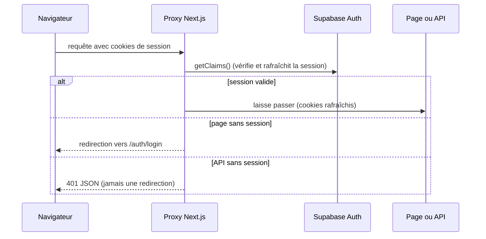

# Sécurité d'accès : authentification, droits et secrets

> **En deux phrases.** Chaque donnée appartient à un seul compte, et c'est **la base de données elle-même** qui l'impose (sécurité par ligne sur les 22 tables), pas seulement l'application. Il n'y a **ni SSO ni double authentification (MFA)** : l'accès repose sur un e-mail et un mot de passe d'au moins 12 caractères, et c'est une limite assumée de cette version.

Faits relevés dans le code, les migrations et la base réelle le 5 novembre 2026 (lecture seule).

## Authentification

| Sujet | État |
|---|---|
| Méthode de connexion | E-mail et mot de passe (`signInWithPassword`), service Supabase Auth |
| Longueur minimale du mot de passe | 12 caractères (`MIN_PASSWORD_LENGTH`) |
| SSO (connexion par un fournisseur externe) | **Aucun** : aucun appel dans le code |
| MFA (second facteur) | **Aucun** : rien dans le code, et 0 facteur enregistré dans la base |
| Double authentification des comptes d'administration | Constat de l'auteur, non vérifié autrement : la double authentification a été activée sur Vercel le 12 novembre 2026 en soirée (heure exacte non relevée). L'état de la double authentification sur GitHub et sur Supabase n'est pas établi |
| Création de compte | **Aucune page d'inscription** dans l'application. La base compte 5 comptes. L'inscription est **désactivée** dans le tableau de bord de Supabase (réglage déclaré par l'auteur le 5 novembre 2026 ; non lisible par les outils utilisés ici) |
| Mot de passe oublié | Lien envoyé par e-mail, retour sur `/auth/confirm` (échange d'un code PKCE contre une session côté serveur), puis page de nouveau mot de passe |
| Mots de passe déjà divulgués | Protection **désactivée** : elle est réservée à l'offre Pro de Supabase |
| Messages d'erreur | Traduits en français, jamais le texte brut ; un même message pour « e-mail inconnu » et « mauvais mot de passe » (`invalid_credentials`) |

Le proxy (`proxy.ts`, règle `accessDecision`, testée) applique une règle simple : sans session, seules les pages `/auth/…` et les deux pages du portfolio public (`/portfolio`, `/portfolio/qui-suis-je`) sont accessibles. Tout le reste est refusé. Le paramètre `next` de retour de connexion est filtré (`safeNext`) pour empêcher une redirection vers un autre site.

## Matrice des droits

L'application est **mono-propriétaire** : il n'y a pas de rôles « admin » ou « lecteur », seulement trois situations.

| Qui | Tables de l'application | Vues publiques du portfolio | Formulaire de contact | Fonctions d'IA et quota |
|---|---|---|---|---|
| **Visiteur sans compte** (`anon`) | Aucun droit | Lecture de 2 vues : `public_realisations`, `public_realisation_images` | Peut appeler `submit_contact_message` | Aucun |
| **Compte connecté** (`authenticated`) | Lit et écrit **ses propres lignes seulement** (`owner_id = auth.uid()`) | Voit aussi ses réalisations non publiées, par ses tables | Aucun | Appelle le chat, limité à 20 appels par minute et 300 par jour |
| **`service_role`** (clé d'administration) | **Non utilisé** | Non utilisé | Non utilisé | Non utilisé |

Les deux vues du portfolio ne montrent que les réalisations « publiées **et** avec accord du client », avec une liste blanche de colonnes fixée par un test : ajouter une colonne sans modifier le test fait échouer la CI.

## Comment c'est garanti dans la base

Mesures prises dans la base réelle le 5 novembre 2026 :

| Contrôle | Résultat |
|---|---|
| Tables de `public` avec sécurité par ligne activée | **22 sur 22** |
| Politiques de sécurité | 74, **toutes réservées aux comptes connectés** ; aucune ouverte à tous |
| Droits de `anon` | 2 lectures seulement (les 2 vues du portfolio) et l'exécution de `submit_contact_message` ; aucune table |
| Fonctions `SECURITY DEFINER` | 3 : `rule_version_is_mine`, `consume_ai_quota`, `submit_contact_message`, toutes avec un `search_path` fixé (test) |

Trois barrières se superposent : une politique par table (`to authenticated` et `auth.uid()`), le retrait des droits d'`anon` (migration `20261030120000_revoke_anon_tables.sql`), et un test qui échoue si une table est créée sans sécurité par ligne.

**Écart relevé et corrigé le 5 novembre 2026.** Quatre fonctions d'aide (`immutable_unaccent`, `pp_thresholds_ok`, `set_updated_at`, `user_stories_guard_closed_sprint`) étaient restées exécutables par `anon`, par le droit par défaut de Postgres, antérieur à la migration du lot D qui n'avait corrigé que les futures fonctions. Elles ne lisaient aucune table. Une migration (`20261105111141_revoke_anon_helper_functions.sql`) a retiré ce droit : `anon` n'exécute plus que `submit_contact_message`, ce qu'un contrôle dans la base confirme. Un test statique vérifie désormais ces quatre retraits, et les 158 tests d'isolation passent après la migration.

## Tests qui le prouvent

| Test | Ce qu'il vérifie | Quand |
|---|---|---|
| `tests/isolation.test.ts` | Deux comptes fictifs ne voient, ne modifient et ne suppriment jamais les données de l'autre ; un visiteur sans compte est refusé (erreur 42501) ; `rls_audit()` liste les tables sans sécurité par ligne | Chaque nuit (`.github/workflows/isolation.yml`) contre la vraie base. **Échec du 30 octobre au 5 novembre faute de secrets ; secrets créés le 5 novembre, essai après les fusions : 158 contrôles sur 158 passent** (voir « Déploiement »). Se lance aussi à la main avec `npm run test:isolation` |
| `lib/security-static.test.ts` | Toute politique est `to authenticated` et utilise `auth.uid()` ; liste blanche des vues publiques ; aucun `service_role` dans le code ; seules l'adresse et la clé publique Supabase portent `NEXT_PUBLIC_` | À chaque envoi de code (CI) |
| `tests/proxy/` | Règle d'accès (`accessDecision`) et motif des chemins couverts par le proxy | CI |

## Secrets

| Secret | Où il vit | Visible du navigateur ? |
|---|---|---|
| Adresse Supabase, clé **publique** Supabase | `.env.local`, Vercel | Oui, volontairement (clé publique : sans la sécurité par ligne, elle ne donne rien) |
| `ANTHROPIC_API_KEY`, `MISTRAL_API_KEY`, `AI_CHAT_MODEL` | `.env.local`, Vercel ; lues uniquement dans des fichiers `server-only` | **Non** (test : aucun composant client n'importe la configuration de l'IA) |
| Identifiants des deux comptes de test | `.env.test.local` (ignoré par Git), secrets GitHub Actions | Non |
| Clé `service_role` | **Nulle part** : aucune occurrence dans le code, les scripts, les tests | Sans objet |

`.env*.local` et `.env` sont dans `.gitignore` (test) ; les fichiers d'exemple ne contiennent aucune valeur secrète (test). Les journaux de la CI ne montrent pas les secrets, et la CI refuse un secret contenant un guillemet ou un retour à la ligne.

## En-têtes de sécurité du site

Posés sur toutes les routes (`lib/security-headers.ts`) : anti-cadre (`X-Frame-Options: DENY`), `nosniff`, politique de référent restreinte, HSTS sur 2 ans, caméra, micro et géolocalisation interdits.

La politique de contenu (CSP) est en **mode rapport seulement** : elle ne bloque rien aujourd'hui, car Next.js et `next-themes` injectent des scripts en ligne. Elle n'envoie pas non plus ses rapports ailleurs que dans la console du navigateur. Passage en mode bloquant : prévu après observation, **non daté**.

## Limites et suite

| Limite | Conséquence | Pistes |
|---|---|---|
| Pas de MFA | Un mot de passe volé suffit pour entrer | **Limite assumée.** Le MFA TOTP (application d'authentification) est disponible gratuitement sur Supabase Auth et activé par défaut sur les projets, mais LogMerry ne l'utilise pas (aucun facteur enregistré, voir plus haut). Le MFA par téléphone, le SSO SAML et la protection contre les mots de passe fuités ne sont pas inclus en offre Free. Sources : <https://supabase.com/docs/guides/auth/auth-mfa/totp> et <https://supabase.com/pricing> (consultées le 10 novembre 2026 ; pages non datées) |
| Mots de passe divulgués non vérifiés | Un mot de passe connu des pirates serait accepté s'il a 12 caractères | Offre Pro, ou politique de mot de passe imposée à la main |
| CSP non bloquante | Une injection de script ne serait pas stoppée par le navigateur | Passer en mode bloquant avec des jetons (nonces) |
